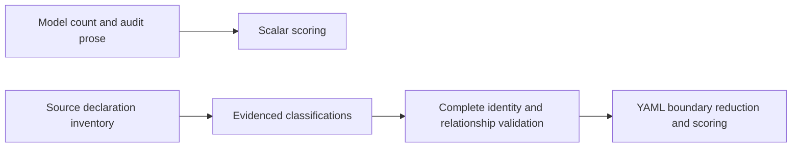
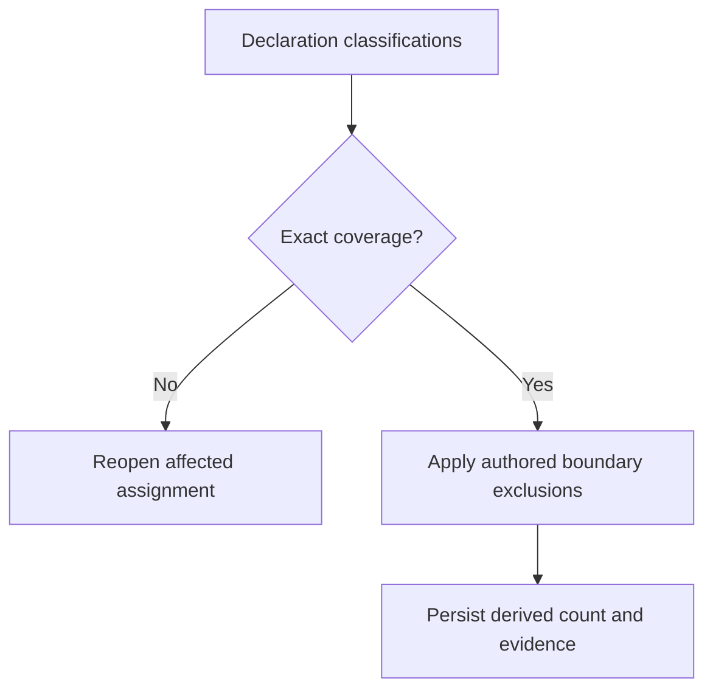

# Code-smells scoring accepts a raw declaration count that contradicts an applied exclusion

## Description

The CS-2 workflow asks the model to collapse one behavioral contract and its first concrete implementation into one cohesive type boundary, but the submitted scalar can still contain the raw declaration count. The MCP scorer accepts that scalar without enough structured measurement evidence to validate that the authored exclusion affected the count, producing a false severe finding that blocks a compliant write.

## Steps to Reproduce

1. Prepare a source file containing exactly one behavioral contract and its first concrete implementation for the same cohesive capability.
2. Run the bundled code-smells workflow through the write-time health gate.
3. Have the model identify both declarations and state that they are treated as one cohesive boundary under the CS-2 exclusion.
4. Submit `class_struct_count: 2` while retaining that exclusion reasoning and evidence.
5. Observe: MCP applies the severe `value >= 2` band and blocks the write even though the accompanying audit says the two declarations form one counted boundary.

## Expected vs Actual

|          | Behavior |
|----------|----------|
| Expected | The submitted CS-2 measurement carries enough structured signals for MCP to validate the effective boundary count, and one contract plus its first cohesive implementation is scored as one boundary. |
| Actual   | MCP receives only the scalar value and audit text, accepts `2`, and scores it severe without detecting that the value contradicts the stated exclusion. |

## Affected Component

The bundled code-smells rule workflow and the flow-engine metric submission/scoring boundary defined under SPEC-039 and delivered by SPEC-036. Reproduced in run `271dd9c00e45409b88b7ce286c22027c`, where event 134 records CS-2 value `2` alongside reasoning that the declarations are one cohesive boundary.

## Root Cause

The submitted count, and later the model-created boundary observations, were not
bound to a complete authoritative declaration inventory. Audit prose described an
exclusion but did not provide validated inputs from which MCP could derive its
effect. The original report above remains historical evidence; SPEC-066 replaces
this bundled-workflow measurement path, not the legacy health checker.

## Fix Plan

SPEC-066 supplies source-owned declaration identities and structural relationships.
The model classifies cohesion and supporting roles for every requested declaration;
MCP rejects incomplete identity coverage before scoring. Authored YAML filters
derive independent boundaries from those facts and judgments. A cohesive implemented
contract joins its implementation; consumed-only contracts and additional independent
implementations remain separate. Reasoning and evidence remain auditable; structural
validation does not independently prove that a model's semantic judgment is true.

## Diagrams

## Test Plan

- When one implemented contract is classified as cohesive with its implementation,
  MCP derives CS-2 value one and COMPLIANT; no model scalar count is accepted.
- When the same conformance is declared in an extension, the result is unchanged.
- When a second independent implementation or consumed-only contract is present,
  it remains counted and the boundary threshold produces SEVERE.
- When classifications omit, duplicate or invent a declaration ID, scoring waits
  for a complete corrected assignment while preserving accepted sibling work.
- When the real aggregate bundle reviews the violation and cohesive-boundary
  fixtures on Codex and Claude, locked outputs and source-grounded audit are retained.

## Definition of Done

- [x] Deterministic source-backed boundary cases and complete-submission recovery pass.
- [x] Full non-live suites pass; legacy instructions and mode selection are unchanged.
- [x] Both live model profiles pass the real aggregate rule contract: the violation
      fixture returns 1 / 2 / 1 and the cohesive-boundary fixture returns 0 / 1 / 0
      on Codex and Claude. The full non-live suite and six final live cases passed
      on 2026-10-20; evidence is recorded in
      [SPEC-066/ExecutionPlan.md](../../subtasks/SPEC-066-source-backed-code-smells-classification/ExecutionPlan.md).
