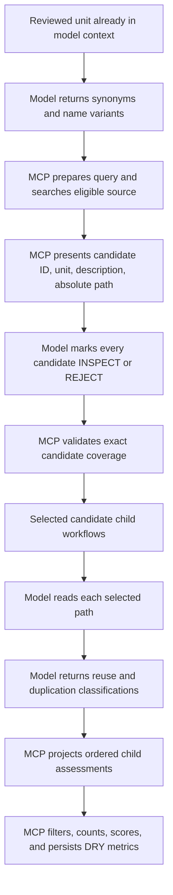

# DRY Candidate Classification Workflow

## Description

Replace the current DRY rule's model-owned counts with an auditable search,
selection, inspection, classification, and MCP-scoring workflow. MCP owns query
preparation, repository search, candidate identity, coverage validation, ordered
fan-in, filtered counts, severity, and persistence. The model supplies semantic
terms, candidate dispositions, source-grounded classifications, reasoning, and
evidence.

The workflow never asks MCP to load candidate source into a model prompt. The
model receives candidate summaries, chooses which candidates warrant inspection,
reads those exact paths with its normal file-reading tool, and classifies only
what it actually inspected.

## Target Flow



## Candidate Disposition Contract

For every candidate shown by `source.present_search`, the model returns exactly
one disposition:

```yaml
- candidate_id: candidate-3
  disposition: INSPECT
  reasoning: The description indicates the same loading responsibility.
  evidence: Candidate description mentions cached remote profile loading.

- candidate_id: candidate-4
  disposition: REJECT
  reasoning: The summary describes persistence rather than loading.
  evidence: Candidate description identifies a database writer.
```

- `INSPECT` means the candidate enters the child review fan-out.
- `REJECT` means source is not read. Reasoning and evidence must explain the
  decision using only the candidate metadata shown to the model.
- Missing, duplicate, unknown, or fabricated candidate IDs are rejected.
- An empty search result completes with an empty disposition list; a nonempty
  result cannot be silently reduced by omission.

## Child-Workflow Output Projection

Dynamic child results need one generic workflow-expression projection:

```yaml
source: "{{workflows.candidate_reviews.outputs.assessment}}"
```

It resolves to the ordered `assessment` output value from every completed child
instance under `candidate_reviews`. It does not expose result envelopes, runtime
instance IDs, aliases, or event payloads. Resolution waits for all non-skipped
children, preserves source-item order, returns an empty array for audited empty
fan-out, and fails when a required child output is absent.

This projection is generic flow-engine behavior. DRY is its first consumer.

## User Stories and Acceptance Scenarios

### US-1: Search the correct source corpus

As a reviewer, I want DRY candidates drawn only from relevant code so model time
is not spent classifying documentation, workflows, caches, or test artifacts.

#### Scenario 1.1 — Search eligible code units

**Given** a reviewed unit, its project root, extension, source context, and
model-generated terms
**When** MCP performs `source.search`
**Then** it excludes the reviewed unit and exact prospective snapshot identity
**And** it returns only eligible code units from the intended project corpus.

#### Scenario 1.2 — Search prospective sibling buffers

**Given** a multi-file prospective patch contains unwritten sibling files
**When** DRY searches the source context
**Then** eligible sibling units participate without being written to disk
**And** current on-disk versions of those prospective files cannot replace the
supplied snapshots.

#### Scenario 1.3 — Present minimal candidate metadata

**Given** MCP finds candidates
**When** it presents them to the model
**Then** each entry contains a stable candidate ID, unit name, frontmatter
description or explicit missing-description message, and absolute path
**And** candidate source and internal match-scoring details are omitted.

### US-2: Account for every discovered candidate

As a maintainer, I want candidate selection complete and auditable so promising
matches cannot disappear silently.

#### Scenario 2.1 — Accept complete dispositions

**Given** MCP presented five candidates
**When** the model returns one unique INSPECT or REJECT disposition for each ID
**Then** MCP accepts the submission and fans out only INSPECT candidates.

#### Scenario 2.2 — Reject partial or fabricated coverage

**Given** MCP presented five candidates
**When** the model omits one ID, duplicates one ID, or supplies an unknown ID
**Then** MCP rejects the submission with the missing, duplicate, and unknown IDs
**And** requests a complete replacement submission.

#### Scenario 2.3 — Audit a summary-level rejection

**Given** the model rejects a candidate without reading it
**When** MCP validates the disposition
**Then** nonempty reasoning and evidence must cite the shown name or description
**And** the audit distinguishes metadata rejection from source inspection.

### US-3: Classify only inspected candidate source

As a reviewer, I want reuse and duplication decisions grounded in actual source.

#### Scenario 3.1 — Read the validated path

**Given** MCP validated an INSPECT disposition
**When** its child workflow runs
**Then** the model reads the exact absolute candidate path using its normal read
tool before classification
**And** submitted inspection evidence identifies that path and executable source.

#### Scenario 3.2 — Keep reuse and duplication independent

**Given** an inspected candidate
**When** it is classified
**Then** reuse is exactly one of `EXACT`, `EXTENSIBLE`, `PARTIAL`, or
`NOT_SUITABLE`
**And** duplication is independently one of `IDENTICAL`, `STRUCTURAL`, `SIMILAR`,
or `NOT_DUPLICATE`.

#### Scenario 3.3 — Reject protocol/conformer false positives

**Given** the target is a protocol and the candidate merely conforms to it
**When** source contains no duplicated implementation body
**Then** reuse is `NOT_SUITABLE`
**And** duplication is `NOT_DUPLICATE`.

#### Scenario 3.4 — Preserve complete fan-in

**Given** multiple selected child reviews complete out of order
**When** the parent projects `workflows.candidate_reviews.outputs.assessment`
**Then** it receives every assessment exactly once in original candidate order.

### US-4: Score DRY results in MCP

As a workflow author, I want classifications converted to DRY metrics without
model counting.

#### Scenario 4.1 — Score reuse misses

**Given** projected child assessments
**When** MCP derives DRY-1
**Then** it counts reuse classifications `EXACT`, `EXTENSIBLE`, and `PARTIAL`
**And** excludes candidate-level authored exceptions.

PARTIAL identifies a concrete shared portion of implementation that can be
extracted into a common abstraction while the remaining behavior stays separate.
Its reasoning and evidence identify the shared portion and the differences;
coincidental similarity or behavior that must remain separate is NOT_SUITABLE.

#### Scenario 4.2 — Score repository duplication

**Given** projected child assessments
**When** MCP derives the repository observation of DRY-2
**Then** it counts unique candidate locations classified `IDENTICAL` or
`STRUCTURAL`
**And** one repository match is severe because it represents the target and one
additional implementation location.

#### Scenario 4.3 — Score within-unit duplication

**Given** the target analysis returns repeated implementation locations within
the reviewed unit
**When** MCP derives the within-unit observation of DRY-2
**Then** it counts participating locations once
**And** two or more locations are severe.

#### Scenario 4.4 — Omit speculative missing-abstraction analysis

**Given** a DRY workflow reviews a unit
**When** it requests classifications and finalizes its result
**Then** it does not ask whether hypothetical future code might reuse a pattern
**And** it does not require a missing-abstraction observation collection
**And** it produces no DRY-3 metric.

#### Scenario 4.5 — Preserve one rule result

**Given** DRY-2 uses separate repository and within-unit observations
**When** the rule finalizes
**Then** both observations remain under metric ID `DRY-2`
**And** the existing worst-severity rule produces one normalized DRY result.

#### Scenario 4.6 — Explain empty target-analysis results

**Given** target analysis returns an empty duplication collection
**When** the model submits the analysis
**Then** a required assessment-level `additional_info` contains nonempty
`reasoning` and `evidence` explaining the result using the reviewed source
**And** missing or empty fields are rejected before dependent scoring advances
**And** a corrected submission is persisted and the empty collection still
scores zero.

## Technical Requirements

- Term generation returns only individual semantic terms/name variants; MCP adds
  deterministic target identity and exclusions.
- Repository search returns structured candidates; model-facing rendering is a
  presentation boundary, not the scoring source.
- Candidate identity is server-owned and stable for the run.
- Selection validation produces a typed ordered selected-candidate collection and
  a durable disposition audit for every shown candidate.
- Child assessment schemas require independent reuse and duplication decisions,
  nonempty reasoning, and nonempty source evidence.
- The model may read only INSPECT candidates. MCP does not inject candidate source
  into workflow prompts or ask the model to classify summaries as source.
- The child-output projection is typed from the included workflow's declared
  output schema and is valid as a collection-backed metric source.
- DRY metrics are MCP-owned collection-backed metrics. Neither classification
  nor exception prompts ask the model to count or choose severity; the model
  supplies observations and MCP derives the metric values.
- Target-pattern analysis compares methods within the reviewed unit. Repository
  and sibling-unit comparisons use the candidate search and inspection path,
  rather than repeating that search inside the target-pattern prompt.
- Target-analysis assessment evidence is declared in the workflow output schema.
  The existing engine renders that schema into the model-facing prompt; no
  duplicate authored prompt instructions or engine-specific DRY handling are
  added. Per-observation evidence and collection scoring remain unchanged.
- Whole-unit DRY exceptions remain available only when every apparent finding is
  exempt; candidate/observation exceptions are filtered before metric scoring.
- Signature-based reuse hints are deferred. Matching argument types and return
  types must not currently broaden discovery or annotate existing candidates;
  neither behavior nor a feature flag is introduced by this cleanup. Whether
  wider signature matching produces useful candidates rather than noise remains
  an open experiment; optional-type equivalence is also outside this change.

## Connects To

| Direction | Spec | Relationship |
|---|---|---|
| Parent | SPEC-036 | Owns the bundled DRY rule and review bundles |
| Upstream | SPEC-040 | Supplies typed source search, presentation, and selection validation |
| Upstream | SPEC-053 | Supplies filtered collection scoring |
| Upstream | SPEC-037 | Supplies ordered fan-out/fan-in and skip semantics |
| Fixtures | SPEC-019 | Supplies DRY fixture scenarios and locked expectations |

## Test Plan

- Search tests for project-root isolation, code-only eligibility, prospective
  siblings, reviewed-unit exclusion, frontmatter descriptions, and stable IDs.
- Selection tests for complete, empty, partial, duplicate, unknown, fabricated,
  INSPECT, and REJECT submissions with actionable retry diagnostics.
- Child tests requiring an exact read path and independent reuse/duplication
  evidence, including protocol/conformer and declaration-only cases.
- Projection tests for ordered children, out-of-order completion, partial
  completion, skipped children, audited empty fan-out, missing output, replay,
  and nested instance isolation.
- Metric tests for every classification, candidate exception, unique location,
  within-unit site, empty search, and worst-severity combination.
- When the bundled DRY prompts are rendered, duplication categories remain
  present, missing-abstraction analysis is absent, target analysis stays within
  the supplied unit, and no prompt asks the model to calculate counts.
- When target-analysis assessment information is missing, lacks either required
  field, or contains an empty reasoning or evidence string, submission is
  rejected; correction completes with the original zero scores and one persisted
  accepted analysis containing the explanation. The rendered schema exposes the
  required fields automatically.
- Controlled temporary-project E2E tests with only explicit candidate files; run
  the same locked workflow through Codex and Claude and retain transcripts,
  events, search results, dispositions, reads, classifications, tokens, and time.

## Implementation Plan

1. Add failing selection-coverage tests and extend the typed selection contract
   from sparse selections to complete candidate dispositions.
2. Add failing generic child-output projection tests, then implement typed ordered
   projection without exposing workflow result envelopes.
3. Keep target-analysis observations for within-unit duplicates only.
4. Keep the existing candidate child workflow but harden read-path and evidence
   validation for every INSPECT candidate.
5. Replace DRY-1/2 model-owned metric prompts with collection-backed metric
   declarations over target observations and projected child assessments.
6. Add policy, exception, audit, replay, Stop, aggregate, and prospective-buffer
   coverage.
7. Run all non-live tests and the controlled Codex/Claude DRY fixture matrix.

## Definition of Done

- [x] Every shown search candidate receives one audited disposition.
- [x] Only INSPECT candidates are read and classified.
- [x] Every selected candidate has source-grounded reuse and duplication evidence.
- [x] Ordered child outputs are available through a typed generic projection.
- [x] DRY-1 and DRY-2 are scored by MCP without model arithmetic; DRY-3 is omitted.
- [x] Protocol/conformer and declaration-only false positives are covered.
- [ ] Controlled Codex and Claude fixtures produce locked auditable results.
- [x] All non-live tests pass.

## Validation Evidence

### Policy change — 2026-10-21

The user removed the separate DRY-3 check for now. Comparison-based reuse
classification covers direct reuse, extension, and partial extraction instead.
SPEC-061 preserves the withdrawn check's investigation as history; its old
expectations are not current workflow requirements. Legacy rule documents
remain unchanged. The shared-helper DRY-2 false positive in SPEC-065 remains
independent and unresolved. Source fixtures and remaining metric thresholds
are unchanged.

### Current status — 2026-10-19

The candidate-disposition, inspection-evidence and MCP-scoring mechanics are
implemented. The latest full non-live checkpoint recorded by SPEC-064 is green:
2,900 tests and 228 subtests passed, with four existing abstract-fixture skips.
The two gate applicability failures and environment-blocked runs in the older
checkpoints below are retained as history, not current non-live failures.

Keep this spec `in-progress`: the full locked DRY live matrix is not green.
SPEC-061 tracks the missing-abstraction classification disagreement; SPEC-065
tracks Claude counting calls to an already-extracted shared helper as duplication
and is explicitly deferred by the user. Signature-hint experiments also remain
deferred. Successful LSP/gate live runs do not close these DRY accuracy cases;
their expectations and failure evidence remain intact.

### Earlier checkpoints

- The DRY integration contract passes with complete disposition retry,
  inspected-candidate fan-out, ordered child projection, two independent DRY-2
  observations, MCP scoring, whole-rule exceptions, prospective buffers, and
  protocol reuse coverage.
- A nested two-parent regression proves projected child assessments remain
  instance-scoped and replay creates no duplicate metric events.
- The non-live flow-engine suite passes with 782 tests and one deliberate
  environment deselection caused by `/bin/bash -lc` resetting the Swift parser
  PATH shim.
- The supporting non-live suites also pass: 854 MCP-server tests with four
  environment skips, 95 harness tests, 62 hook tests, and 36 Apple build tests.
- Live validation is currently environment-blocked before workflow execution:
  Codex produced no first model event, while Claude exhausted API retries with
  `ENOTFOUND`. The Claude model-profile compatibility flag successfully removed
  the separate Advisor/profile startup rejection.

### Prompt cleanup checkpoint — 2026-10-19

- Removed model-counting instructions from target-pattern analysis and exception
  classification. Within-unit analysis no longer repeats repository discovery.
  Schemas, metric definitions, thresholds, candidate search, and fixture
  expectations are unchanged. Signature-based hints remain deferred.
- The prompt-contract test failed on the old counting instruction before the
  cleanup; all 12 focused DRY integration tests pass afterward.
- Current non-live suites: **2,871 passed, 4 skipped, 199 subtests passed,
  2 failed**. The two failures are the existing new-buffer and replay cases in
  `test_solid_gate_on_write_workflow.py`, where nested applicability bindings
  skip expected work. SPEC-050 records that separate outstanding issue; this
  cleanup neither changes the engine nor weakens those assertions.
- Live DRY checks: **2 passed, 2 failed** in 298.03 seconds. Both Codex and Claude
  passed the existing-protocol reuse scenario, including the expected `EXACT`
  reuse and `NOT_DUPLICATE` classification. Their local artifact copies are
  `.solid-coder/.artifacts/test/codex/e2e/review/dry-exact-protocol-reuse/20261019T143535Z-236ef961/`
  and
  `.solid-coder/.artifacts/test/claude/e2e/review/dry-exact-protocol-reuse/20261019T143857Z-06f9f7b8/`.
- Codex completed the within-unit scenario with values `0 / 0 / 2 / 0`, versus
  the locked `0 / 0 / 2 / 1`. Its `missing_abstractions` collection was empty;
  MCP correctly counted zero. This reproduces the discrepancy tracked in
  SPEC-061, not an established counting defect. Evidence:
  `.solid-coder/.artifacts/test/codex/e2e/review/dry/20261019T143745Z-9babd1fb/`.
- Claude's within-unit session made no `flow_start` call and created no run.
  Its startup record shows the current `plugin:solid-coder:flow-engine`
  connected alongside failed duplicate `solid-coder-flow-engine` entries.
  Tool discovery returned the current flow tools, but the model stopped and
  reported the failed entries instead of calling them. This is not evidence
  that the current flow-engine connection failed. Evidence:
  `.solid-coder/.artifacts/test/claude/e2e/review/dry/20261019T144015Z-60d4a56e/`.
- No fixture expectations were relaxed and no repeated run was used to conceal
  either failure. The live matrix is not fully validated.

### Schema-required assessment evidence — 2026-10-19

- Added required assessment-level `additional_info` to the target-analysis output
  schema, with nonempty `reasoning` and `evidence`. Authored prompt text, engine
  code, scoring, and locked fixture expectations were not changed in this step.
- Focused DRY and schema-rendering checks: **20 passed, 6 subtests passed**.
  The six cases cover absent assessment information, absent fields, empty
  strings, correction, zero scoring, and persistence of the accepted analysis.
- All non-live suites: **2,871 passed, 4 skipped, 205 subtests passed, 2 failed**.
  The same two gate-binding failures noted above remain open.
- Both live fixture runs completed and persisted the new assessment evidence.
  Claude matched the locked `0 / 0 / 2 / 1`; Codex returned `0 / 0 / 2 / 0`, so
  the live score assertions are **1 passed, 1 failed**. Codex now explicitly
  describes the repeated sequence as payroll-domain calculation logic rather
  than a separate cross-domain abstraction. The evidence gap is closed, but the
  SPEC-061 classification disagreement is not resolved.
- Preserved local artifacts:
  `.solid-coder/.artifacts/test/codex/e2e/review/dry/20261019T150909Z-6f1d165c/`
  and
  `.solid-coder/.artifacts/test/claude/e2e/review/dry/20261019T151201Z-3ef58406/`.
