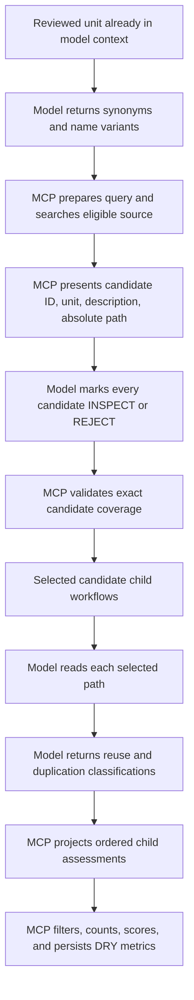

# DRY Candidate Classification Workflow

## Description

Replace the current DRY rule's model-owned counts with an auditable search,
selection, inspection, classification, and MCP-scoring workflow. MCP owns query
preparation, repository search, candidate identity, coverage validation, ordered
fan-in, filtered counts, severity, and persistence. The model supplies semantic
terms, candidate dispositions, source-grounded classifications, reasoning, and
evidence.

The workflow never asks MCP to load candidate source into a model prompt. The
model receives candidate summaries, chooses which candidates warrant inspection,
reads those exact paths with its normal file-reading tool, and classifies only
what it actually inspected.

## Target Flow



## Candidate Disposition Contract

For every candidate shown by `source.present_search`, the model returns exactly
one disposition:

```yaml
- candidate_id: candidate-3
  disposition: INSPECT
  reasoning: The description indicates the same loading responsibility.
  evidence: Candidate description mentions cached remote profile loading.

- candidate_id: candidate-4
  disposition: REJECT
  reasoning: The summary describes persistence rather than loading.
  evidence: Candidate description identifies a database writer.
```

- `INSPECT` means the candidate enters the child review fan-out.
- `REJECT` means source is not read. Reasoning and evidence must explain the
  decision using only the candidate metadata shown to the model.
- Missing, duplicate, unknown, or fabricated candidate IDs are rejected.
- An empty search result completes with an empty disposition list; a nonempty
  result cannot be silently reduced by omission.

## Child-Workflow Output Projection

Dynamic child results need one generic workflow-expression projection:

```yaml
source: "{{workflows.candidate_reviews.outputs.assessment}}"
```

It resolves to the ordered `assessment` output value from every completed child
instance under `candidate_reviews`. It does not expose result envelopes, runtime
instance IDs, aliases, or event payloads. Resolution waits for all non-skipped
children, preserves source-item order, returns an empty array for audited empty
fan-out, and fails when a required child output is absent.

This projection is generic flow-engine behavior. DRY is its first consumer.

## User Stories and Acceptance Scenarios

### US-1: Search the correct source corpus

As a reviewer, I want DRY candidates drawn only from relevant code so model time
is not spent classifying documentation, workflows, caches, or test artifacts.

#### Scenario 1.1 — Search eligible code units

**Given** a reviewed unit, its project root, extension, source context, and
model-generated terms
**When** MCP performs `source.search`
**Then** it excludes the reviewed unit and exact prospective snapshot identity
**And** it returns only eligible code units from the intended project corpus.

#### Scenario 1.2 — Search prospective sibling buffers

**Given** a multi-file prospective patch contains unwritten sibling files
**When** DRY searches the source context
**Then** eligible sibling units participate without being written to disk
**And** current on-disk versions of those prospective files cannot replace the
supplied snapshots.

#### Scenario 1.3 — Present minimal candidate metadata

**Given** MCP finds candidates
**When** it presents them to the model
**Then** each entry contains a stable candidate ID, unit name, frontmatter
description or explicit missing-description message, and absolute path
**And** candidate source and internal match-scoring details are omitted.

### US-2: Account for every discovered candidate

As a maintainer, I want candidate selection complete and auditable so promising
matches cannot disappear silently.

#### Scenario 2.1 — Accept complete dispositions

**Given** MCP presented five candidates
**When** the model returns one unique INSPECT or REJECT disposition for each ID
**Then** MCP accepts the submission and fans out only INSPECT candidates.

#### Scenario 2.2 — Reject partial or fabricated coverage

**Given** MCP presented five candidates
**When** the model omits one ID, duplicates one ID, or supplies an unknown ID
**Then** MCP rejects the submission with the missing, duplicate, and unknown IDs
**And** requests a complete replacement submission.

#### Scenario 2.3 — Audit a summary-level rejection

**Given** the model rejects a candidate without reading it
**When** MCP validates the disposition
**Then** nonempty reasoning and evidence must cite the shown name or description
**And** the audit distinguishes metadata rejection from source inspection.

### US-3: Classify only inspected candidate source

As a reviewer, I want reuse and duplication decisions grounded in actual source.

#### Scenario 3.1 — Read the validated path

**Given** MCP validated an INSPECT disposition
**When** its child workflow runs
**Then** the model reads the exact absolute candidate path using its normal read
tool before classification
**And** submitted inspection evidence identifies that path and executable source.

#### Scenario 3.2 — Keep reuse and duplication independent

**Given** an inspected candidate
**When** it is classified
**Then** reuse is exactly one of `EXACT`, `EXTENSIBLE`, `PARTIAL`, or
`NOT_SUITABLE`
**And** duplication is independently one of `IDENTICAL`, `STRUCTURAL`, `SIMILAR`,
or `NOT_DUPLICATE`.

#### Scenario 3.3 — Reject protocol/conformer false positives

**Given** the target is a protocol and the candidate merely conforms to it
**When** source contains no duplicated implementation body
**Then** reuse is `NOT_SUITABLE`
**And** duplication is `NOT_DUPLICATE`.

#### Scenario 3.4 — Preserve complete fan-in

**Given** multiple selected child reviews complete out of order
**When** the parent projects `workflows.candidate_reviews.outputs.assessment`
**Then** it receives every assessment exactly once in original candidate order.

### US-4: Score DRY results in MCP

As a workflow author, I want classifications converted to DRY metrics without
model counting.

#### Scenario 4.1 — Score reuse misses

**Given** projected child assessments
**When** MCP derives DRY-1
**Then** it counts reuse classifications `EXACT` and `EXTENSIBLE`
**And** excludes candidate-level authored exceptions.

#### Scenario 4.2 — Score repository duplication

**Given** projected child assessments
**When** MCP derives the repository observation of DRY-2
**Then** it counts unique candidate locations classified `IDENTICAL` or
`STRUCTURAL`
**And** one repository match is severe because it represents the target and one
additional implementation location.

#### Scenario 4.3 — Score within-unit duplication

**Given** the target analysis returns repeated implementation locations within
the reviewed unit
**When** MCP derives the within-unit observation of DRY-2
**Then** it counts participating locations once
**And** two or more locations are severe.

#### Scenario 4.4 — Score missing abstractions

**Given** target analysis returns reusable non-domain-specific patterns with
reasoning and evidence
**When** MCP derives DRY-3
**Then** it counts non-excepted missing-abstraction observations.

#### Scenario 4.5 — Preserve one rule result

**Given** DRY-2 uses separate repository and within-unit observations
**When** the rule finalizes
**Then** both observations remain under metric ID `DRY-2`
**And** the existing worst-severity rule produces one normalized DRY result.

## Technical Requirements

- Term generation returns only individual semantic terms/name variants; MCP adds
  deterministic target identity and exclusions.
- Repository search returns structured candidates; model-facing rendering is a
  presentation boundary, not the scoring source.
- Candidate identity is server-owned and stable for the run.
- Selection validation produces a typed ordered selected-candidate collection and
  a durable disposition audit for every shown candidate.
- Child assessment schemas require independent reuse and duplication decisions,
  nonempty reasoning, and nonempty source evidence.
- The model may read only INSPECT candidates. MCP does not inject candidate source
  into workflow prompts or ask the model to classify summaries as source.
- The child-output projection is typed from the included workflow's declared
  output schema and is valid as a collection-backed metric source.
- DRY metrics are MCP-owned collection-backed metrics. No DRY metric prompt asks
  the model to count or choose severity.
- Whole-unit DRY exceptions remain available only when every apparent finding is
  exempt; candidate/observation exceptions are filtered before metric scoring.

## Connects To

| Direction | Spec | Relationship |
|---|---|---|
| Parent | SPEC-036 | Owns the bundled DRY rule and review bundles |
| Upstream | SPEC-040 | Supplies typed source search, presentation, and selection validation |
| Upstream | SPEC-053 | Supplies filtered collection scoring |
| Upstream | SPEC-037 | Supplies ordered fan-out/fan-in and skip semantics |
| Fixtures | SPEC-019 | Supplies DRY fixture scenarios and locked expectations |

## Test Plan

- Search tests for project-root isolation, code-only eligibility, prospective
  siblings, reviewed-unit exclusion, frontmatter descriptions, and stable IDs.
- Selection tests for complete, empty, partial, duplicate, unknown, fabricated,
  INSPECT, and REJECT submissions with actionable retry diagnostics.
- Child tests requiring an exact read path and independent reuse/duplication
  evidence, including protocol/conformer and declaration-only cases.
- Projection tests for ordered children, out-of-order completion, partial
  completion, skipped children, audited empty fan-out, missing output, replay,
  and nested instance isolation.
- Metric tests for every classification, candidate exception, unique location,
  within-unit site, empty search, and worst-severity combination.
- Controlled temporary-project E2E tests with only explicit candidate files; run
  the same locked workflow through Codex and Claude and retain transcripts,
  events, search results, dispositions, reads, classifications, tokens, and time.

## Implementation Plan

1. Add failing selection-coverage tests and extend the typed selection contract
   from sparse selections to complete candidate dispositions.
2. Add failing generic child-output projection tests, then implement typed ordered
   projection without exposing workflow result envelopes.
3. Add target-analysis observations for within-unit duplicates and missing
   abstractions.
4. Keep the existing candidate child workflow but harden read-path and evidence
   validation for every INSPECT candidate.
5. Replace DRY-1/2/3 model-owned metric prompts with collection-backed metric
   declarations over target observations and projected child assessments.
6. Add policy, exception, audit, replay, Stop, aggregate, and prospective-buffer
   coverage.
7. Run all non-live tests and the controlled Codex/Claude DRY fixture matrix.

## Definition of Done

- [ ] Every shown search candidate receives one audited disposition.
- [ ] Only INSPECT candidates are read and classified.
- [ ] Every selected candidate has source-grounded reuse and duplication evidence.
- [ ] Ordered child outputs are available through a typed generic projection.
- [ ] DRY-1, DRY-2, and DRY-3 are scored by MCP without model arithmetic.
- [ ] Protocol/conformer and declaration-only false positives are covered.
- [ ] Controlled Codex and Claude fixtures produce locked auditable results.
- [ ] All non-live tests pass.
