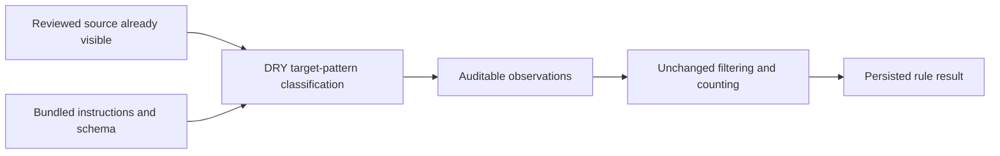
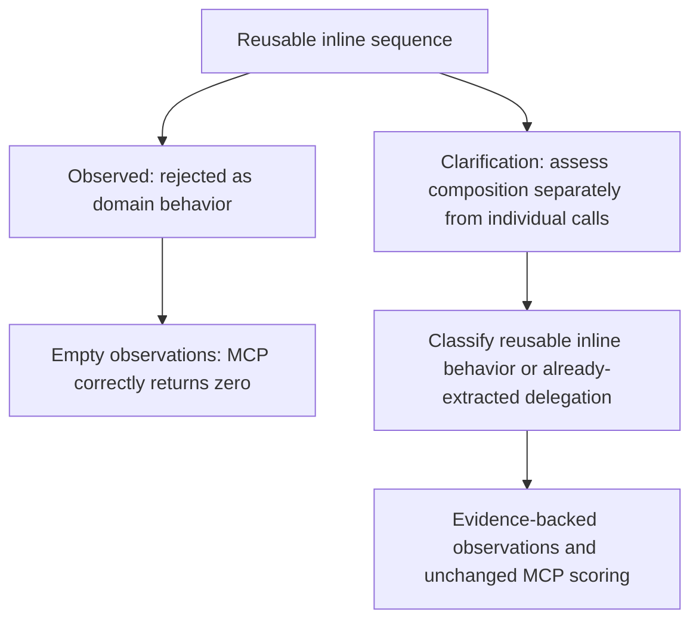
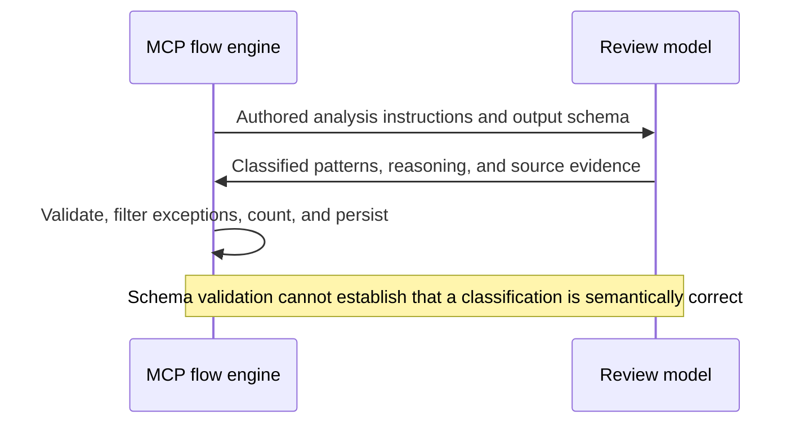

# DRY-3 missing-abstraction classification differs between live backends

## Description

**Current decision — 2026-10-21:** the user withdrew the separate DRY-3
missing-abstraction check for now. Remove its hypothetical-reuse prompt,
observation output, metric, and exception-step dependency from bundled
workflows, including the older DRY prompt experiment. Concrete candidate
comparisons remain: non-excepted EXACT, EXTENSIBLE, and PARTIAL results count
as DRY-1 reuse misses; PARTIAL identifies shared implementation behavior that
can be extracted while the remaining behavior stays separate. DRY-2 continues
to measure implementation duplication. No new engine logic or second score
for the same missing-abstraction decision is introduced.

The investigation and results below are historical evidence, not an active
requirement to restore DRY-3. Its classification issue is not claimed fixed.
Legacy rule documents and legacy fixture expectations remain unchanged.
Workflow-only expectations now contain three observations: DRY-1 repository
reuse, DRY-2 repository duplication, and DRY-2 within-unit duplication.
Source fixtures remain unchanged. Validation must demonstrate that prompts
and submissions no longer require missing-abstraction observations, completed
results omit DRY-3, and the remaining classifications and exceptions still
score correctly. Reintroducing a separate metric requires a new policy
decision. The independent shared-helper DRY-2 false positive remains SPEC-065.

The locked DRY fixture produces DRY-3 = 0 through Codex and DRY-3 = 1 through
Claude, although both runs complete the same review scenario and detect the two
within-unit duplicate locations. This leaves the Codex live contract failing
and missing-abstraction detection unverified across backends. The investigation
must establish whether the discrepancy comes from effective instructions,
model classification, or the locked expectation; the recorded MCP count matches
each submitted observation collection, so an engine counting defect is not
established.

## Steps to Reproduce

1. Use `tests/principles/DRY/fixtures/fixture-1.swift` unchanged. Its
   `PayrollLedger.grossWages` and `PayrollLedger.reimbursements` methods repeat
   positive-entry filtering, multiplication, accumulation, and cent rounding.
2. Use the shared live harness in
   `tests/harness/flow_engine/dry_validation_e2e_live_base.py`. It copies the
   target into an isolated project's `Sources/ReviewTarget.swift`, removes
   scenario candidate files, enables only the `dry` rule, and launches the real
   `solid-review` bundle through shared file normalization. Keep the locked
   expected values `0 / 0 / 2 / 1` and existing model profiles unchanged.
3. From the repository root, run the specific Codex case:

   ```sh
   python3 -m pytest tests/harness/flow_engine/test_dry_validation_live.py::TestCodexDRYValidationLive::test_workflow_satisfies_its_live_contract -v -s
   ```

4. Run the matching Claude case as a separate comparison:

   ```sh
   python3 -m pytest tests/harness/flow_engine/test_dry_validation_live.py::TestClaudeDRYValidationLive::test_workflow_satisfies_its_live_contract -v -s
   ```

5. Compare the preserved `flow-run/events.jsonl` entries for
   `search_repository`, `analyze_target_patterns`, and `missing_abstractions`,
   then compare `flow-run/results/review/result.json`. Observe the Codex
   assertion `0 != 1` for DRY-3 despite a completed workflow.

Observed on 2026-09-30 in one completed run per backend; repeat frequency is
unknown. These commands reproduce the controlled setup, not a guaranteed model
response. No repeated measurements are required merely to file this report.

## Expected vs Actual

Metric order below is DRY-1 repository reuse misses, DRY-2 repository duplicate
locations, DRY-2 within-unit duplicate locations, then DRY-3 missing abstractions.

| Case | Values | Target-analysis evidence |
|---|---|---|
| Locked expectation | `0 / 0 / 2 / 1` | Two repeated implementation locations and one non-excepted missing abstraction. |
| Codex actual | `0 / 0 / 2 / 0` | Both locations classified `IDENTICAL`, `is_exception: false`; `missing_abstractions: []`. |
| Claude actual | `0 / 0 / 2 / 1` | Both duplicate locations reported; one non-excepted `currency-rounding` pattern citing `(subtotal * 100).rounded() / 100` in both methods. |

Both searches return `candidates: []`, `files_scanned: 1`, and
`files_with_frontmatter: 0`. Both final reviews are `SEVERE` because of DRY-2;
matching overall severity does not make the individual DRY-3 results equivalent.
Codex's metric event records `source_size: 0`, `matched_indexes: []`, and
`value: 0`; Claude's records one source entry, `matched_indexes: [0]`, and
`value: 1`. MCP therefore correctly derives each count from what was submitted.

Preserved run evidence (paths relative to the repository):

- Codex failure:
  `.solid-coder/.artifacts/test/codex/e2e/review/dry/20260930T231323Z-8d8fd4a1/`.
  Model session: `01a0f498-2c69-7aa2-b330-7e45b47f11d4`.
- Claude comparison:
  `.solid-coder/.artifacts/test/claude/e2e/review/dry/20260930T231626Z-a8dafbfa/`.
- Each directory preserves the effective `flow-run/workflow.yaml`,
  `flow-run/events.jsonl`, normalized review results, and model-session evidence.
  These local artifact copies are not committed; the observed submissions and
  count derivations are recorded above so the report survives artifact cleanup.

## Affected Component

- Parent: SPEC-056, DRY candidate classification workflow, specifically its
  missing-abstraction live contract.
- Authored workflow: `workflows/review/rules/dry/workflow.yaml`,
  `analyze_target_patterns` output `missing_abstractions` and the downstream
  MCP-owned DRY-3 metric.
- Canonical intent: `references/principles/DRY/rule.md` and its review
  instructions. Compare these with the effective prompts, schemas, supplied
  source, and model-profile settings in the preserved runs before proposing a
  change. Determine why Codex omitted the observation Claude supplied, and
  validate the fixture expectation against the original rule.
- Existing live assertions:
  `tests/harness/flow_engine/dry_validation_e2e_live_base.py` and
  `tests/harness/flow_engine/test_dry_validation_live.py`.
- Related but separate: SPEC-060 shared source-search performance. Search returns
  the expected empty collection in both runs. Earlier harness-wiring failures
  and the preceding Codex startup/tool-availability failure are not this
  completed-run discrepancy.

The original report was an investigation, not an approved prompt or scoring change.
Preserve the fixture, locked expectation, and generic MCP counting behavior
until evidence supports a proposed correction. Do not hide the mismatch by
retrying until a passing response, weakening assertions, or special-casing DRY
inside the engine. Append the root cause, fix plan, and targeted tests after
investigation rather than assuming them here.

## Root Cause

The 2026-10-21 gate rerun `df37c42a57e64b3fbfde5884fc09a6ae` reproduces the
classification issue with a different unchanged fixture: `ReviewComparisonCatalog`.
Codex's evidence explicitly identifies the cache-to-storage fallback at lines
35–40, but its reasoning says no reusable inline pattern exists beyond the
class's catalog behavior. It returns an empty missing-abstraction collection,
which MCP correctly scores as zero. This is not missing source or an arithmetic
defect. Artifacts: `.solid-coder/.artifacts/test/codex/e2e/gate/solid-gate-on-write/20261021T182411Z-0c3eef98/`.

The authored instructions already allow a single occurrence and reuse within
one domain. They do not explicitly distinguish using abstractions for individual
operations from extracting the reusable control flow that composes them. That
distinction was the narrow clarification tested below; the transcript establishes
the submitted rationale, not the model's hidden cause. Whether this wording
improves classification must be established by live cases, not prompt-presence assertions.

## Fix Plan

The tested candidate clarified the target-pattern analysis: assess a complete sequence;
individual abstracted calls do not themselves extract its composition. An
already-extracted pattern delegates that sequence to another abstraction.
Parameterizable domain names, types, keys, constants, or formatting choices do
not alone make the sequence inseparable from domain policy. Preserve intentional
specialization, all schemas, thresholds, fixtures, candidate limits, model
profiles, and generic MCP scoring. No engine-specific DRY behavior was added.

**This candidate was withdrawn after the live results below.** The current
bundled workflow and its prompt-contract test match the pre-experiment version.
Do not reintroduce this wording as a verified fix. A subsequent correction must
distinguish reusable inline behavior from already-extracted helpers across both
the isolated-rule and aggregate-gate contexts; its design remains open.

The user authorized this follow-up after accepting the current aggregation
baseline. Parallel-session experimentation remains deferred. SPEC-065 separately
tracks the shared-helper DRY-2 false positive and remains deferred.

## Diagrams







## Test Plan

- When the real DRY prompt is rendered, the generic composition distinction is
  present without new counting instructions; the assertion fails before the
  wording change and passes after it.
- When a missing abstraction is submitted without duplicate locations, the
  existing integration case produces `0 / 0 / 0 / 1`; empty observations still
  produce zero and invalid assessment evidence still rejects before scoring.
- When the unchanged original PayrollLedger fixture is reviewed by each locked
  backend, the existing live contract expects `0 / 0 / 2 / 1`.
- When the real aggregate write gate reviews its unchanged catalog fixture,
  both backends must report at least one non-excepted DRY-3 observation with
  source evidence, while the existing full-gate assertions remain unchanged.
- When the already-extracted-helper fixture is reviewed, preserve its zero
  expectations and record any failure rather than relaxing it; the separately
  deferred DRY-2 issue is not hidden by a DRY-3 improvement.

### Experiment results — 2026-10-21

The candidate's prompt assertion failed first, then focused integration passed
**12 tests and 6 subtests**. The complete non-live suite passed **3,052 tests,
274 subtests, four abstract-base skips** before live validation. These checks
prove engine behavior and instruction delivery, not classification accuracy.

| Live case | Codex | Claude |
|---|---|---|
| Original PayrollLedger positive fixture | `0 / 0 / 2 / 1`, pass | `0 / 0 / 2 / 1`, pass |
| Already-extracted helper | `0 / 0 / 0 / 0`, pass | `0 / 0 / 2 / 1`, fail |
| Aggregate catalog gate | DRY-3 = 0, fail | Interrupted after repeated invalid JSON; no final classification |

The four focused rule tests therefore report **3 passed, 1 failed**. They run
the real public review chain with unchanged profiles/fixtures/expectations.
Artifacts under `.solid-coder/.artifacts/test/`:

- `codex/e2e/review/dry/20261021T190621Z-70aef2f1/`
- `claude/e2e/review/dry/20261021T190800Z-6914b5c9/`
- `codex/e2e/review/dry-extracted-helper/20261021T190536Z-69b18be3/`
- `claude/e2e/review/dry-extracted-helper/20261021T190653Z-9747fee3/`

In the failed helper case, Claude classifies the two calls to `accumulate` as
IDENTICAL and separately reports the rounding expression inside `accumulate`
as a missing abstraction. Earlier evidence recorded the same DRY-2 false
positive with DRY-3 = 0. This sample adds a DRY-3 false positive, but one sample
does not establish that the wording caused it. It does not justify retaining
the candidate as a reliable improvement. SPEC-065 retains the separately
deferred DRY-2 issue.

The aggregate Codex run `82f99e298309400e92b6c9f28249a299` received the proposed
clarification untruncated yet again described each method as distinct and
returned no missing abstraction. Its evidence explicitly mentions cache-aside
loading. Artifacts: `codex/e2e/gate/solid-gate-on-write/20261021T185419Z-5ff3d994/`.
The paired Claude attempt and submission failures are recorded in SPEC-067.

After withdrawing only the experimental wording and corresponding three
prompt-string assertions, the focused integration suite again passed **12 tests
and 6 subtests**. All scoring assertions, live expectations, schemas, and source
fixtures remain unchanged. The bug remains open.

## Definition of Done

- [x] The observed empty collection is traced through model evidence and MCP scoring.
- [x] The candidate is exercised and its unsuccessful live outcome is preserved; unproven wording is withdrawn.
- [x] Non-live checks and focused rollback validation pass without scoring changes.
- [ ] Locked Codex and Claude positive cases pass across isolated and aggregate contexts with preserved source evidence.
- [x] The extracted-helper comparison is recorded without weakening its expectations.
