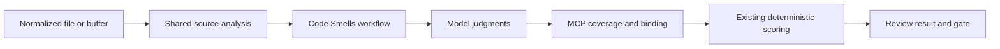
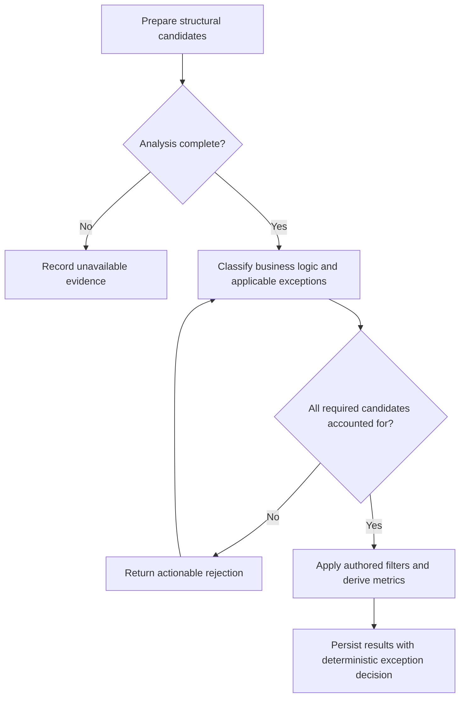
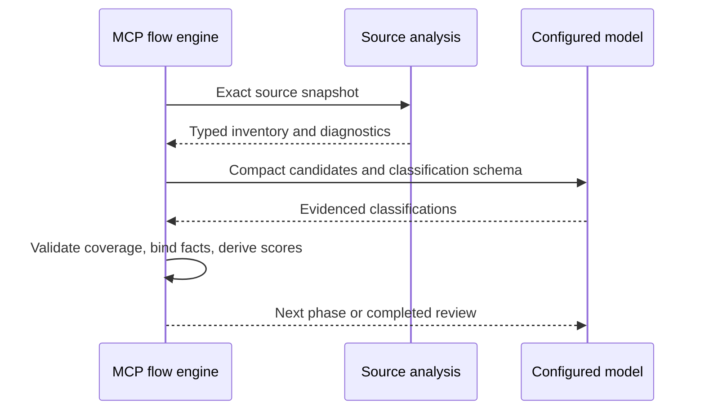

# Source-backed Code Smells Classification

## Description

Reuse deterministic source analysis to identify declarations and their enclosing
scopes before applying the bundled Code Smells workflow. The model classifies
business behavior, semantic exceptions, and contract/implementation cohesion;
MCP owns candidate identity, structural facts, coverage, counting, and severity.
This closes the observation-grounding gap described by SPEC-051 without changing
legacy health-check instructions or adding a rule-specific source parser.

## Input / Output

| Direction | Contract |
|---|---|
| Input | The exact normalized file or prospective buffer with its path; the buffer remains authoritative even if the destination is absent or stale. |
| Analysis | Source-ordered declaration identities, declaration kinds, enclosing scopes, modifiers, visibility, source ranges, and explicit completeness diagnostics. |
| Classification | One evidenced classification per requested candidate; structural facts remain server-owned and cannot be replaced by model output. |
| Output | Auditable CS-1, CS-2, and CS-3 metric outcomes using the existing review result contract and project severity policy. |

## User Stories

As a developer, I want Code Smells to classify a server-prepared declaration
inventory so that a model cannot silently omit declarations, invent scopes, or
submit an inconsistent count.

### Acceptance Criteria

1. A file and the equivalent unsaved buffer produce the same declaration and
   enclosing-scope facts. Analysis of a prospective buffer neither reads stale
   destination content nor writes that destination.
2. The existing top-level review-unit inventory remains unchanged. A separate
   generic declaration inventory includes declarations nested in types,
   functions, initializers, accessors, and closures, with source-ordered stable
   identities and explicit enclosing scope facts.
3. Comments and string text do not create declarations. Executable interpolation
   and nested scopes are inspected as syntax, not regular-expression matches.
4. MCP selects CS-1 static/class methods and module-level functions. The model
   classifies business logic and semantic exceptions, with reasoning/evidence;
   constants and DSL exceptions preserve the original authored policy.
5. MCP selects top-level CS-2 classes, structs, and behavioral contracts and
   preserves candidate relationships without asserting semantic conformance.
   Extensions contribute relationships to their declared type, not additional
   type counts. Direct conformance and conformance declared in an extension
   produce equivalent CS-2 outcomes. The model classifies cohesion and supporting
   roles with reasoning/evidence, not counts or opaque pre-grouped boundaries.
6. CS-2 permits one cohesive implementation boundary per file under the following
   user-approved policy:
   - One class/struct and the contracts it implements may share a boundary when
     those contracts describe the same cohesive capability. Multiple contracts
     are not a violation merely because there is more than one.
   - A contract consumed as a dependency, but not implemented by that type,
     cannot join its boundary merely because it is used there. It belongs with
     its own capability and remains a separate boundary in the reviewed file.
   - Additional independently usable class/struct implementations count
     separately, including further implementations of the same contract.
   - A supporting helper type may join the primary implementation only when its
     visibility confines it to this file or a narrower scope and its role serves
     that implementation. Private visibility alone does not exempt an unrelated
     implementation; a non-file-private helper is not exempt.
   - A protocol-only file follows the same cohesion policy: contracts describing
     one capability form one boundary; unrelated capabilities form separate
     boundaries. Contract names or co-location alone do not establish cohesion.
   - This deliberately extends the original class/struct count to behavioral
     contracts. It does not introduce a blanket count of every named type or
     change how enums and other declaration kinds are treated.
7. MCP identifies CS-3 type declarations inside function/method scopes. Closures
   themselves are not type declarations. The original build-system/code-generator
   DSL exception applies to CS-3 as well as CS-1.
8. Classification coverage rejects missing, duplicate, and unknown candidates
   before scoring. The response identifies the affected candidates and the
   required correction; a valid resubmission completes without repeating accepted
   work in unrelated rule instances.
9. Parser failures and unsupported languages produce explicit unavailable
   evidence, never a false zero/compliant result. Swift is the initial supported
   structural adapter; the domain contract remains language-neutral.
10. CS-1 and CS-3 remain SEVERE at one; CS-2 remains SEVERE at two. Metric-specific
    exceptions affect only the appropriate candidates, not the entire file.
11. Whole-rule absence of an exception is recorded deterministically, with audit
    evidence. No model turn is spent confirming a fixed false exception flag.
12. Sequential and aggregate review execute MCP preparation before presenting
    classification, then perform MCP scoring after validated classification.
    Partial submission, retry, replay, and Stop enforcement remain effective.
13. Model prompts contain the authored classification instructions and compact
    candidate identities/locations, not repeated source buffers or complete
    internal source-analysis objects.

## Technical Requirements

- Source parsing and scope extraction belong in the existing source-analysis
  module, behind its language selection and typed result contracts. Reuse the
  existing syntax tree, traversal, source spans, member/signature parsing, and
  bounded relationship services. No SourceKit requirement is introduced.
- Reuse workflow batching/aggregation, typed operation bindings, collection
  identity coverage validation, conditions, reducers, and deterministic scoring.
  New shared capabilities must not encode CS metric IDs or severity thresholds.
- Parsed inventories and classifications are typed objects. Dictionaries remain
  transport/serialization boundaries, not new internal domain representations.
- The original rule and coding instructions are the policy baseline. Preserve
  their exceptions while fixing contradictory omission of module-level functions
  and the missing CS-3 DSL exception. The explicit CS-2 policy in acceptance
  criterion 6 supersedes the old class/struct-only scope for the bundled workflow.
  Do not change the legacy path or its reference instructions in this task.
- The CS-2 measurement counts independent boundaries after source-grounded
  contract and helper associations. Non-exempt concrete implementations cannot
  be merged through a shared contract or a chain of helper associations. Unknown
  or ambiguous structural relationships are not proof of conformance and cannot
  silently remove a boundary.
- The fixed exception result needs a shared, validated engine-owned binding;
  deleting the required exception result without replacing its audit is invalid.
- No version bump, commit, or release is part of this task.

## Connects To

| Direction | Target | Relationship |
|---|---|---|
| Upstream | SPEC-040 and source analysis | Supplies immutable file/buffer analysis and language-selected parsing. |
| Upstream | SPEC-057 | Supplies typed declaration/member facts and bounded relationships. |
| Upstream | SPEC-058 and flow engine | Supplies authored deterministic metrics and shared aggregation mechanics. |
| Downstream | SPEC-036 bundled review and write gate | Executes the real Code Smells rule for file-scoped review. |
| Related | SPEC-051 | Records the original false boundary-count failure; this work grounds classifications before scoring. |
| Downstream | Existing rule test harnesses | Exercises the real bundled workflow through Codex and Claude profiles. |

## Diagrams

## Test Plan

### Source analysis

- When source contains top-level types, methods, and a module function, analysis
  returns their distinct identities, modifiers, and enclosing scopes without
  adding nested types to the existing top-level unit list.
- When a method contains a local type inside a branch or closure, analysis records
  the enclosing callable and the local declaration once.
- When a type contains a nested type outside a method, analysis distinguishes that
  type from a function-local type.
- When comments or literals contain fake declarations, analysis ignores them.
- When overloaded functions or repeated local names share a line, their identities
  remain distinct and deterministic.
- When an unsaved destination is absent or contains stale text, text-backed
  analysis uses only the supplied buffer and leaves the file unchanged.
- When syntax is incomplete or the language has no adapter, analysis preserves
  diagnostics and the review records unavailable outcomes.

### Classification and scoring integration

- When the original fixture is classified, MCP derives the locked 1 / 2 / 1
  values and records each contributing source declaration.
- When a contract and its first implementation form one cohesive capability, MCP
  records one CS-2 boundary; an extra non-private implementation records two.
- When conformance moves from a type declaration into a separate extension of
  that same type, the recorded CS-2 count and severity remain identical.
- When several contracts describe the cohesive capability implemented by one
  type, classification preserves every contract identity and MCP records one
  boundary rather than counting protocol declarations independently.
- When a file also declares a contract consumed only as an injected dependency,
  that contract remains a separate boundary and CS-2 records two and SEVERE.
- When a private or file-private helper supports the primary implementation,
  MCP records one boundary; removing file-confined visibility records two.
- When an unrelated implementation is private, its visibility alone does not
  remove it and MCP records two boundaries and SEVERE.
- When a file contains only related contracts for one capability, MCP records
  one boundary; two unrelated capabilities record two and SEVERE.
- When a classification tries to merge two non-exempt concrete implementations
  through a shared contract or helper, both implementations remain counted.
- When the named type in an extension is ambiguous or unresolved, the unresolved
  relationship is preserved and cannot justify a grouping exception.
- When a submitted classification is missing, duplicated, or unknown, scoring
  does not run and the correction response names the invalid coverage.
- When a corrected submission is supplied, the same run completes and preserves
  the rejected attempt and accepted classifications in its audit.
- When a DSL exception is classified, CS-1 and CS-3 exclude their candidates
  without exempting unrelated CS-2 boundaries.
- When all candidates are absent, the rule records zero metrics without inventing
  a candidate or asking the model to return a fixed exception flag.
- When the rule is included in aggregate review, MCP preparation/scoring remain
  engine-owned, partial model submissions remain pending, and replay preserves
  the exact scored result without re-analysis.

### Live validation

- Run the real bundled rule through the existing Codex and Claude live bases on
  the unchanged violation fixture and added contract/exception fixtures.
- Capture completed metric outputs, model/tool failures, transcript evidence,
  timing, and token usage in the existing test artifact infrastructure.
- Run every non-live test group before the live rule and flow-engine checks.

## Definition of Done

- [x] CS-2 scope decision is recorded and no acceptance criterion remains pending.
- [x] Shared inventory, classification coverage, and bundled-rule changes pass
      their focused tests and the complete non-live suite.
- [x] Codex and Claude live rule and flow-engine runs complete with recorded results.
- [x] SPEC-051 and related completion notes reflect verified outcomes, not merely
      the presence of a new schema.

Completed on 2026-10-20: 2,974 non-live tests passed, four existing skips,
264 subtests passed, and six Codex/Claude live cases passed. Both models returned
the locked 1 / 2 / 1 violation values and 0 / 1 / 0 cohesive-boundary values.
Implementation sequencing, run locations, and validation evidence live in
[ExecutionPlan.md](ExecutionPlan.md).
