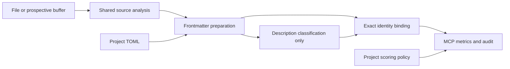
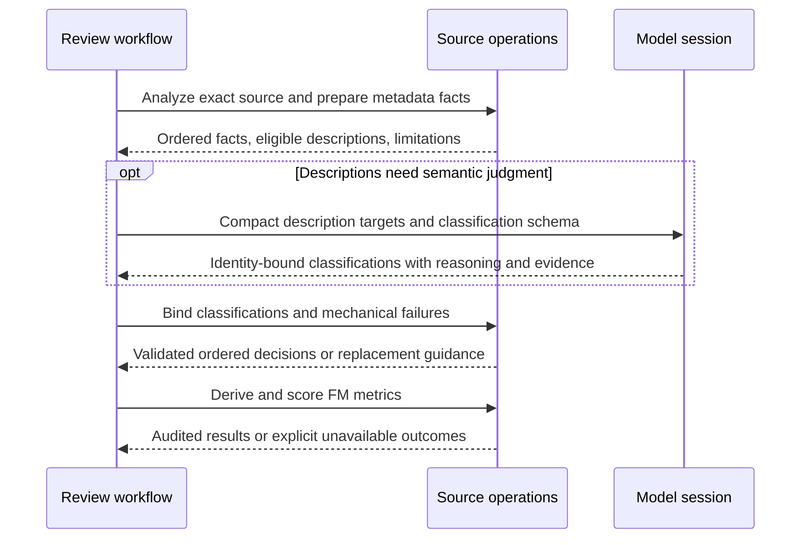

# Source-backed Frontmatter Validation

## Description

Move mechanical Frontmatter checks from the model into deterministic MCP source
processing. The model classifies description quality; MCP validates its coverage,
calculates all FM metrics, applies project scoring policy, and records evidence.
SPEC-055 completed observation-based counting, but did not move declaration
discovery or mechanical metadata checks out of its model prompt.

## Input / Output

| Boundary | Contract |
|---|---|
| Input | Exact file or prospective-buffer source analysis from the shared review preparation chain, including declaration identities, spans, attached comments and syntax evidence |
| Project configuration | Effective category additions from existing hierarchical TOML, plus the existing review scoring policy |
| Model input/output | Eligible description identities and text; one capability, implementation-detail or vague classification per identity with reasoning and evidence |
| MCP output | Ordered metadata facts, effective vocabulary, description decisions, explicit limitations and FM-1 through FM-5 results persisted in the engine-owned run audit |

## Responsibilities

| Check | Owner |
|---|---|
| Declarations and attached metadata blocks | MCP source analysis |
| Missing frontmatter and structurally determined exclusions | MCP |
| Declared name versus actual declaration name | MCP |
| Category validity | MCP, bundled registry extended by project TOML |
| Stack tags versus supported source evidence | MCP, declaration-level evidence |
| Description absence and mechanically checkable formatting | MCP |
| Description capability, implementation detail, and vagueness | LLM classification |
| Identity coverage, exception filtering, counts, severity, and audit | MCP |

## Confirmed Policy Decisions

1. Ship a bundled category registry. Projects extend it with
   `[frontmatter] additional_categories = ["domain-role"]` in their existing TOML
   configuration. Additions must be lowercase hyphenated names, not placeholders.
   Unknown categories are invalid; additions never remove bundled categories.
   Existing root-to-leaf and local override precedence applies to the configured
   additions. Persist the effective registry alongside the prepared facts.
2. Stack validation requires evidence inside the declaration. Imports alone never
   impose a tag on every type. A plain data type beside a SwiftUI view has no
   SwiftUI requirement; the view's direct framework usage does. Use bounded
   language-specific syntax registrations, excluding comments and string literals,
   and preserve their evidence. These are syntax facts, not inferred semantic
   ownership. Unsupported source remains explicitly unavailable.

The user confirmed both policies before implementation. Keep file-wide workflow
activation separate from these declaration-level metadata checks.

## User Stories and Acceptance Scenarios

### US-1: Ground metadata checks in source facts

As a reviewer, I want MCP to discover declarations and their attached metadata so
missing or incorrectly named blocks cannot disappear from model observations.

- **Given** a top-level declaration without metadata, **when** source inspection
  runs, **then** MCP records its identity and missing block with source evidence.
- **Given** metadata whose name differs from its following declaration, **when**
  source inspection runs, **then** the block remains attached by source position
  and the mismatch is detected rather than lost in name-based lookup.
- **Given** comments, attributes, multiple declarations, and Unicode source,
  **when** source inspection runs, **then** leading comments retain correct
  declaration ownership and inclusive line evidence without reparsing per field.
- **Given** field-looking text in strings or another declaration's comments,
  **when** inspection runs, **then** it cannot become the target's metadata.
- **Given** a new destination and prospective buffer, **when** inspection runs,
  **then** it uses that buffer and never reads stale or absent destination content.
- **Given** malformed metadata or incomplete/unsupported source analysis,
  **when** inspection runs, **then** the diagnostic remains explicit and cannot
  silently produce a compliant empty inventory.

### US-2: Keep deterministic policy and scoring in MCP

As a workflow author, I want metadata facts checked without model counting so
mechanical results are repeatable and scoring remains configurable.

- **Given** source-backed metadata facts, **when** FM-1 through FM-4 execute,
  **then** no model is asked to discover those facts, count them, or choose severity.
- **Given** a private/fileprivate helper under ten lines or a conformance-only
  extension with no added members, **when** FM-1 executes, **then** its authored
  structural exclusion is applied deterministically with evidence.
- **Given** category and stack policies confirmed above, **when** their checks
  execute, **then** both matching and mismatching cases are tested without
  introducing rule IDs, severity bands, or category vocabularies into the flow engine.
- **Given** project severity overrides, **when** scoring executes, **then** the
  existing effective-rule plan retains precedence over bundled defaults.

### US-3: Ask the model only for description classifications

As a reviewer, I want description judgments tied to known source identities so
each description is accounted for before MCP scores FM-5.

- **Given** nonempty descriptions, **when** the model step is presented, **then**
  it receives compact identities and authored classification instructions;
  source buffers and complete internal analysis objects are not retransmitted.
- **Given** a missing, duplicate, unknown, or malformed description classification,
  **when** submitted, **then** existing identity-coverage/schema validation rejects
  it with recoverable correction instructions before final scoring.
- **Given** valid classifications with reasoning/evidence, **when** MCP scores,
  **then** each bad block counts once and compliant descriptions count zero.
- **Given** no descriptions requiring judgment, **when** review executes,
  **then** no model turn is spent on mechanical checks or fixed exception flags.
- **Given** sequential or aggregate execution, **when** classifications complete,
  **then** metric values, audit identities, partial recovery, and replay agree.

## Technical Requirements

- Reuse typed `SourceFrontmatter`, YAML decoding, source inventories, technology
  detection strategies, identity-coverage validation, and workflow scoring.
- Keep parsing and code analysis in the source modules. Preserve the cheap
  frontmatter-only repository-search path; do not force AST parsing into search.
- Preserve source/comment association before metadata-name validation. The current
  name-based selector cannot serve as an authoritative mismatch detector.
- Use typed objects and attributes internally. Raw mappings are serialization or
  JSON/YAML boundaries only. Do not create factories for simple data construction.
- Keep language-specific syntax behind the existing source-parser strategy.
  Unsupported or unresolved evidence must be reported explicitly.
- Keep FM-1 through FM-5 identities and existing severity bands. Preserve authored
  exclusions and project policy precedence. Do not modify the legacy checker.

## Connects To

| Type | Spec | Relationship |
|---|---|---|
| Parent | SPEC-036 | Completes deterministic Frontmatter preparation in bundled review |
| Dependency | SPEC-040 | Reuses source inspection and typed source metadata |
| Dependency | SPEC-055 | Retains collection-based metric scoring |
| Dependency | SPEC-066 | Reuses declaration scope and exact classification coverage patterns |

## Diagrams

## Test and Implementation Plan

1. Capture the responsibility split and resolve category/stack policy decisions.
2. Write failing parser/association tests, then preserve leading comment evidence
   through the shared source inventory without duplicating parsing.
3. Write failing metadata tests for absence, mismatches, malformed YAML, exclusions,
   category policy, stack scope, and prospective-buffer equivalence.
4. Implement typed preparation and bind description classifications using existing
   capabilities; expose reusable logical source operations.
5. Replace the real bundled Frontmatter workflow's mechanical model instructions.
   Add exact workflow tests for mechanical-only completion, description coverage,
   aggregation, partial recovery, replay, and project scoring overrides.
6. Run all non-live suites, then the existing Codex and Claude Frontmatter live
   cases against the bundled rule, including missing, invalid, and compliant metadata.
7. Preserve raw attempts and audit artifacts, then update status from verified results.

## Definition of Done

- [x] Category and stack policies are explicit and confirmed.
- [x] MCP discovers and validates mechanical metadata facts with auditable ownership.
- [x] The model only classifies description quality with complete identity coverage.
- [x] Existing metric identities, exclusions, and project scoring precedence remain valid.
- [x] Sequential and aggregate workflow checks pass.
- [x] All non-live suites and locked Codex/Claude Frontmatter scenarios pass.

## Verified Completion — 2026-10-22

The real bundled rule now uses source-backed preparation, compact description
classifications and MCP scoring. Mechanical description failures use the same
evidenced classification record with an MCP-owned `INVALID_FORMAT` outcome;
the model's schema remains limited to its three authored classifications.
Exact identity binding reuses the shared coverage validator and preserves record
order without dictionaries in domain logic. The redundant decision record was
removed. A workflow test proves that a project threshold overrides the bundled
FM-1 threshold without changing the measured count.

The user-approved gate validation also required repairing shared configuration
and cleanup-hook seams. The old function-based configuration module was replaced
with an injectable typed loader and all callers/tests were migrated. Legacy
principle instructions, severity semantics and mode selection were not changed.
The full-content review covered all 24 retained original source files; two
obsolete original files were removed/replaced. Subsequent production edits were
gated one file at a time.

The first complete non-live run exposed 19 standalone search-script failures:
the new loader imported a bare configuration module unavailable to fresh callers.
A fresh-process test reproduced that failure before the package import fix.
The final rerun below includes that test and all original search assertions.

| Final non-live group | Passed | Subtests | Skipped |
|---|---:|---:|---:|
| Flow engine | 1,072 | 96 | 0 |
| MCP server and MCP | 1,362 | 144 | 4 existing |
| Remaining harness, hooks, integration, validators and rule tests | 160 | 2 | 0 |
| Scripts | 253 | 66 | 0 |
| Apple build and skill-support tests | 295 | 0 | 0 |
| **Total** | **3,142** | **308** | **4 existing** |

Live checks used the existing locked profiles: Codex `gpt-5.6-terra` and Claude
`claude-opus-4-5`. All six Frontmatter scenarios passed through `solid-review`
with project rule selection, not a test-authored replacement workflow:

| Scenario | FM-1 / FM-2 / FM-3 / FM-4 / FM-5 | Codex artifact ID | Claude artifact ID |
|---|---|---|---|
| Missing metadata | 1 / 0 / 0 / 0 / 0 | `20261022T214150Z-aac91e85` | `20261022T214306Z-2b34aacf` |
| Invalid metadata | 0 / 1 / 1 / 1 / 1 | `20261022T214408Z-69873ad7` | `20261022T214458Z-ae881881` |
| Compliant metadata | 0 / 0 / 0 / 0 / 0 | `20261022T214529Z-2b3696bd` | `20261022T214604Z-b2d3e68b` |

Preserved test copies are under
`.solid-coder/.artifacts/test/{codex,claude}/e2e/review/` in the corresponding
`frontmatter`, `frontmatter-invalid` and `frontmatter-compliant` folders.
The complete engine-owned audit is copied byte-for-byte into each passing run's
`flow-run` directory; normal runtime audits remain in user-level project storage.

The initial Claude missing-metadata attempt
`20261022T214221Z-8e765eb8` is preserved as a failed startup attempt, not passing
rule evidence. It stopped before a flow run because startup reported obsolete
server-name failures alongside connected current servers. One unchanged retry
passed. No user MCP configuration or model profile was modified to hide this.

The shared `test_flow_e2e_live.py` suite additionally passed all ten checks in
489.80 seconds: collection scoring, reducer/audit results, nested item workflows,
and question/statement routing on both backends. `git diff --check` is clean.
Scope-measurement agents remain disabled at the user's request. This completion
does not close SPEC-036's unrelated refactor, broader-target or benchmark work.
