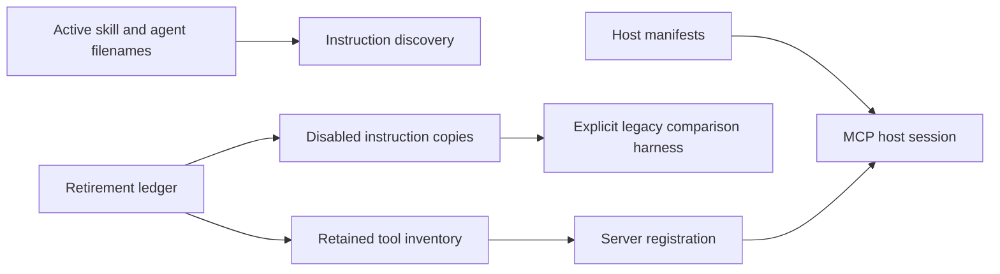
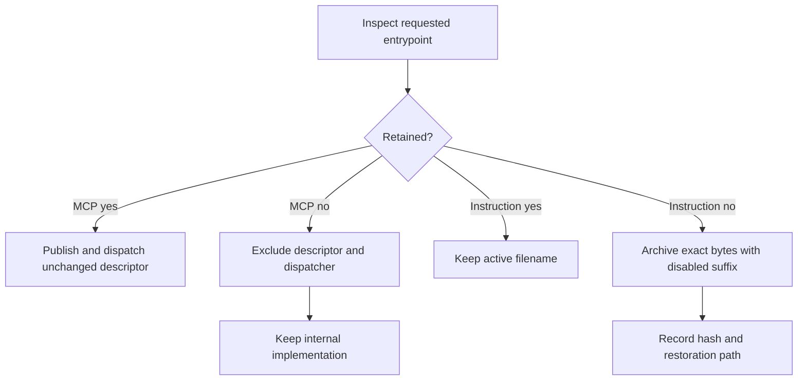
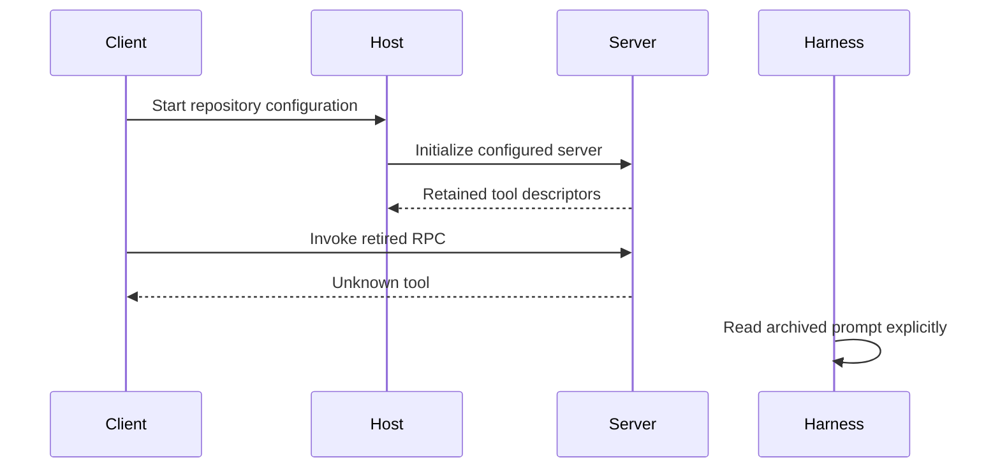

# Reversible Legacy Entrypoint Retirement

## Description

Reduce the repository's advertised MCP, skill, and agent surface to the capabilities used by legacy healthcheck, flow-engine, Apple build/test/lint, standalone coding, and spec authoring. Disable obsolete entrypoints while preserving their instructions and implementation for later recovery. This retrospective spec records the checkout changes and their acceptance evidence; installation into running clients is outside its scope.

## Input / Output

| | Detail |
|---|---|
| Input | Repository MCP host manifests, tool registrations, skill/agent entrypoints, and the retained capability inventory. |
| Output | Four configured MCP servers advertising 18 tools; 11 discoverable skills and six plugin agents. Hosts read manifests at startup, discover instructions from active filenames, and retain the resulting descriptors for that host session. |
| Evidence | The versioned retirement ledger in `.claude/docs/legacy-entrypoint-retirement-2026-10-23.json` supplies exact tool names, archive paths, hashes, removed manifest entries, and restoration instructions. The validation resource maps each acceptance criterion to recorded checks. |

## User Stories

### US-1: Retain the required MCP surface

As a developer, I want only the MCP capabilities used by the retained workflows advertised so that clients stop selecting obsolete orchestration tools.

- The configured docs, pipeline, flow-engine, and Apple servers advertise exactly the 18 retained tools listed in the retirement ledger, with retained descriptions, input/output schemas, and metadata identical to their pre-retirement descriptors.
- The four disabled docs tools and ten disabled pipeline tools listed in the ledger are absent from discovery and return an unknown-tool result when invoked through MCP.
- Neither repository host manifest configures the specs MCP server, while its source, CLI scripts, and gateway operations remain available for explicit use.
- Legacy healthcheck, workflow review, and the archived comparison harness reference only retained MCP capabilities; the harness can still construct its explicit legacy review prompt.

### US-2: Preserve recoverable instructions

As a maintainer, I want obsolete skills and agents removed from automatic discovery with their copies intact so that I can inspect or restore them later.

- All 14 retired skill entrypoints and ten retired agent entrypoints listed in the ledger are absent under their active filenames and present under their recorded `.disabled` filenames with byte-identical contents.
- Discovery retains the ledger's 11 skills and six plugin agents, including their active agent dependencies; the project flow-engine review agent remains active.
- The ledger contains the original/destination paths and content hashes for every archived entrypoint, exact removed server registrations, and steps to restore registration, filenames, and the comparison harness's prompt location.

### US-3: Keep retirement bounded

As a maintainer, I want retirement to affect entrypoint exposure so that existing implementation remains available while the supported surface is reduced.

- Disabling MCP exposure preserves the underlying decorated callables, handlers, scripts, and schemas; direct internal calls remain available, and an unrestricted registration policy continues to expose all supplied tools.
- Legacy healthcheck's native rules, flow-engine behavior, and the six Apple build/test/lint tool contracts remain unchanged by this retirement.
- Global client settings and installed plugin caches are untouched; the evidence report distinguishes checkout verification from unperformed installation and live-model checks.

## Connects To

| Direction | Target | Relationship |
|---|---|---|
| Parent | SPEC-001 | Narrows current entrypoints; historical implementation records are not erased. |
| Preserves | SPEC-036 bundled workflows | Flow-engine remains enabled; unfinished bundled refactor and workflow requirements remain open. |
| Preserves | SPEC-055 and SPEC-069 | Native legacy/workflow rules and source-backed review evidence remain valid within their recorded scope. |
| Consumes | Repository host manifests and registration policies | Select the active MCP surface during server construction. |
| Consumes | Skill/agent discovery and retirement ledger | Active filenames select discoverable instructions; archived filenames retain recoverable copies. |
| Produces | Host sessions and legacy comparison harness | Sessions receive retained tools; the harness explicitly reads the archived prompt. |

## Technical Requirements

Tool registration filters apply before both descriptor publication and dispatch registration. An omitted filter preserves prior registration behavior; an empty filter exposes no tools. Filtering must not replace decorated functions or prevent explicit internal invocation. The dedicated flow-engine and Apple registrations remain intact.

Archive instruction files by filename change rather than content rewrite. Keep helper scripts and schemas in place. The old comparison harness selects the archived prompt explicitly and keeps batch-findings submission; it must not request the retired single-findings permission.

This scope covers repository-controlled discovery only. Existing installed plugin copies, cached client instructions, client restarts, and permanent source deletion are excluded. It does not close broader historical specs, implement new config precedence, or claim new live healthcheck comparison results.

## Test Plan

### Registration and host contracts

- When unrestricted, allowlisted, and empty registration policies are supplied, registration exposes the selected descriptors and dispatchers while preserving direct callable behavior.
- When the four configured servers initialize, all 18 retained descriptors match baseline and all 14 retired docs/pipeline RPC calls return unknown-tool results.
- When both host manifests are inspected, neither registers specs and the preserved specs source and CLI remain available.

### Discovery and consumers

- When instruction discovery scans the checkout, all 24 archived files match ledger and baseline hashes, and the active skills, agents, and dependencies match the retained inventory.
- When healthcheck, workflow, and harness tool references are checked, each belongs to the retained surface and the archived prompt constructs without unresolved placeholders.
- When non-live test groups and Ruff run, the evidence records their outcomes, existing skips, and infrastructure failures separately without claiming unperformed live-model validation.

## Diagrams

### Connection

### Flow

### Sequence

## Definition of Done

- [x] Each acceptance criterion has a recorded evidence reference, with verification limits identified.
- [x] Archive restoration data and active-surface inventories are versioned with the change.
- [x] Non-live regression results, existing skips, Ruff status, and gate restoration are recorded.
- [x] Broader workflow backlog and client installation/live verification are not represented as completed by this spec.
- [ ] Scope validation findings are resolved or explicitly accepted for retrospective close-out.
