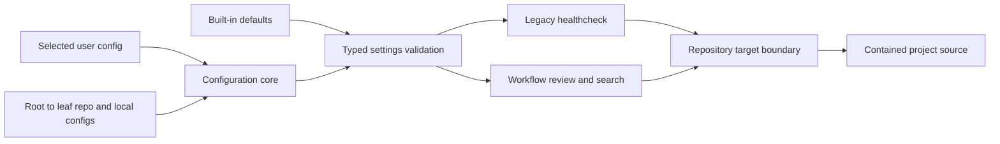
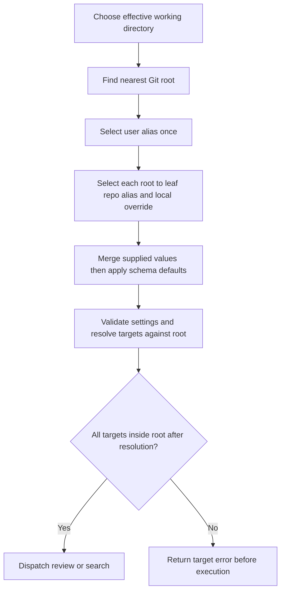
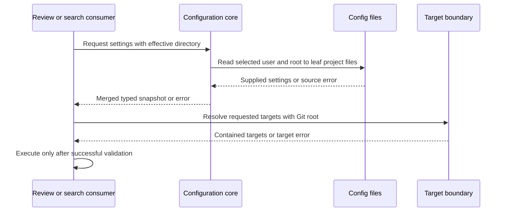

# Layered Configuration and Repository Path Boundaries

## Description

Allow shared user defaults while repository settings and personal project overrides retain precedence. Apply the same configuration lookup to legacy healthcheck and workflow consumers, and ensure review/search targets remain within the selected Git repository or worktree. This feature changes solid-coder configuration loading and target validation; external setup automation receives an integration contract rather than an implementation in this repository.

## Input / Output

| | Detail |
|---|---|
| Input | Existing TOML settings schema, effective working directory, Git root marker, optional user/repository/local config files, and review/search targets from configuration or invocation. |
| Output | A validated settings snapshot returned through the existing loading boundary to each requesting consumer for that operation, plus canonical repository-contained targets returned to review/search execution. No process-wide settings cache or mutable snapshot sharing is introduced. |
| Failure | An actionable configuration or target error returned before review/search execution, identifying the file or target and the reason; no fallback execution outside the repository. |
| Integration | Documented file locations and precedence for external `repo:setup` synchronization and mise-managed user defaults. Required CI settings live in committed project config. |

## User Stories

### US-1: Merge shared defaults with repository settings

As a developer, I want repository configuration to override shared user defaults so that I can reuse preferences without copying every setting into each repository.

- Configuration precedence is built-in defaults, selected user config, repository config, then personal project overrides; higher layers replace conflicting scalar/list values and recursively merge tables while retaining lower-layer keys omitted above, including explicit false and zero values.
- User config selects the first existing file from `~/.config/solid-coder/config.toml` then `~/.solid-coder/config.toml`; repository config at each applicable directory selects `.solid-coder/config.toml` then `.config/solid.coder/config.toml`. If both aliases exist, only the first contributes settings.
- A request from a nested directory preserves repository-root-to-request-directory overrides: each directory's selected repository config is followed by its `.solid-coder/config.local.toml`, with deeper directories overriding ancestors; user defaults are merged only once below this entire chain.
- Missing optional files contribute no settings; a selected unreadable, malformed, or schema-invalid file reports its path and reason without silently selecting the lower-priority alias. The final merged settings receive existing typed validation, and omitted values receive built-in defaults without overwriting supplied lower-layer values.
- With no user config, existing project settings and explicit test-model-profile selection retain their behavior; a clean CI home with committed project configuration produces the required project settings without a developer's home files.

### US-2: Bound review and search to the repository

As a developer, I want every review/search target interpreted within the selected repository so that shared defaults cannot cause another directory to be read as project source.

- The selected repository is the nearest ancestor Git root of the effective working directory, accepting both `.git` directories and worktree marker files; explicit working directory precedes the existing project-directory environment setting and process working directory. A review/search request without such a root fails before traversal.
- Relative review/search targets from any config layer or invocation resolve against that repository root, including requests made from nested working directories; absolute paths within that root are accepted and targets are never anchored at the user config directory or home directory.
- Outside-root absolute paths, parent traversal that resolves outside the root, and symlink escapes fail before target content is read, naming the offending target. Review/search enumeration excludes outside-root resolved entries even when reached through a directory or glob inside the root.
- Legacy healthcheck and workflow review/search enforce the same boundary on configured and explicitly supplied targets; a rejected target prevents dispatch of that operation rather than silently broadening or dropping its requested scope.
- Plugin/dependency resource lookup and existing audit/model storage retain their existing locations; the repository containment rule applies to project review/search targets and does not relocate those separate resources.

## Connects To

| Direction | Target | Relationship |
|---|---|---|
| Parent | SPEC-001 | Adds shared defaults to existing plugin configuration consumers. |
| Consumes | Existing configuration core, recursive merge, and typed settings decoding | Extend lookup without replacing settings schema or splitting precedence across consumers. |
| Produces | Legacy healthcheck and flow-engine review/search | Receive validated snapshots and repository-bounded targets through their existing composition boundaries. |
| Preserves | SPEC-036, SPEC-055, SPEC-067, SPEC-069 | Native workflow/legacy rule behavior and source-backed review semantics remain distinct from config discovery. |
| External integration | `repo:setup` and mise | Consume documented locations; their machine-wide synchronization implementation is outside this repo's scope. |

## Technical Requirements

The configuration core owns root discovery, candidate selection, and precedence. Start with the effective working directory: explicit request, existing project-directory environment setting, then process directory. Resolve it and walk ancestors until the nearest Git marker; never merge project files from above that boundary. Reuse the existing recursive table merge and typed decoder. Apply user defaults once, then each directory's repository/local pair in root-to-leaf order. An absent key uses the schema default only after all layers have merged. Read settings anew at the existing operation boundary; no new cross-operation cache is required.

Candidate selection uses existence before parsing. An existing preferred alias that cannot be read or parsed is an error, not permission to try the second alias. Report the source file for invalid supplied settings; after merging, validate the complete settings contract and report merged-setting errors with their contributing sources. Preserve the explicit test-model-profile override used by the existing test infrastructure.

The review/search execution boundary owns target containment. Resolve requested target paths and symlinks against the discovered root, compare by path components rather than string prefixes, and reject escapes before opening target content. For target patterns, validate their literal anchor and validate each resolved match before reading it; discovered escapes produce the same target error rather than being followed. An operation with any invalid target fails as a whole. Existing nonexistent-target behavior remains unchanged after containment checks. This is a boundary for project-source traversal, not a new security sandbox against concurrent filesystem mutation.

Do not introduce settings keys, change native rules, alter resource/audit/model paths, or change global machine files. Document that external setup can synchronize `.solid-coder/config.toml` as the canonical project location, that `.config/solid.coder/config.toml` is the exact supported alternate, and that mise may manage the primary user config. Automation code outside this repository is a separate delivery. Keep required CI configuration committed; optional personal files cannot be its sole source.

## Test Plan

### Configuration discovery and merge

- When isolated home and Git/worktree fixtures contain neither, either, or both aliases, lookup selects exactly the first existing candidate in each pair.
- When user, root, and nested repo/local layers conflict, recursive merging preserves omitted keys and explicit false/zero, replaces scalars/lists, and applies defaults only to absent settings.
- When a selected file is unreadable, malformed, or contains invalid settings, loading reports its source without alias fallback; valid requests retain explicit test-model-profile behavior and observe changes on the next operation.
- When CI uses an empty home and committed project-only settings, the required project settings and existing project-only regression outputs remain reproducible.

### Repository target boundary

- When requests vary explicit/environment/process directories across ordinary, nested, and worktree repositories, root discovery selects the nearest Git marker and a missing root rejects execution.
- When relative, absolute, traversal, symlink, or glob targets are resolved, in-root paths pass and escapes including similarly prefixed sibling paths fail before content reads.
- When the same invalid targets reach legacy healthcheck or workflow review/search, both reject the entire operation before project-content reads or dispatch.
- When contained review/search requests run, plugin resources and audit/model storage retain their locations; verification records non-live results before separately authorized live checks and reports infrastructure failures without machine changes.

## Diagrams

### Connection

### Flow

### Sequence

## Definition of Done

- [ ] All acceptance criteria have deterministic regression coverage through existing consumer boundaries.
- [ ] Config precedence, candidate locations, errors, and source-target containment are documented with project/user examples.
- [ ] External setup synchronization contract is documented without claiming changes to machine-wide automation.
- [ ] Non-live regression results and infrastructure failures are recorded; live equivalence claims require separately recorded live evidence.
