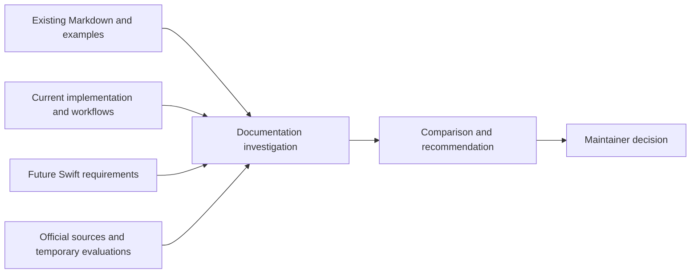
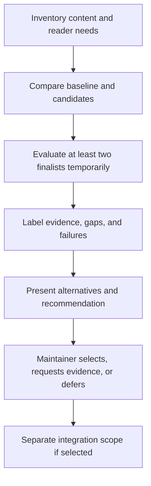

# Documentation System Investigation

## Description

Investigate documentation options for human readers and AI agents without selecting or integrating a generator in advance. Compare the needs of the current solid-coder workflow and bundled workflows with the future Swift version, keeping documentation content portable across implementation languages. This is a research deliverable; finishing the current workflows remains the implementation priority.

## Input / Output

| | Detail |
| --- | --- |
| Input | Current README, configuration and workflow references, representative Swift/Python examples, current development requirements, and the planned future Swift version. |
| Output | A Markdown comparison and recommendation at `resources/DocumentationOptions.md`, adjacent to this spec, for the maintainer to review before choosing a system. It remains versioned decision material until superseded. |
| Boundary | Research and temporary evaluation only. Repository integration, hosting, publication, and a Swift implementation are separate decisions and deliveries. |

## User Stories

### US-1: Compare options for humans and AI

As a maintainer, I want an evidence-backed comparison of documentation systems so that I can choose an approach that serves readers and agents across the current and future implementations.

- The comparison includes plain repository Markdown as a baseline and at least four candidates: MkDocs, Docusaurus, VitePress, and Swift-DocC. Any exclusion or additional candidate is explained rather than silently replacing an option.
- The matrix covers authoring format and portability; direct source access for AI; human navigation, search, diagrams, links, and versioned documentation; install/build dependencies and supported development/CI platforms; API-reference needs for Python and Swift; offline/self-hosted use; hosting requirements, costs, licensing, and maintenance status. Documentation-builder language is distinguished from the languages it can document.
- Each capability or limitation is supported by a dated official source or a recorded evaluation. Untested, unavailable, or uncertain behavior is labeled explicitly, including deployment costs that depend on a hosting choice.
- The same sample content is used to evaluate candidates: a configuration table with TOML, a workflow page with a diagram, cross-page links, and both Swift and Python examples. At least two finalists receive a temporary local evaluation covering build/preview steps, navigation, search queries, broken-link handling, and access to source content for agents. Unsupported capabilities and failed checks remain visible in the comparison.
- The report presents at least two viable options with tradeoffs, setup and maintenance effort, migration consequences, and a justified recommendation. The maintainer can select an option, request more evidence, or defer the decision; the investigation does not authorize installation into the project, hosting, or publication.

## Connects To

| Direction | Target | Relationship |
| --- | --- | --- |
| Parent | SPEC-001 | Documentation supports the solid-coder product and its maintainers. |
| Consumes | README and configuration/workflow references | Existing Markdown supplies representative content and identifies stale-documentation risks. |
| Preserves | SPEC-036 bundled workflows | Research does not change workflow implementation, rule behavior, or its unfinished acceptance requirements. |
| Considers | Future Swift version | Compare portability and Swift documentation needs without starting that implementation. |
| Produces | Maintainer and a future integration spec | The comparison informs a later explicit tooling decision and scoped implementation. |

## Technical Requirements

Evaluate source portability separately from the generator runtime and from language-specific API extraction. Use current official project documentation and package/release information when researching candidates; record the checked versions and dates instead of assuming a past recommendation remains current.

Keep evaluation environments temporary or under ignored artifacts. Do not modify runtime requirements, global machine configuration, plugin registration, or CI/deployment configuration to perform the investigation. If a candidate cannot be evaluated because of an infrastructure failure, report the failed step and missing evidence rather than repairing the machine or claiming a successful evaluation.

The comparison must make dependencies explicit for both the current Python implementation and the future Swift version. No documentation tool is a prerequisite for reading the README or the repository Markdown while this investigation remains open.

## Test Plan

### Research acceptance

- When the candidate inventory is reviewed, it contains the Markdown baseline and all four named systems or an explicit exclusion rationale.
- When a matrix claim is sampled, its official source or evaluation record identifies the checked date/version and separates observed behavior from assumptions.
- When finalist evaluations use the sample content, their results include build/preview, search, navigation, broken-link, and agent-source-access outcomes, including failures and unsupported features.
- When the recommendation is reviewed, at least two viable options and their current-Python/future-Swift tradeoffs are available without an installed project integration.

## Diagrams

### Connection

### Flow

## Definition of Done

- [ ] The comparison and finalist evaluations satisfy the acceptance criteria.
- [ ] Evidence gaps and infrastructure failures are explicit.
- [ ] A maintainer-reviewed decision or documented deferral is recorded.
- [ ] No generator, hosting, publication, or Swift implementation is claimed delivered by this research.
