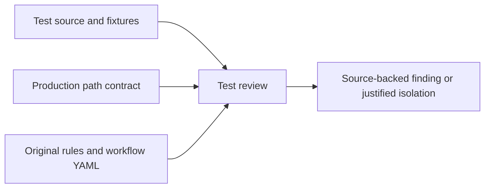
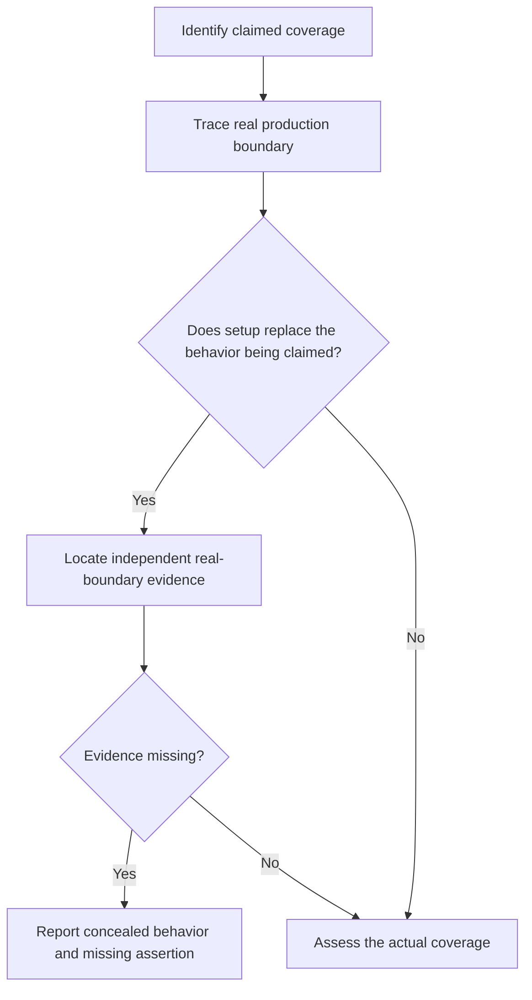

# Path Test Fidelity Review

## Description

Extend unit-testing review rules to detect tests that conceal broken production path or project-context resolution. A passing test must not be treated as evidence for a boundary whose real behavior the fixture replaces. This draft records the review-policy work prompted by the 1.7.21 installed code-search regression; implementing the policy is separate from repairing that regression.

## Input / Output

| | Detail |
|---|---|
| Input | Test source, production path/context resolution, fixture setup, test-double usage, and the behavior each test claims to cover. |
| Output | Source-backed review findings identifying concealed resolution or containment behavior, consumed by legacy and bundled workflow test reviews through their existing result contracts. |

## User Stories

### US-1: Detect tests that conceal path-resolution defects

As a developer, I want test reviews to distinguish real path validation from substituted answers so that green tests do not hide broken production behavior.

- A test claiming project-root discovery or containment coverage is flagged when it replaces the resolver, current-project reader, or filesystem boundary with the expected answer and never exercises the real behavior elsewhere in the claimed coverage.
- The finding names the replacement location, the production behavior bypassed, and the missing observable assertion; tool or fixture names alone are insufficient evidence.
- A test using an explicit temporary repository, isolated home, real session records, and the production resolver is accepted when it asserts both accepted in-repository targets and rejected escapes.
- Legitimate unit isolation is not rejected solely because a test double exists: review distinguishes a consumer test with an injected collaborator from a claim that the collaborator's real resolution behavior has been validated.
- Changing fixtures or expected results solely to hide a failing production path contract is flagged; corrective guidance requires repairing production behavior and preserving regression coverage.

### US-2: Require evidence matching the deployed path boundary

As a developer, I want installed-path claims backed by the actual entry point so that startup smoke checks cannot stand in for functional project selection.

- Installed-plugin search coverage starts the packaged server outside the target repository, sends real request/session context, invokes search, and checks the returned project paths without replacing the resolver.
- Coverage distinguishes process working directory, plugin directory, user configuration directory, and active repository; at least one scenario gives these different locations.
- Containment coverage includes outside absolute paths, parent traversal, similarly prefixed siblings, and symlink escapes, with rejection before target content is consumed.
- A server initialize/tool-list check is classified as startup evidence only, not evidence that a search uses the correct repository.

## Connects To

| Direction | Target | Relationship |
|---|---|---|
| Parent | SPEC-001 | Extends test-review policy. |
| Related | SPEC-036 | Bundled review workflows consume the updated testing rules. |
| Related | SPEC-071 | Repository containment and shared configuration provide concrete path contracts to validate. |
| Consumes | Original unit-testing rules and current workflow YAML | Preserve native review contracts while adding the agreed validation. |
| Produces | Legacy and workflow unit-test review results | Evidence-based findings without silently changing scoring or exemptions. |

## Technical Requirements

Keep behavioral classification with the reviewing model. First compare original testing rules with current YAML and agree which syntactic facts can be extracted deterministically; extraction must not infer correctness from a patching API name. Use the installed code-search regression as a negative example and the repaired real-session test as a positive example. Preserve distinct unit, integration, startup, and installed-functional coverage claims.

TBD before implementation: exact rule identifier, severity bands, supported-language extraction scope, and the native legacy/workflow scoring changes. Do not implement or mark this draft ready until those choices are reconciled against the original rules.

## Test Plan

- When a path-resolution test replaces the resolver with the expected root, review identifies the bypassed behavior and missing real-boundary evidence.
- When an injected reader isolates a consumer test without claiming discovery coverage, review does not invent a resolver-coverage claim.
- When a packaged MCP search runs from the plugin directory using real session context, review recognizes functional evidence for project selection.
- When only initialization and tool listing run, review does not claim functional search coverage.
- When invalid targets are changed to valid fixtures merely to hide a production defect, review requires a logic fix and retained negative coverage.
- When an installed search rejects an outside symlink before reading it, review preserves that evidence rather than recommending weaker containment.

## Diagrams

### Connection

### Flow

## Definition of Done

- [ ] TBD policy choices are resolved against original rules and current YAML.
- [ ] Native rule contracts and scoring changes are explicitly documented.
- [ ] Positive and negative examples cover both concealed defects and legitimate isolation.
- [ ] Legacy and workflow reviews report source-backed results for the agreed examples.
- [ ] Verification distinguishes deterministic extraction, model classification, and infrastructure failures.
