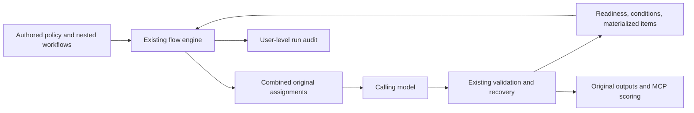
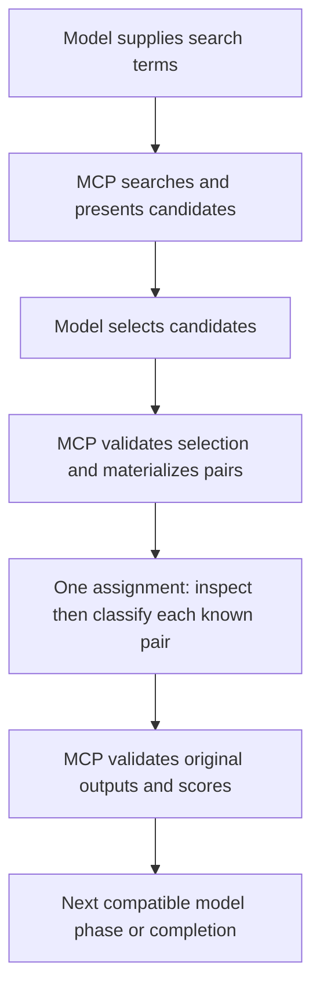
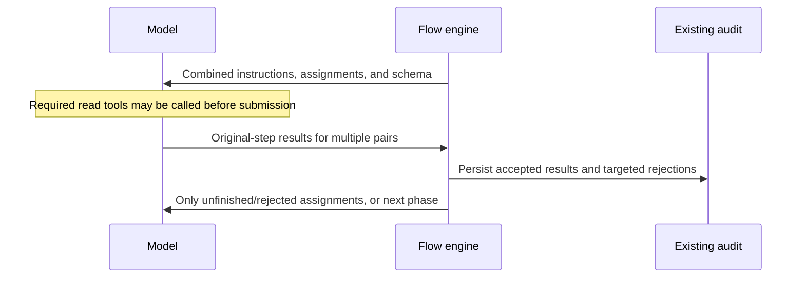

# Reduce Unnecessary Turns in Nested Aggregate Workflows

## Description

Make an enclosing aggregate/combined policy apply predictably to nested workflows and materialized iteration work, while preserving explicit local choices and genuine MCP-owned dependencies. The current review run demonstrates that an outer aggregate group does not prevent nested work from reverting to individual granular submissions. This work extends the existing planner and presentation mechanisms; it does not introduce another batching engine or replace granular workflows with monolithic prompt copies. Implementation and test-first validation are authorized; the separately approved LSP coverage and fatal-call policy below are explicit rule changes, not consequences of aggregation.

### Observed evidence and cause

The Codex gate run `c631b8f7b22845ad86339f0a77bb551c`, captured on 2026-10-20, completed 22 accepted workflow turns. Its test artifact copy is under `.solid-coder/.artifacts/test/codex/e2e/gate/solid-gate-on-write/20261020T235542Z-2af97c7b/`; the authoritative audit is under the user's `.solid-coder/<project-slug>/` directory recorded in that artifact's `canonical-audit-path.txt`.

- The distributed `solid-file-review-aggregate` bundle declares aggregate execution and combined presentation around dynamically discovered rules.
- The persisted nested DRY candidate group nevertheless has granular execution, individual presentation, individual iteration, and no combined-presentation ownership. Five target/candidate pairs took ten accepted submissions: five inspections and five classifications. These are pairs, not five distinct source files.
- Inline-group policy propagation is explicit in the loader, but ordinary workflow-ID includes do not propagate it through further nested includes. Omitted settings are resolved to granular/individual defaults before the enclosing policy can be inherited consistently.
- An existing policy-loading test preserves nested defaults even when an enclosing policy exists. This is an implemented scoping limitation, not evidence that the model ignored a valid aggregate assignment. Changing omission semantics must update that contract deliberately while retaining explicit opt-outs.
- The aggregate collector stops at any condition declaration and at additional iteration-bearing steps. It does not distinguish every already-resolved condition/materialized collection from one that requires future model output. Presentation also selects only siblings belonging to the selected batch group.
- The LSP workflow asks for empty relationship observations even after its inheritance trigger is false. The class's accepted turn 21 did only that work. This is an authored routing issue, distinct from policy propagation.

Evidence locations in the checkout:

- `mcp-server/harness/include_source.py`, `inline_group_source_resolver.py`, `workflow_include_source_resolver.py`, and `nested_include_child_group_policy_selector.py`.
- `mcp-server/harness/workflow_include_runtime_parser.py`, `for_each_declaration_parser.py`, `aggregate_phase_step_collector.py`, `aggregate_step_eligibility_checker.py`, and `sibling_batch_step_selector.py`.
- `tests/harness/flow_engine/resolvers/test_workflow_execution_policy_loading.py`, particularly the nested-policy isolation case.
- `workflows/review/rules/dry/workflow.yaml`, its `candidate-review/workflow.yaml`, and `workflows/review/rules/lsp/workflow.yaml`.

The existing SPEC-045 contract already permits compatible model-only dependent steps in one aggregate assignment. It requires a phase boundary for unresolved conditions and MCP-owned intermediate work; it does not require a model turn merely because a condition or nested include exists. Recursive omission inheritance and implicit iteration presentation are clarified here rather than claimed as already implemented.

## Input / Output

| Direction | Contract |
|---|---|
| Input | Existing workflow declarations, explicit or omitted execution/presentation/iteration settings, resolved includes, materialized instances, condition decisions, and replayed state |
| Model-facing output | A deduplicated instruction set and schema for the compatible original assignments in the current phase, returned through the existing start/next tools |
| Runtime output | Ordinary validated original-step completions, ordered workflow outputs, unchanged deterministic scoring, and the existing pending/rejected assignment state |
| Audit output | Effective policy and its origin, plus reasons for phase boundaries, retained with the existing user-level run audit; not added as model instructions |
| Measurement output | Separately reported accepted workflow turns, submission attempts/rejections, model requests when available, other tool calls, input/cached/output tokens, and elapsed time |

A **workflow turn** here means an accepted submission counted by the engine. One aggregate assignment can require several model requests and file-read tool calls before its results are submitted. Reducing workflow turns is not a claim that those reads, requests, tokens, or their latency disappear.

## User Stories

### US-1 — Set policy once without silently losing it in children

As a workflow author, I want nested workflows to inherit omitted execution and presentation settings so that I can experiment with aggregate execution without maintaining alternate copies of each child workflow.

Approved policy:

- Resolve execution and presentation independently. At an include boundary, an explicit include-site setting takes precedence over the included workflow's explicit root setting, which takes precedence over the inherited enclosing setting. Explicit settings on deeper groups remain local overrides.
- Omission means inherit; outside a configured ancestor, the existing granular/individual defaults remain unchanged. An explicit granular setting prevents step folding in that scope. An explicit individual presentation prevents cross-item combination in that scope. Neither setting implicitly changes the other axis.
- In a combined scope, an omitted iteration mode does not force separate presentations for already materialized child instances. Explicit individual iteration remains an opt-out. Explicit batch mode retains its current label requirement; implicit combined addressing uses existing stable opaque instance coordinates, not guessed names or parsed identity strings.
- A child opt-in does not affect an unconfigured parent or sibling. No new YAML mode is proposed.

| Scenario | Given | When | Expected |
|---|---|---|---|
| P1: Recursive omission | An aggregate/combined group includes a child that includes another child, both with omitted settings | Both levels materialize | Both retain the enclosing effective policy and compatible work can share the enclosing presentation |
| P2: Explicit override | A child explicitly selects granular execution, individual presentation, or individual iteration | Its parent aggregates | Each explicit choice remains effective only in its own scope; omitted independent settings still inherit |
| P3: Child-only opt-in | A parent and sibling have no policy and one child opts into aggregate/combined | Work advances | Only the opted-in child combines; parent and sibling retain their original behavior |
| P4: Snapshot | A run has explicit overrides, inherited settings, and partial child completion | A fresh engine replays it | Policy origins, effective settings, labels, pending assignments, and completion state remain unchanged |

Controlled expectation matrix, using two known items and two model-only steps A then B per item, with no rejection, operation, condition, or further input binding needed between them:

| Effective execution | Effective presentation | Expected accepted submissions |
|---|---|---|
| Granular | Individual | Four: A and B separately for each item |
| Aggregate | Individual | Two: A+B for each item |
| Granular | Combined | Two: A for both items, then B for both items |
| Aggregate | Combined | One: A+B for both items |

This matrix applies whether settings are explicit or inherited. It does not assert a fixed total for a full live review with searches, uncertain judgments, and retries.

### US-2 — Split only when execution really needs an intermediate result

As a workflow author, I want already-resolved work to combine while unresolved engine decisions remain boundaries so that fewer submissions do not change workflow meaning.

| Scenario | Given | When | Expected |
|---|---|---|---|
| F1: Known conditions | Independent model assignments share an effective combined scope and their conditions are already true or false | The phase is planned | True assignments join the phase; false assignments are durably skipped and do not require empty model submissions |
| F2: Unknown condition | A condition depends on a model output that has not been submitted | The current phase is planned | The conditional work is withheld; MCP evaluates the condition after validation before presenting the next phase |
| F3: Known nested items | Two parent items contain respectively three and two selected candidates; each child has inspect then classify and no engine step between them | Aggregate/combined planning starts after selection validation | All five pairs appear in one assignment, each with inspect and classify outputs; candidate inspection precedes classification within that assignment |
| F4: Newly discovered items | A model output determines an iteration collection | The producer is presented | The engine does not invent its future children; after submission it validates and materializes the collection, then combines the eligible children |
| F5: Required operation | Model step A supplies a search, validation, calculation, command, script, or delegated-session result needed by model step B | The workflow advances | A and B remain separate phases and the existing MCP handler performs the intervening work; the model never simulates it |
| F6: Independent branch | One branch waits on an operation and another already has a renderable model assignment in the same combined scope | A phase is planned | The independent assignment remains eligible; declaration order alone does not create a dependency or suppress it |
| F7: Loop and scalar work | Materialized per-item classifications and unit-level work are renderable in the same combined scope | A phase is planned | Both can be represented without losing parent/child identity; a pending calculation or fan-in dependency still prevents premature consumption |
| F8: Missing render input | A later model prompt, binding, or assignment schema needs a value that MCP cannot resolve until an earlier submission | Aggregation is requested | The engine records that dependency as a boundary rather than inserting unresolved expressions or asking the model to perform MCP interpolation |

Inspection and classification are retained as separate authored steps and separate validated outputs, not concatenated into a new rule. Authored language that assumes a previous submission, such as "do not classify it yet" or "previously submitted", must be reviewed for phase-compatible sequencing. Any wording adjustment is limited to execution order; the engine must not rewrite prompt text, remove evidence, or change classification criteria.

### US-3 — Preserve correctness and make reductions measurable

As a maintainer, I want fewer turns with the same coverage and scoring guarantees so that a shorter review is not achieved by silently omitting work.

| Scenario | Given | When | Expected |
|---|---|---|---|
| C1: Complete response | A combined assignment contains five candidate pairs with two outputs stages each | All ten original step outputs validate | Every original step completes once; deterministic downstream results match granular execution for the same observations |
| C2: Partial response | Some items or later stages are omitted | Accepted work is persisted and the run is resumed | Only missing work is presented again, fan-in stays blocked until complete, and Stop denies premature completion |
| C3: Invalid producer | A child inspection is invalid and its dependent classification is also supplied, while another child is valid | MCP validates the aggregate response | The dependent result does not become authoritative; the valid independent child remains complete and the retry identifies only the work requiring correction |
| C4: Identity collision | Two parents contain the same candidate label or different children reuse local step IDs | A combined response is mapped | Existing scoped identities prevent collisions; unknown or stale coordinates are rejected without guessing |
| C5: Empty branch | An iteration collection is empty or a known condition excludes every child | MCP advances | Existing empty/skipped completion semantics consume no model submission and remain replayable |
| C6: Count equivalence | Fixed valid observations are submitted through granular and aggregate execution | Scoring completes | Metric values, severity, exception handling, availability, and ordered outputs are identical |
| C7: Explain a split | A planned assignment cannot join the current phase | Its audit is inspected | The reason identifies an explicit policy boundary, pending operation, unavailable condition/collection/render input, or outstanding validation, rather than silently falling back |

The separate LSP classification-coverage fix remains necessary: assignment coverage does not establish coverage inside an arbitrary submitted array. Its existing failing integration test stays visible and must be fixed through authoritative member inventory and collection validation, not weakened to make this turn-reduction work pass.

### Approved LSP coverage and fatal-call policy — 2026-10-21

- MCP requires exactly one classification for each implemented member matched to a known protocol requirement. Internal helpers are supporting context, not extra contract obligations. Missing, duplicate, or unknown identities are rejected before scoring; unresolved contracts remain explicitly unavailable rather than compliant.
- Every actual Swift fatalError call in the reviewed source is a violation for now, whether direct, conditional, in an initializer, or inside a helper. A claim that the call is intentional, unreachable, or outside valid contract usage does not waive it. Comments and string literals that merely mention the name are not calls.
- Source analysis supplies detected calls and source evidence. Classification cannot erase a deterministically detected call or use the whole-unit NoOp exception to suppress it. Existing LSP-3 severity remains SEVERE for one or more confirmed fatal calls.
- When an implemented requirement invokes a helper containing a fatal call, retain the contract-member attribution and the supported call path as evidence. Do not invent links for ambiguous dispatch, overloads, unavailable helper source, or cycles. Call resolution belongs in the dedicated source-analysis module and reuses its language strategy boundaries.
- Empty implementations remain a separate behavioral classification. This fatal-call policy does not make every empty body a violation or change LSP-4 severity.

## Connects To

| Direction | Target | Relationship |
|---|---|---|
| Parent | SPEC-010 | Retains the existing lifecycle, DAG, replay, and Stop enforcement |
| Upstream | SPEC-045 | Reuses aggregate compilation; clarifies nested default inheritance and removes unnecessary phase limits |
| Upstream | SPEC-037 / SPEC-042 / SPEC-043 | Reuses conditions, nested outputs, iteration identities, partial completion, and combined presentation |
| Upstream | SPEC-052 | Preserves actionable aggregate rejection and subset retry behavior |
| Downstream | SPEC-036 / SPEC-056 | Applies the generic change to canonical review rules and nested DRY candidate review |
| Related correctness work | `test_missing_contract_classifications_reject_before_scoring_then_recover` | Keeps the currently failing LSP coverage case as a separate acceptance requirement for trustworthy comparisons |
| Validation consumer | Existing Codex/Claude flow and gate live infrastructure | Measures the real bundled workflow and hook path without constructing alternate review prompts |

## Technical Requirements

- Extend existing typed policy resolution, phase planning, materialization, and response mapping; do not add a rule-specific scheduler, a second batching engine, or a separate aggregate lock/state machine.
- Preserve explicit-versus-omitted policy information through parsing and snapshots. Do not infer an author's explicit intent from an already-defaulted enum value.
- Plan from the dependency graph, existing readiness/condition decisions, and actual materialized instances. No prompt-text parsing, identifier splitting, or rule-name-specific exceptions determine eligibility.
- Drain executable MCP-owned work through existing handlers. Side-effecting operations keep their existing order and execution semantics; turn reduction is not permission to reorder them for convenience.
- Deduplicate instructions by existing authored-step identity while retaining necessary per-assignment bindings, evidence, schemas, and provenance. Do not reintroduce repeated full source buffers or internal planning metadata into model-facing prompts.
- Preserve ordinary completion/attempt events, ordered fan-in, scoring, recovery, and replay. Planning diagnostics use the existing audit location and are not a second source of execution state.
- The inheritance proposal changes omission behavior only under an explicit enclosing policy. Existing fully granular workflows remain unchanged. Existing in-progress snapshots must not be silently reinterpreted using current YAML or assumed author intent.
- Bundle follow-up: use deterministic routing for LSP's false inheritance branch, preserving its established not-applicable score semantics without asking the model for an empty answer. Keep unavailable evidence distinct from an authoritative negative trigger.
- Do not change OCP/DRY/LSP thresholds, model profiles, legacy health-check behavior, candidate limits, or source-search semantics in this work. The approved LSP coverage and fatal-call policy is the only additional rule-semantic change; update expectations only where that policy requires it. Do not chunk responses as a turn-reduction workaround or introduce parallel model sessions.

## Diagrams

### Connections

### Phase boundaries

### Submission and recovery

## Test Plan

### Parsing and policy scope

- When a three-level include chain omits local modes, loading it under aggregate/combined preserves inheritance across static, catalog, dynamically discovered, and runtime-materialized children (P1).
- When each execution/presentation combination in the matrix is selected, a controlled two-item/two-step fixture produces respectively four, two, two, and one accepted submissions without changing outputs (P1-P3).
- When a child explicitly opts out on one axis, that choice is preserved while the other omitted axis inherits; a child-only opt-in never affects its parent or sibling (P2-P3).
- When an inherited-policy snapshot is reloaded after partial completion, effective policy, origin, labels, and remaining work match the pre-restart state (P4).

### Phase planning and submission integration

- When known true/false conditions precede otherwise compatible work, planning combines the true assignments and persists false skips without an extra empty submission (F1, C5).
- When an unknown condition or iteration collection depends on current model output, planning waits for validation and materialization before exposing those assignments (F2, F4).
- When five known pairs span two parent items, one aggregate response completes inspect and classify for every pair and produces the same ordered child outputs as granular mode (F3, C1, C6).
- When operation, command, script, or delegated-session steps produce inputs for later model work, they execute in MCP between phases rather than appearing as model tasks (F5).
- When an unrelated pending operation appears earlier in declaration order, compatible independent ready work is not suppressed by that position (F6).
- When scalar work and materialized nested loops share a presentation scope, results route to exact original instances and required fan-in/calculation consumers still wait (F7, C4).
- When prompt interpolation needs an unsubmitted output, the planner retains a phase boundary and exposes no unresolved expression (F8).
- When an aggregate response is partial, invalid, duplicated, unknown, or stale, accepted siblings remain durable, dependent work stays blocked as required, recovery is specific, and Stop/replay preserve coverage (C2-C4).
- When a false LSP inheritance trigger has already been recorded, no model assignment requests empty relationship observations and deterministic scoring retains the established not-applicable outcome (F1, C5).
- When a phase is split, the existing audit explains its policy or dependency reason without adding audit metadata to the model prompt (C7).

### Validation sequence and live comparison

LSP acceptance cases run through the real bundled workflow in granular and aggregate configurations:

- When two known protocol implementations are required, an empty classification array is rejected with both missing identities; a partial array names the remaining identity; a complete corrected array succeeds without reopening accepted independent work.
- When a contract method calls a local helper containing a fatalError call, the result is SEVERE and preserves both the call site and supported helper path; the helper is not a second required contract classification.
- When a fatalError call appears directly, conditionally, in a helper without protocol conformance, or in a type named NoOp, deterministic detection still produces a SEVERE fatal-call result.
- When fatalError appears only in comments or literal text, no fatal call is counted; a real call inside string interpolation is still detected.
- When call targets or protocol requirements cannot be resolved, evidence records uncertainty and no fabricated contract link or compliant coverage is reported.
- When a required implementation has an empty body, the model still classifies its behavior under the existing empty-method policy.

1. Write failing tests for inherited/explicit policy scope and the five-pair, one-submission case before implementation. Assert submitted results, scoring, and recovery, not only rendered prompt membership.
2. Implement and validate one file at a time using existing capabilities; retain genuine boundary tests while adding resolved-condition/materialized-loop cases.
3. Run focused tests and all non-live suites. The existing red LSP collection-coverage test is not excluded or relabeled as passing; complete its separate fix before claiming a clean baseline.
4. Run existing Codex and Claude flow-engine live checks, then the real `solid-gate-on-write` fixture with the same source project, rules, and locked profiles. Generic mechanics fixtures belong under tests, not distributed workflows; rule/gate acceptance uses the real bundled workflows.
5. Compare canonical audits/transcripts for output coverage, classifications, scored results, accepted workflow turns, all submission attempts, file-read calls, elapsed time, and available input/cached/output token usage. Preserve artifacts before cleanup and report unavailable counters as unavailable.
6. Lock exact turn counts only for controlled deterministic fixtures. For live runs, report baseline and measured counts with split/retry reasons; do not promise that all 22 existing turns become one or claim accuracy from completion alone.

Implementation is in progress. Failing policy, five-pair submission, partial recovery, and render-dependency tests were reproduced before their fixes. Scope/LOC measurement agents are excluded at the user's request.

### Implementation checkpoint — 2026-10-21

- Recursive omission inheritance, independent axes, explicit individual iteration, and a nested combined opt-in behind an individual parent are covered. The last two tests reproduced policy leaks before their fixes.
- Five candidate pairs preserve ten original inspect/classify results in one combined submission. Partial invalid producers cannot authorize dependent classifications; accepted independent results survive replay.
- Known conditions and materialized loops can join phases; required operation/calculation and unresolved interpolation dependencies still wait.
- Swift invocation facts use Tree-sitter syntax and the existing token parser, not text search. Comments/literals are excluded, interpolation calls remain, and callee formatting does not change matching.
- `source.contract_members` reuses bounded declaration discovery and requirement matching, including conformance declared on an extension. `source.bind_member_classifications` reuses exact collection-identity validation.
- The real bundled LSP workflow has 28 granular/aggregate fatal-policy integration cases, including conditional calls, initializers, helper calls, attempted empty contract submissions and NoOp claims. The `load → parse → fatalError` case proves that the helper is not another contract obligation and that model misclassification cannot suppress the source-backed fatal-call result.
- `LSP-3/fatal_calls` is the deterministic call observation. The existing `LSP-3/value` contract classification remains separate; consumers must use metric plus observation identity, not assume one observation per metric. A whole-unit NoOp claim cannot suppress the call observation.
- Unsupported or ambiguous requirement signatures remain unavailable. In the existing `LiveStreamPlayer` fixture, inferred `isPlaying` type coverage is unresolved; this does not hide the confirmed fatal call. The fixture was not changed to manufacture certainty.
- Call sites and submitted helper-path evidence are retained. This change does not claim a general, semantically verified call graph or dynamic-dispatch resolution.

### Validation record — 2026-10-21

After the delegate capability correction described in SPEC-048, all non-live suites passed: **3,044 tests, 270 subtests, four skips**. The skips are abstract `SchemaFixtureTestBase` methods; concrete implementations run. The SourceKit-dependent suites failed in the restricted sandbox with service-closed/invalid-service errors, then passed unchanged outside it. No tests were excluded to hide those failures.

| Suite | Passed | Subtests | Skipped |
|---|---:|---:|---:|
| `tests/mcp-server tests/mcp` | 1,294 | 118 | 4 |
| Non-live `tests/harness/flow_engine` | 1,043 | 84 | 0 |
| Remaining non-live harness, hooks, integration, validators, coding, testing | 159 | 2 | 0 |
| `scripts/tests` | 253 | 66 | 0 |
| Apple build, skills, version-bumper scripts | 295 | 0 | 0 |

The real bundled gate passed for Claude and for the bounded Codex retry. These tests invoke the real hook against the same source fixture, not a hand-assembled review prompt.

- Claude run `8fa3a5efc1434c529923a6dffb2fb1d6`: five accepted submissions, zero recorded rejections/attempt failures, two file reads. Artifacts: `.solid-coder/.artifacts/test/claude/e2e/gate/solid-gate-on-write/20261021T154550Z-55ec1540/`.
- First Codex run `1d3307d439f146dfa7525a95a20676a2` failed before an accepted submission because the named flow tool was not callable. The gate failed closed. Artifacts: `.solid-coder/.artifacts/test/codex/e2e/gate/solid-gate-on-write/20261021T154244Z-ebf281eb/`.
- Codex retry `d35d0b97dac048c3b7581da2bb4ce3c9`: six accepted submissions. Its transcript records one initial tool-not-callable error and four JavaScript syntax errors before successful submission. MCP then rejected one incomplete DRY candidate selection with the exact missing IDs and a complete-replacement instruction; the model corrected it and finished. Artifacts: `.solid-coder/.artifacts/test/codex/e2e/gate/solid-gate-on-write/20261021T155509Z-4e8ed2dc/`.
- Separate read-only capability probes found the same flow tool present and callable in repository and isolated-project contexts. They do not establish why it was initially unavailable in the real Codex sessions. Do not classify that infrastructure issue as fixed or blame aggregation without further evidence.

One-sample comparison with the recorded 2026-10-20 gate runs:

| Backend/sample | Accepted workflow turns | Workflow elapsed seconds | Input tokens including cache | Cached-input subset | Output tokens |
|---|---:|---:|---:|---:|---:|
| Codex earlier | 22 | 108.46 | 1,007,342 | 947,456 | 12,924 |
| Codex current successful retry | 6 | 439.27 | 624,616 | 567,808 | 19,533 |
| Claude earlier | 18 | 293.06 | 739,776 | 689,270 | 21,843 |
| Claude current | 5 | 239.67 | 222,735 | 181,324 | 18,437 |

Codex counters come from the final transcript total-token record. Claude counters are summed once per unique assistant message, including cache creation/read inputs; repeated streaming records are not counted twice. Elapsed time is engine start-to-terminal, not total pytest duration. Counts include recovery, but the failed first Codex run is **additional experiment cost**, not included in its successful-retry row. Model requests and accepted workflow turns are not interchangeable. The unchanged source fixture has SHA-256 `04f8500811dc07352342c633b0c43b649f79ddf83fa5a8ed217d08aeba088523`; the approved LSP policy changed, so this is not a controlled accuracy benchmark or proof of a general speed improvement.

The first generic live-flow suite recorded eight passes and two Claude delegate failures. Their transcripts exposed the stale legacy MCP configuration tracked in SPEC-048. A failing default-composition integration test now covers that wiring, and the dedicated flow configuration and allowlist are corrected. After the final non-live suite, the full live-flow rerun passed **10/10 in 432.02 seconds**: five Codex and five Claude cases, including both delegated fan-out and conditional-routing cases per backend. Successful artifacts are under `.solid-coder/.artifacts/test/{codex,claude}/e2e/flow-engine/workflow-contract/`, timestamped from `20261021T161231Z` through `20261021T161838Z`. Manual inspection confirms that the new child transcripts actually call the flow MCP tools. Keep the original failures as evidence rather than reporting the first suite as green.

### Phase-split audit checkpoint — 2026-10-21

C7 now records typed `aggregate_phase_planned` events in the canonical run's `events.jsonl`. Each record preserves the accepted-turn counter, selected original step IDs, materialized instance IDs, and deferred steps with their scope, reason, blocking step IDs, and interpolation error where applicable. Reasons come from the existing planner/materializer branches, not a second planner or model-prompt inspection. A workflow-boundary deferral means the step belongs to another logical phase; it does not imply that separately planned phases cannot share combined presentation.

The same record retains root policy and include-scope aliases, owner aliases, effective policy, and explicit-declaration flags. Together with the persisted workflow snapshot, these expose the ownership chain for inherited policy without copying prompts, parameters, source buffers, or schemas into diagnostics. The event does not become execution state: ordinary completion, rejection, attempt, and skip events remain authoritative. Read-only snapshot/status resolution does not write diagnostics, and resuming an unchanged frontier does not append an identical audit record.

Four focused integration tests cover missing render inputs, engine/condition/collection barriers, explicit nested policy, and partial fan-out. They also prove original prompts remain unchanged, rejected input can be corrected, accepted sibling instances remain closed, and replayed execution state is unchanged. The first two reproduced missing diagnostics before implementation. After implementation, all non-live groups passed: **3,048 tests and 270 subtests, with four abstract-base skips**. The shared live flow-engine suite passed **10/10 in 451.87 seconds**, across Codex and Claude.

The [fresh measurement report](resources/2026-10-21-measurements.md) preserves the requested measurement-before-investigation ordering, native transcripts, phase audit, timing/token methodology, and failures. Codex completed five accepted submissions versus the earlier 22, with 269,558 input tokens versus 1,007,342, but its DRY-3 accuracy assertion failed. Claude was interrupted after eight malformed tool-input JSON submissions and did not finish. The real gate test suite therefore remains **two failures**, not a successful accuracy comparison.

Subsequent controlled Codex probes reproduced a missing initial tool when the delayed MCP server was optional, and an available tool when the same server was required. At that checkpoint, the production adapter forwarded only command/arguments and left the essential server optional. This establishes a startup race mechanism consistent with the older failures; missing historical startup logs prevent proving their precise cause. No production registration or continuation instructions had been changed. The report records the proposed narrow follow-up: required startup, forwarded startup settings, retained startup diagnostics, and delayed/failing-start tests.

### Required Codex startup follow-up — 2026-10-21

The user authorized this correction after accepting the five-submission baseline;
parallel-session experiments remain deferred. Codex must wait for essential
injected MCP servers before model execution, or fail startup with diagnostics.
The Codex adapter now marks those servers required with a 30-second startup
timeout. This applies to both workflow and explicitly selected legacy profiles.
Shared MCP JSON remains transport-neutral: Claude receives no Codex-only keys.
No CLI/model upgrade, global config edit, schema, or continuation-prompt change
is part of this fix. The behavior is documented by the
[Codex MCP configuration reference](https://learn.chatgpt.com/docs/extend/mcp#other-configuration-options).

Completed child-process stdout and stderr are retained before exit validation
through the existing logger at the target project's user-level audit directory,
in `codex-execution.log`. This includes native thread IDs for transcript
correlation and full failed-start details instead of only the short gate error.
It is an execution diagnostic, not a new workflow state or live-stream logger.

| Given | When | Expected |
|---|---|---|
| A gate or legacy Codex configuration | Its CLI arguments are built | Every injected essential server is required and has the 30-second timeout; shared JSON is unchanged |
| A successful or failed child process | Exit status is validated | Complete stdout/stderr have already been retained under the target-project audit directory |
| The actual flow server deliberately starts after 15 seconds | A locked Codex child probes its first available capabilities | The first probe finds a callable flow tool, with no discovery/retry required |
| The injected essential server exits during initialization | The locked child starts | Startup fails before model execution and retains the failure diagnostics |

The configuration and diagnostic assertions were written failing first and now
pass through the production composition. Permanent delayed/failed-start live
tests reuse the model-profile and artifact infrastructure under
`tests/harness/test_codex_mcp_startup_live.py`. The independent DRY-3 wording experiment and its unchanged locked
expectations are recorded in SPEC-061, not treated as an aggregation fix.

Validation of this follow-up:

- All non-live groups passed: **3,052 tests, 274 subtests, four abstract-base
  skips**. Group counts are 1,298 MCP/source tests, 1,047 flow-engine tests,
  159 remaining harness/hook tests, 253 script tests, and 295 build/skill tests.
- Both permanent live startup checks passed in **34.60 seconds**. The delayed
  server's first native tool call evaluates the actual callable and returns
  `function`; failed initialization produces no model turn. Artifacts:
  `.solid-coder/.artifacts/test/codex/e2e/gate/mcp-startup/20261021T185331Z-61be97a8/`
  and `20261021T185403Z-611b8328/` under the same root. Delayed-probe child:
  `01a15fcf-bdc9-7d73-b9c5-39f96fcce639`.
- The real gate suite remains **two failures**. Codex run
  `82f99e298309400e92b6c9f28249a299` completed with six accepted submissions in
  303.93 seconds but still returned DRY-3 = 0 for the class. Its tool was
  available; two JavaScript syntax failures occurred before MCP, and one
  incomplete candidate disposition was rejected by MCP and corrected. A recovery
  request for the initial assignment was wrapper-truncated; the later DRY
  clarification was actually delivered untruncated. Input tokens: 581,864,
  cached subset: 538,624, output: 12,773. Child transcript:
  `01a15fd0-89b6-7b92-a76e-253490a21b2f`. Artifacts:
  `.solid-coder/.artifacts/test/codex/e2e/gate/solid-gate-on-write/20261021T185419Z-5ff3d994/`.
- Claude run `ccb60772aee2475fa8892749cf41e2bb` was intentionally stopped after
  repeated malformed-JSON submissions without advancing past two accepted
  turns; five parser errors were persisted by termination. It has no final
  accuracy result and is not a successful timing sample. Preserved usage totals
  are 249,640 input tokens including cache, 212,371 cached-input tokens, and
  26,104 output tokens, deduplicated by assistant message ID. Child transcript:
  `2cfd47a8-745c-413f-b9c0-c9ef7f3b02dd`. Artifacts:
  `.solid-coder/.artifacts/test/claude/e2e/gate/solid-gate-on-write/20261021T185930Z-84f02884/`.

The four targeted DRY rule checks subsequently reported three passes and one
failure. Both backends passed the original positive fixture, but Claude still
misclassified the extracted-helper fixture and additionally flagged its rounding
as a missing abstraction. The experimental wording and its three prompt-string
assertions were withdrawn; the bundled DRY workflow is unchanged from the
committed baseline. SPEC-061 preserves the full experiment and evidence.

The final retained tree was then revalidated: **3,052 non-live tests and 274
subtests passed**, with the same four abstract-base skips. The generic live
flow-engine suite passed **10/10 in 425.29 seconds**, five cases per backend,
covering scoring, reducers, nested workflows, conditional routing, and delegated
sessions. Artifacts are under
`.solid-coder/.artifacts/test/{codex,claude}/e2e/flow-engine/workflow-contract/`,
from `20261021T191634Z-593e1e4c` through `20261021T192251Z-e9b08741`.
These successful mechanics checks do not reclassify either full-gate failure
as a pass, nor validate the withdrawn prompt experiment for release.

Remaining before closing the entire spec: resolve the recorded real-gate
submission/classification failures. Required startup is now tested, not claimed
to solve either of those separate issues. SPEC-048 separately retains strict
capability enforcement and authoritative child-completion follow-ups; passing
delegate JSON is not proof of those stronger guarantees.

## Definition of Done

- [x] The inheritance/opt-out semantics are agreed before runtime changes.
- [x] Parsing, planner, submission, recovery, replay, and deterministic equivalence scenarios pass through the existing engine.
- [x] Canonical bundle integration removes demonstrated avoidable turns without weakening coverage; the separately approved LSP fatal-call policy is tested explicitly.
- [ ] All non-live checks and both locked-model live validations have recorded outcomes, with failures resolved rather than excluded.
- [x] SPEC-045, authoring documentation, and the affected status records describe the verified behavior and remaining limitations accurately.
