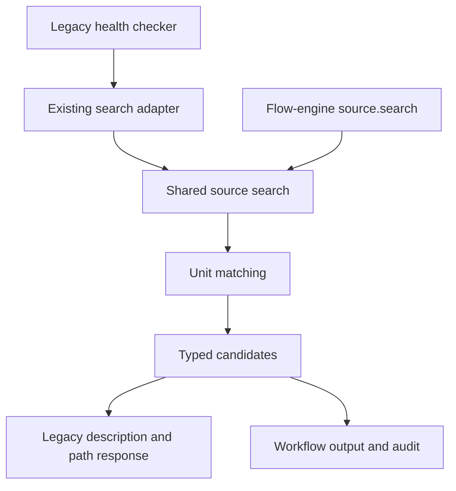
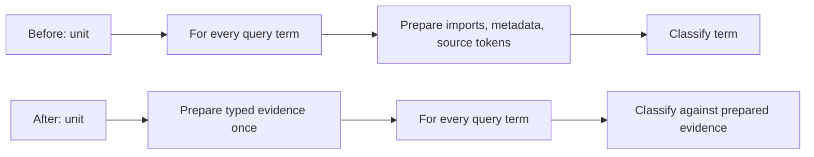

# Source search repeats preparation and diverges between callers

## Description

Legacy health-check DRY search and flow-engine `source.search` share a matcher
that repeats source preparation for every query term. Large repositories and
multi-term queries can exhaust the caller's timeout before search returns.
Fix the shared implementation without changing candidate eligibility, search
coverage, match provenance, or either caller's public contract.

Follow-up scope agreed after the preparation fix: legacy and workflow searches
must use one source-owned candidate-discovery pipeline, not caller-specific
file versus parsed-unit implementations. File eligibility must be applied before
content reads. The original measurements below describe the first defect only;
they do not establish acceptable whole-repository performance.

## Steps to Reproduce

1. Create an undocumented Swift source containing compound identifiers, an
   import, and methods; search its whole-file unit with one absent term.
2. Repeat using 38 distinct absent terms and observe token-extraction calls.
3. Observe 38 content tokenizations and 38 frontmatter tokenizations instead of
   preparing the unchanged unit once. Imports are also reparsed per term.
4. Repeat through legacy health-check `search_codebase` or the flow engine's
   registered `source.search`; both reach the same production matcher.

The reported real-project incident involved 6,837 source files and 38 terms:
the review connection closed after approximately three minutes, and a replay
exceeded five minutes. Those timings are reporter measurements, not a verified
post-fix performance target. A local in-memory 17,725-byte reproduction measured
one versus 38 content passes (approximately 0.003 versus 0.115 seconds).

### Follow-up reproduction

1. Place a matching source file, nonmatching Swift files, localization resources,
   and unrelated JSON in one temporary project.
2. Invoke legacy search and the registered workflow search with equivalent
   effective query, eligibility, and limit options.
3. Observe that legacy uses frontmatter/file candidates while workflow search
   parses every eligible Swift file before matching, producing different unit
   identities and source ranges.
4. Supply an explicit extension filter and observe that excluded file contents
   are still read before that filter is applied.

## Expected vs Actual

| | Behavior |
|---|---|
| Expected | Preparation per searchable unit is bounded independently of term and query count; every term is matched against the same request-local prepared data. |
| Actual | Every term reparses imports and frontmatter and can retokenize the same complete unit, multiplying preparation cost by query length. |

## Affected Component

| Direction | Component | Relationship |
|---|---|---|
| Upstream | Legacy health-check DRY search | Calls the shared search adapter and records completion only after a successful result. |
| Upstream | Flow-engine `source.search` | Uses the same production search factory with typed operation inputs and outputs. |
| Owner | `mcp-server/source/exact_source_search_matches_resolver.py` | Iterates queries and terms. |
| Owner | `mcp-server/source/exact_source_search_match_kind_resolver.py` | Repeats preparation before classifying each term. |
| Downstream | Candidate rendering and flow audit | Must retain existing paths, descriptions, identities, match kinds, ranking, limits, and persisted outputs. |

## Root Cause

Term-independent preparation lives inside the per-term classifier. Each call
rebuilds file imports, frontmatter values and tokens, and, for undocumented units,
source tokens and case-normalized text. Deduplication only removes repeated terms
inside one query; distinct terms and separate queries repeat preparation.
`.build` directories are already pruned, and candidate limits are applied after
matching, so neither changing that exclusion nor lowering the result limit fixes
this defect.

The follow-up investigation found a separate source of divergence: the shared
factory selects different candidate-discovery implementations by caller-selected
granularity. Snapshot collection also reads and hashes files before applying
extension eligibility or excluding paths replaced by proposed buffers. Shared
matcher coverage did not prove equivalent discovery behavior or end-to-end cost.

## Fix Plan

1. Add failing preparation-budget tests for 38 absent terms and multiple queries.
2. Separate preparation from classification using an immutable typed evidence
   value and a narrow preparation capability. Reuse existing token extraction;
   do not duplicate identifier segmentation or introduce dictionaries.
3. Prepare evidence once for each unit before the query/term loops. Reuse it for
   every query in that call. Prepared data is local to the call, not a persistent
   path-keyed cache; changed disk files and prospective buffers are re-prepared.
4. Preserve match precedence: filename substring, import, frontmatter, symbol,
   content substring. Named frontmatter continues to suppress content fallback.
   Preserve original term spelling and query identity in the returned matches.
5. Wire this through the existing shared production factory. Keep legacy health
   completion recording and flow-engine operation execution/replay unchanged.
6. Verify both entry points with real shared search implementations, run the
   complete non-live suites and focused Codex/Claude flow-engine live checks,
   and record a bounded before/after diagnostic.

Term caps, new search-root configuration, persistent indexes, timeout increases,
and caller-specific search implementations are outside this fix.
Existing legacy `sources_dir` remains available. Preparation is per unit; this
fix does not promise a cross-unit file-import cache or eight-second total scans.

### Follow-up implementation sequence

1. Write failing tests for equivalent requests through both entry points and
   extension/proposed-path filtering before any content read.
2. Make source search own one typed discovery, matching, exclusion, and ranking
   pipeline. Legacy only translates arguments/results and records its own health
   completion marker outside the source service.
3. Search frontmatter and retain the agreed missing-frontmatter lexical fallback.
   Do not analyze repository candidates. Reuse existing prepared source
   analysis where available for exact self-exclusion. Search never invokes source
   analysis. Do not invent declaration ranges from frontmatter or widen exact-unit
   exclusion to a file.
4. Keep same-file siblings, prospective multi-file snapshots, root confinement,
   descriptions, query provenance, bounded results, and persisted replay intact.
5. Remove obsolete caller-specific discovery wiring and prove parity using the
   real adapters. Run all non-live tests and relevant Codex/Claude flow tests.
6. Measure the actual reported legacy request by stages once its exact root and
   request are available. Keep synthetic measurements explicitly separate.

Gate-required cleanup: sharing the extension policy exposed module-level
`grep_by_name`/`glob_by_name` services with a concrete discoverer. Replace them
with one injected `FileSearcher`, reuse existing capabilities and the existing
search factory, and update the local-model runner's callbacks. Preserve its
normal tool responses and test the wiring without starting a local model.

Confirmed contract: search returns candidate metadata, not exact declaration
ranges. The model reads selected paths using its file-reading tool. Explicit
bounded candidate reads return verified file content; declaration slicing belongs
to source analysis, not search. Prepared review snapshots retain their existing
unit information for self-exclusion and same-file sibling matching. An exact-unit
exclusion without that prepared context fails explicitly rather than silently
returning the reviewed unit or dropping its entire file.

Default code-search extensions reuse the existing source-file policy (.swift,
.kt, .java, .py, .ts, .js). An explicit extension collection overrides that default;
an explicit empty collection retains unrestricted extension search for generic
clients. Both adapters use this same source-owned policy.

## Diagrams

### Connections



### Failing and corrected flow



## Test Plan

### Reproduction coverage

- When an undocumented unit is searched with 38 absent terms, preparation extracts
  its source tokens once, frontmatter tokens at most once, and returns no matches.
- When multiple queries address the same unit, preparation remains one pass while
  matches retain each query's identity and original term spelling.

### Matching and isolation

- When filename, import, metadata, symbol, and substring evidence overlap,
  classification retains the existing precedence.
- When named frontmatter exists, body-only terms remain ineligible and content
  tokenization is not performed.
- When a query repeats a term with different casing, only its first spelling is
  retained; the same term in another query produces that query's own match.
- When the same path is searched after its content changes, the new content is
  used and no prepared data leaks from the earlier call.
- When a prospective sibling replaces disk content, only the proposed content
  participates, and exact reviewed-unit exclusion still retains other siblings.
- When sources lie beneath `Tuist/.build`, neither entry point publishes them.

### Shared entry points

- When legacy health-check search receives a 38-term query in an isolated source
  project, it returns the expected description and path and records successful
  DRY completion through the real coordinator.
- When a workflow runs the registered `source.search` with the same query, it
  returns the expected typed candidate through engine-owned execution, and replay
  uses the persisted result after the source changes.
- When all non-live suites and focused Codex/Claude flow-engine live tests run,
  existing search, health-check, operation, and scoring contracts remain passing.

### Follow-up coverage

- When legacy and registered workflow search receive equivalent effective
  inputs, both publish equivalent ordered candidates and descriptions.
- When file extensions exclude localization resources and unrelated JSON,
  search never reads, decodes, hashes, or analyzes those files.
- When a proposed buffer replaces a disk path, search does not read the stale
  disk file and publishes evidence from the proposed snapshot only.
- When eligible files do not match the query, source analysis is not invoked
  for those files.
- When frontmatter or lexical content matches, both entry points still invoke
  no source parser and return metadata without fabricated declaration ranges.
- When an exact-unit exclusion has no prepared source units, search fails with
  an actionable error instead of silently including self or excluding siblings.
- When reviewed and sibling units share a file, exact self-exclusion retains
  the siblings; multi-file prospective context remains searchable.
- When the reviewed target is a complete file, its typed exclusion removes the
  file without requiring declaration analysis.
- When an explicit extension list selects Markdown, it replaces the default
  code policy; an explicit empty list permits generic search. An eligible-looking
  symlink cannot bypass filtering of its resolved target extension.
- When the local-model name-search helper is constructed through the production
  factory, definition lines, filename globs, missing-directory responses, and
  ignored build directories retain their behavior without a model process.
- When either live DRY scenario is built without launching a model, its workflow
  is `solid-review`, its parameters are the shared file-review input, and its
  execution root owns both the reviewed file and only the scenario's explicit
  candidates. The live harness must not pass direct-rule parameters to the
  review wrapper or apply wrapper assertions to a standalone rule run.
- When the operation is replayed after filesystem changes, the persisted result
  is returned without new search or source reads.

## Definition of Done

- [x] The reproduction tests fail before the fix and pass afterward.
- [x] One shared request-local preparation path serves legacy and workflow search.
- [x] Matching semantics and changed-buffer isolation tests pass.
- [x] Both real entry-point integration tests pass.
- [x] Non-live and focused live verification results are recorded.
- [x] A bounded before/after diagnostic records preparation counts and timing.
- [x] One source-owned discovery pipeline serves both entry points.
- [x] Eligibility and proposed-path filtering precede content reads.
- [x] Candidate metadata and exact self-exclusion contracts are covered explicitly.
- [x] Equivalent-input parity and matching/nonmatching-file analysis-budget tests pass.
- [ ] Full non-live and relevant live verification passes after unification.
- [x] Actual slow-request measurements are recorded, or unavailable inputs are
  reported explicitly without claiming the real-project timeout is resolved.

### Verification — 2026-09-30

Before production changes, the two preparation-budget tests failed with 38 and
4 content tokenizations respectively, where each expected one. After the fix,
all eight added tests pass across preparation budgeting, classification
precedence, and real legacy/workflow entry points. Existing same-file sibling
and prospective-buffer tests also pass.

The shared factory now supplies request-local typed evidence preparation to the
existing matcher; neither caller has its own search algorithm. Tests live under
`tests/mcp-server/source/`:

- `test_source_search_preparation.py`
- `test_source_search_match_precedence.py`
- `test_shared_source_search_entry_points.py`

The full non-live suites passed: **2,434 passed, 4 skipped**. Commands were run
sequentially in separate processes to respect the existing import layout:

```sh
python3 -m pytest tests/harness/flow_engine --ignore-glob='*live.py' -q --tb=short
python3 -m pytest tests/mcp-server -q --tb=short
python3 -m pytest tests/harness/tests -q --tb=short
python3 -m pytest tests/hooks -q --tb=short
python3 -m pytest tests/mcp -q --tb=short
python3 -m pytest scripts/tests tests/harness/test_harness_runner.py -q --tb=short
python3 -m pytest skills -q --tb=short
python3 -m pytest mcp-server/build/apple/tests .claude/skills/version-bumper/scripts/tests -q --tb=short
```

Focused live flow-engine verification passed **4/4** on locked Codex and Claude
profiles: component counting and the existing collection-reducer contract.
These are engine checks, not a live full health-check comparison or a replay of
the reporter's iOS repository. The real legacy search and registered workflow
search are covered by the isolated non-live integration tests above.

Preserved live artifact copies:

- `.solid-coder/.artifacts/test/codex/e2e/flow-engine/component-count/20260930T202936Z-a5040f3f`
- `.solid-coder/.artifacts/test/claude/e2e/flow-engine/component-count/20260930T203005Z-e7b54d6b`
- `.solid-coder/.artifacts/test/codex/e2e/flow-engine/workflow-contract/20260930T203039Z-796ce1b2`
- `.solid-coder/.artifacts/test/claude/e2e/flow-engine/workflow-contract/20260930T203111Z-591b73b2`

The same in-memory 17,725-byte, 38-absent-term diagnostic changed from 38 content
and 38 frontmatter tokenizations in approximately 0.1151 seconds to one of each
in approximately 0.0037 seconds. A one-term search after the fix measured
approximately 0.0036 seconds. This demonstrates removal of term-multiplied
preparation, not a guaranteed whole-repository runtime.

### Follow-up live harness correction

The first Codex protocol-reuse run after discovery unification completed and
produced the expected `DRY-1=1`, repository `DRY-2=0`, within-unit `DRY-2=0`,
and `DRY-3=0`, with the expected `RemoteContentLoading` metadata candidate.
Its test nevertheless failed: the case launched root workflow `dry`, while the
shared assertion filtered for nested `.rule_reviews.dry-` instances belonging
to `solid-review`. The default case also overrode the shared review parameters
with direct-rule parameters and used a different temporary execution root.

Two non-live scenario tests reproduced these contract mismatches before the
harness fix. Both cases now reuse the shared isolated source project, policy,
file input, and `solid-review` launcher. Only scenario-owned temporary candidate
copies are adjusted. The obsolete direct-rule parameter model was removed;
production workflow instructions and locked expected metrics are unchanged.

Original diagnostic artifacts are retained at
`.solid-coder/.artifacts/test/codex/e2e/review/dry-exact-protocol-reuse/20260930T225735Z-8d98bcfd`.

### Follow-up verification — 2026-09-30

All eight non-live command groups above were rerun after the final changes:
**2,453 passed, 4 skipped, no warnings**. The four skips remain the abstract
schema-fixture base cases. The imported `TestHarnessRunner` helper is explicitly
marked as non-test code; its behavior tests still execute with unchanged counts.
The new non-live checks include early resource/symlink filtering, explicit
extension overrides, complete typed legacy/workflow parity, parser-call budgets,
prepared-context exclusions, and the two live-scenario construction failures.

The corrected live DRY cases produced the following results through the real
`solid-review` workflow, with unchanged fixtures, instructions, and expectations:

| Backend | Scenario | Result |
|---|---|---|
| Codex | Existing reusable protocol | Pass; expected `1 / 0 / 0 / 0`. |
| Codex | Within-unit duplication, no repository candidate | **Fail**; observed `0 / 0 / 2 / 0`, expected `0 / 0 / 2 / 1`. |
| Claude | Existing reusable protocol | Pass; expected `1 / 0 / 0 / 0`. |
| Claude | Within-unit duplication, no repository candidate | Pass; expected `0 / 0 / 2 / 1`. |

For the remaining Codex failure, `search_repository` scanned the single reviewed
file and returned the expected empty candidate collection. The model returned
two within-unit duplicate observations but `missing_abstractions: []`. The
engine persisted `source_size: 0` and correctly counted zero for DRY-3. This is
an unresolved classification/locked-expectation mismatch, not an engine count
error. It is not hidden by changing the expected score or rewriting the rule
inside the search fix. The investigation is tracked separately in
[SPEC-061 — DRY-3 missing-abstraction classification](../../../../../../SPEC-001-solid-coder/features/SPEC-036-bundled-solid-workflows/subtasks/SPEC-056-dry-candidate-classification-workflow/features/bugs/SPEC-061-dry-3-missing-abstraction-classification/Spec.md).
Full live verification remains open, so this bug is not marked done.

A preceding Codex attempt never created a flow: `flow_start` was unavailable,
and stderr also recorded HTTP 503 with “Plugin directory is temporarily
unavailable.” That attempt was retried once without code changes. The retry is
the completed classification failure recorded above.

Current live evidence copies:

- Codex protocol pass: `.solid-coder/.artifacts/test/codex/e2e/review/dry-exact-protocol-reuse/20260930T231038Z-b40facd4`.
- Codex classification failure: `.solid-coder/.artifacts/test/codex/e2e/review/dry/20260930T231323Z-8d8fd4a1`.
- Codex startup failure: `.solid-coder/.artifacts/test/codex/e2e/review/dry/20260930T231133Z-3f3ff1df`.
- Claude protocol pass: `.solid-coder/.artifacts/test/claude/e2e/review/dry-exact-protocol-reuse/20260930T231519Z-2a92d04b`.
- Claude within-unit pass: `.solid-coder/.artifacts/test/claude/e2e/review/dry/20260930T231626Z-a8dafbfa`.

No local model was started. The original iOS repository root and exact 38-term
request were not available for a post-fix replay; the reported real-project
timeout is therefore not claimed resolved by measurement. Search discovery
and preparation budgets are verified by deterministic tests, separately from
the remaining live classification mismatch.
