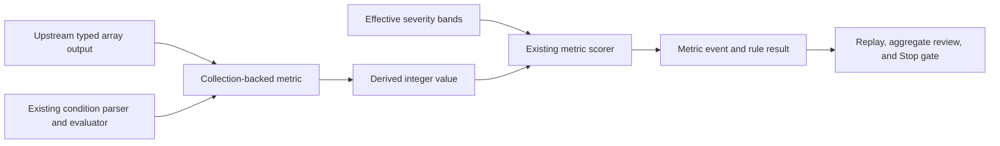
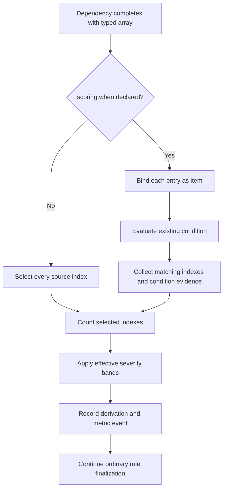
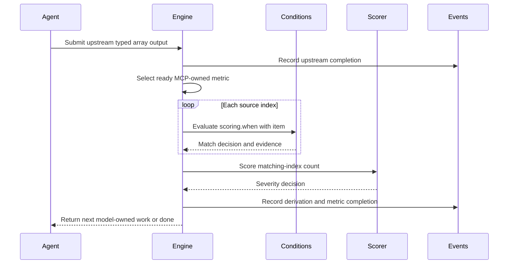

# Collection-Backed Deterministic Metric Scoring

## Description

Allow a metric to derive its integer value by counting entries from a typed array produced by an earlier workflow step. Workflow authors select counted entries with the existing condition grammar; MCP resolves the collection, evaluates the condition for every entry, calculates the count, applies the existing severity bands, and persists the derivation evidence without asking the model to submit the count.

The capability is generic and available to bundled and client-defined workflows. MCP does not know the meaning of fields such as `classification`, `name`, or `is_exception`; those fields and comparison values belong to the workflow's authored source schema and condition.

This subtask deliberately adds only filtered collection counting. It does not add general-purpose expressions, arbitrary reducers, executable rule code, or automatic migration of existing bundled rules.

## Proposed YAML Contract

```yaml
steps:
  - id: analyze_task_sites
    type: agent
    prompt: |
      Return every task creation site with its classification and exception decision.
    outputs:
      - name: task_sites
        type: data
        schema:
          type: array
          items:
            type: object
            additionalProperties: false
            required: [classification, is_exception, reasoning, evidence]
            properties:
              classification:
                type: string
                enum: [DETACHED, UNSTRUCTURED, STRUCTURED, SWIFTUI_MANAGED]
              is_exception: {type: boolean}
              reasoning: {type: string, minLength: 1}
              evidence: {type: string, minLength: 1}

  - id: detached_task_count
    type: metric
    metric_id: DT-1
    depends_on: [analyze_task_sites]
    value:
      type: integer
      minimum: 0
    scoring:
      source: "{{steps.analyze_task_sites.outputs.task_sites}}"
      when:
        all:
          - ref: "{{item.classification}}"
            equals: DETACHED
          - ref: "{{item.is_exception}}"
            equals: false
      severe:
        operator: greater_than_or_equal
        value: 1
```

`scoring.source` and `scoring.when` are optional additions to the existing metric scoring declaration:

- When `source` is absent, the existing model-submitted scalar metric behavior remains unchanged.
- When `source` is present, it must resolve to a declared array output from a completed dependency, the metric value type must be integer, and MCP owns metric completion.
- When `when` is absent, every source entry is counted.
- When `when` is present, MCP binds each source entry as `item`, evaluates the existing typed condition declaration, and counts matching entries.
- Severity bands compare the derived integer exactly as they compare existing model-submitted scalar values.

## Input / Output

| | Detail |
|---|---|
| Input | A metric declaration with an integer value schema, an optional `scoring.source` reference to a prior typed array output, an optional `scoring.when` condition, and the existing minor/severe bands |
| Runtime context | The completed source collection, stable source order, current workflow-instance context, and the existing condition evaluator with each entry bound as `item` |
| Output | One MCP-derived integer metric observation, deterministic severity, generated audit information, per-entry condition evidence, and the existing normalized rule result |
| Consumers | Bundled executable rule workflows, client workflows under `.solid-coder/workflows/`, aggregate rule execution, policy overrides, replay, Stop enforcement, and review-result persistence |

## User Stories and Acceptance Scenarios

### US-1: Count authored collections without model arithmetic

As a workflow author, I want MCP to count selected entries from a typed prior-step collection so metric values do not depend on model arithmetic.

#### Scenario 1.1 — Count matching entries

**Given** a completed dependency publishes four typed entries
**And** three entries satisfy the metric's authored condition
**When** the collection-backed metric becomes ready
**Then** MCP records the raw metric value as `3`
**And** no model prompt or metric submission is created for that metric step
**And** MCP applies the existing severity bands to `3`.

#### Scenario 1.2 — Count every entry when no condition is declared

**Given** a collection-backed metric declares a source containing four entries
**And** its scoring declaration omits `when`
**When** MCP evaluates the metric
**Then** the raw metric value is `4`.

#### Scenario 1.3 — Complete an empty collection as zero

**Given** a valid collection source is empty
**When** MCP evaluates the metric
**Then** the raw metric value is `0`
**And** the metric completes without a model turn
**And** existing bands determine whether zero is compliant, minor, or severe.

#### Scenario 1.4 — Preserve duplicate entries

**Given** two distinct source indexes contain equal JSON values
**When** both entries match the authored condition
**Then** MCP counts both entries
**And** it does not deduplicate by content, identity, reasoning, or evidence.

### US-2: Filter collections with the existing condition contract

As a client workflow author, I want to select countable entries using existing workflow conditions so MCP is not hardcoded to bundled rule fields or values.

#### Scenario 2.1 — Combine classification and exception predicates

**Given** a custom workflow publishes task-site entries containing `classification` and `is_exception`
**And** the metric condition requires `classification == DETACHED` and `is_exception == false`
**When** MCP evaluates the collection
**Then** it counts only non-excepted detached-task entries
**And** MCP has no detached-task-specific field names, enums, or branches.

#### Scenario 2.2 — Match a custom string field

**Given** a custom workflow publishes entries containing `name` and `is_exception`
**And** the metric condition requires `name == "this"` and `is_exception == false`
**When** MCP evaluates the collection
**Then** only non-excepted entries with that exact name contribute to the count.

#### Scenario 2.3 — Reuse all condition compositions

**Given** a scoring condition uses any supported combination of `all`, `any`, or `not`
**And** its comparisons use an existing supported comparison operator
**When** the metric declaration is parsed and evaluated
**Then** the same typed condition parser, value matcher, strict comparison semantics, and evidence models used by workflow routing are reused
**And** collection scoring does not introduce a second condition language.

#### Scenario 2.4 — Preserve missing-value semantics

**Given** an item omits a schema-optional field referenced by a condition
**When** the condition is evaluated
**Then** the existing condition semantics for an unavailable value apply unchanged
**And** authors may use the existing `exists` operator when presence is part of the rule.

### US-3: Reject ambiguous or unsafe declarations before execution

As the flow engine, I want collection-backed metric declarations validated before execution so invalid calculations cannot silently produce scores.

#### Scenario 3.1 — Require an array source

**Given** `scoring.source` resolves to a scalar or object output schema
**When** the workflow is loaded
**Then** validation fails with the metric step ID and source reference
**And** no workflow run starts.

#### Scenario 3.2 — Require an integer metric value

**Given** a collection-backed metric declares a string, boolean, or number value type
**When** the workflow is loaded
**Then** validation fails because collection counting produces an integer.

#### Scenario 3.3 — Require dependency-safe source visibility

**Given** a metric source references an unknown step, unknown output, future step, sibling workflow outside its visible scope, or step that is not an upstream dependency
**When** the workflow is loaded or materialized
**Then** the existing typed output-reference validation rejects the declaration
**And** the engine does not guess by unqualified name or execution order.

#### Scenario 3.4 — Validate item references against the item schema

**Given** a metric condition references `item.some_field`
**And** the source array's item schema does not declare `some_field`
**When** the workflow is loaded
**Then** validation rejects the condition before execution.

#### Scenario 3.5 — Reject model-owned fields on a derived metric

**Given** a collection-backed metric also declares a prompt or authored model outputs
**When** the workflow is loaded
**Then** validation rejects the mixed ownership declaration
**And** authors must place classification work in an upstream agent step.

### US-4: Preserve ordinary metric behavior and rule semantics

As a maintainer, I want collection-backed scoring to extend rather than replace existing scalar metrics and rule finalization.

#### Scenario 4.1 — Preserve model-submitted scalar metrics

**Given** a metric scoring declaration omits `source`
**When** the workflow executes
**Then** its prompt, generated `value` plus `additional_info` schema, retry behavior, and model-submitted observation remain unchanged.

#### Scenario 4.2 — Apply whole-rule exceptions after derivation

**Given** MCP derives a nonzero collection-backed metric value
**And** the rule's existing exception step returns `is_exception: true`
**When** MCP finalizes the rule result
**Then** the raw derived value and derivation audit remain recorded
**And** the metric severity and aggregate rule severity are compliant-by-exception under the existing finalization contract.

#### Scenario 4.3 — Apply effective policy bands

**Given** project policy replaces a collection-backed metric's authored severity bands
**When** MCP evaluates the derived count
**Then** it applies the effective policy bands exactly as it does for model-submitted scalar values
**And** policy cannot replace the source or condition.

#### Scenario 4.4 — Remain instance-scoped under fan-out and nesting

**Given** the same workflow is materialized for multiple `for_each` items or nested workflow instances
**When** each instance resolves its collection-backed metric
**Then** each metric reads only its instance-local upstream output
**And** counts, events, attempts, and results cannot cross instance boundaries.

#### Scenario 4.5 — Respect aggregate execution boundaries

**Given** upstream agent steps are presented through aggregate or combined execution
**When** their typed outputs complete
**Then** MCP drains ready collection-backed metric steps internally before presenting further model-owned work
**And** aggregate response schemas never request output for those MCP-owned metric steps.

### US-5: Audit, replay, and explain every derived count

As a maintainer, I want every MCP-derived metric value explainable from durable source entries and condition evidence.

#### Scenario 5.1 — Record derivation evidence

**Given** a collection contains four entries and three match
**When** MCP completes the metric
**Then** the metric event records the source step/output identity, source size, authored condition, matched source indexes, excluded source indexes, raw value `3`, matching severity band, and resulting severity
**And** the event does not duplicate complete source payloads already retained by the upstream completion event.

#### Scenario 5.2 — Generate metric audit information without a model

**Given** a collection-backed metric is completed by MCP
**When** the normalized metric decision is published
**Then** its required reasoning states how many source entries matched out of the total
**And** its evidence identifies the source output and stable matched indexes
**And** the result identifies MCP as the scoring authority.

#### Scenario 5.3 — Replay without re-running classification

**Given** a run contains the upstream output and completed derived-metric event
**When** the run is replayed or resumed
**Then** the same raw value, derivation evidence, and severity are reconstructed
**And** no model call or duplicate metric event occurs.

#### Scenario 5.4 — Resume an interrupted internal derivation

**Given** the upstream output is durable but no derived-metric completion event exists
**When** the run resumes
**Then** MCP deterministically evaluates and records the metric before returning additional model-owned work.

#### Scenario 5.5 — Keep Stop enforcement accurate

**Given** all model-owned dependencies are complete and only collection-backed metrics remain ready
**When** the workflow advances or the Stop gate reconstructs the run
**Then** MCP drains the internal metrics
**And** the run cannot remain blocked waiting for a model submission that the schema does not permit.

## Technical Requirements

### Authoring contract

- `scoring.source` is optional and accepts the existing workflow-expression syntax for one declared upstream step output.
- `scoring.when` is optional, valid only when `scoring.source` is present, and uses the existing condition declaration grammar without new comparison or composition operators.
- The resolved source output schema must be an array. Its item schema supplies the static field vocabulary available beneath `item`.
- A collection-backed metric must declare an integer value schema and at least one existing severity band.
- A collection-backed metric is MCP-owned: it declares no prompt, model outputs, `for_each`, process executor, or delegate mode.
- Collection-backed metrics remain ordinary DAG nodes. `depends_on`, qualification, nested workflow identity, conditions on the metric step itself, policy coordinates, and final rule ownership continue to work.
- Source order is authoritative. Every matching source index contributes one count; no implicit deduplication occurs.
- An omitted scoring condition means every source index matches.
- Field names and values are never reserved by the scorer. `classification`, `name`, `is_exception`, and the string `DETACHED` are examples authored entirely by workflows.

### Runtime contract

- MCP evaluates collection-backed metrics through the existing engine-owned draining loop after their dependencies complete.
- Each source entry is bound as `item` while the condition evaluates; the surrounding instance context remains the same context used by existing workflow conditions.
- The derived raw value is the number of matching source indexes.
- Existing severity-band evaluation, worst-severity selection, whole-rule exception handling, effective policy overrides, result aggregation, and persistence consume that integer unchanged.
- A runtime source-resolution failure is a flow validation failure, not a zero count.
- A source step skipped through existing audited empty-fan-out semantics supplies the corresponding empty collection. An unresolved or absent ordinary output does not silently become an empty collection.

### Audit contract

- The durable derived-metric event records a typed derivation containing its kind (`collection_count`), source reference, source size, condition declaration, ordered matched indexes, ordered excluded indexes, and condition evidence per source index.
- The normalized metric decision retains the derived integer and a compact derivation projection sufficient to locate its supporting upstream output without copying that payload.
- MCP generates non-empty metric reasoning and evidence for derived metrics; a model does not fabricate those fields.
- Replay reads the snapshotted workflow and append-only events. It does not reread current YAML or reevaluate already completed metrics against modified conditions.

### Compatibility and non-goals

- Existing metrics without `scoring.source` retain their current schema and execution behavior.
- Existing step-level `when` controls whether the metric node executes; `scoring.when` filters source entries only. The two conditions remain separately audited.
- This subtask does not add `sum`, `minimum`, `maximum`, average, joins, mapping, arbitrary expressions, embedded Python, embedded Swift, or custom executable scorers.
- This subtask does not infer count semantics from a severity comparison operator. `greater_than_or_equal` remains a scalar comparison and can continue scoring nesting depth, duration, complexity, or any other integer.
- This subtask does not automatically rewrite SRP, OCP, structured-concurrency, or client workflows. Migrations occur explicitly after the engine contract is accepted and tested.

## Connects To

| Direction | Spec / Component | Relationship |
|---|---|---|
| Parent | SPEC-010 — MCP-Driven Flow Orchestration | Owns workflow parsing, dependency ordering, internal-step draining, events, replay, and Stop enforcement |
| Upstream | SPEC-037 — Conditional Workflow Routing and Result Aggregation | Supplies the typed condition grammar, strict value matching, condition evidence, and instance-scoped context |
| Upstream | SPEC-039 — Executable Rule Workflows and Review Policy | Supplies metric declarations, deterministic severity scoring, policy overrides, exceptions, rule finalization, and result persistence |
| Downstream | SPEC-055 | Migrates bundled count-based metrics to typed observations and MCP-derived values |
| Downstream | SPEC-056 | Uses collection scoring for DRY target and candidate classifications |
| Downstream | SPEC-054 | Extends the bounded derivation contract with typed reducers |
| Downstream | Client workflows | May count arbitrary typed entries using client-authored fields and existing condition operators |
| Adjacent | SPEC-043 and SPEC-045 | Combined presentation and aggregate execution must omit MCP-owned collection-backed metric submissions and preserve engine-owned boundaries |

## Diagrams

### Connection diagram



### Flow diagram



### Sequence diagram



## Test Plan

### Unit Tests — Scoring declaration parsing

- When scoring declares a valid array source, integer metric value, condition, and severity band, parsing returns a typed collection-backed scoring declaration.
- When scoring declares a source and omits a condition, parsing preserves an explicit count-all declaration.
- When scoring declares a condition without a source, validation rejects the metric before execution.
- When a source references an unknown, future, out-of-scope, or nondependency output, validation reports the metric step and reference.
- When a source output schema is scalar or object-valued, validation rejects collection-backed scoring.
- When a collection-backed metric declares a non-integer value schema, validation rejects the incompatible metric.
- When a condition references a field absent from the source item schema, validation rejects the field reference.
- When a collection-backed metric declares a prompt or model outputs, validation rejects mixed execution ownership.
- When a scalar metric omits a source, its existing parsed declaration remains unchanged.

### Unit Tests — Collection counting

- When four entries all match and no condition is declared, evaluation returns `4`.
- When four entries contain three matching classifications, evaluation returns `3`.
- When an `all` condition requires `classification == DETACHED` and `is_exception == false`, evaluation counts only entries satisfying both comparisons.
- When a condition requires `name == "this"` and `is_exception == false`, evaluation excludes differently named and excepted entries.
- When `any` and `not` compositions are nested, evaluation matches the same entries as the existing workflow-condition evaluator.
- When two equal JSON entries occupy different source indexes, evaluation counts both indexes.
- When the source collection is empty, evaluation returns `0`.
- When no entry matches, evaluation returns `0`.
- When source resolution fails at runtime, evaluation fails instead of returning zero.

### Unit Tests — Scoring and policy

- When the derived count matches a severe band, MCP records the severe metric decision.
- When the derived count matches a minor and severe band, MCP selects the existing highest severity.
- When the derived count matches no band, MCP records a compliant metric decision.
- When project policy replaces the metric bands, the derived count uses the effective bands while preserving the authored source and condition.
- When a whole-rule exception matches, MCP retains the derived value and audit but publishes compliant-by-exception severity.

### Integration Tests — Workflow execution

- When an upstream agent step submits task-site entries, MCP drains the dependent collection-backed metric without returning another agent step.
- When collection-backed metrics are nested under two workflow instances, each instance counts only its own local source output.
- When a collection-backed metric follows a batch `for_each`, every item receives an independent deterministic count in source-item order.
- When an upstream aggregate submission completes, MCP-derived metric steps are absent from the model response schema and drain before the next aggregate phase.
- When only collection-backed metrics remain ready, workflow progression reaches the next model step or terminal state without Stop-hook intervention.
- When a source step supplies an audited empty fan-out, the derived metric completes with zero.
- When a required source output is unavailable without empty-fan-out semantics, the run fails rather than fabricating an empty collection.

### Integration Tests — Audit and replay

- When three of four entries match, the event records source size four, value three, ordered matched and excluded indexes, condition evidence, band, and severity.
- When the normalized result is written, generated reasoning and evidence identify the source and matched indexes without duplicating the complete collection.
- When a completed run is replayed, the derived count and severity are reconstructed without another condition evaluation event or model call.
- When a run resumes after the upstream output but before derived completion, MCP records the deterministic metric exactly once.

### End-to-End Tests — Generic client workflow

- When a test workflow submits detached, unstructured, structured, and excepted detached task entries through Codex, MCP returns the locked filtered count and severity.
- When the same workflow and locked entries run through Claude, MCP returns the same filtered count, severity, derivation indexes, and terminal status.
- When the test workflow changes only its authored field names and comparison value, MCP evaluates it without production-code changes or domain-specific registration.

### Regression Tests — Existing rules

- When all non-live tests run, existing model-submitted scalar metrics retain their current prompts, output schemas, scoring, policy, events, replay, and persisted results.
- When existing live executable-rule scenarios run without `scoring.source`, Codex and Claude retain their locked metric values and severities.

## Implementation Plan

1. Add failing parser and validation tests for optional scoring sources, optional per-item conditions, array-source compatibility, integer-value compatibility, dependency visibility, and mixed-ownership rejection.
2. Extend the typed metric scoring declaration with an optional workflow output reference and optional existing condition declaration while preserving the current scalar-only shape when the source is absent.
3. Reuse upstream output-schema metadata to validate that the source is an array and that every statically referenced `item` field is declared by its item schema.
4. Add failing evaluator tests for count-all, multi-field filtering, composed conditions, empty collections, duplicate values, missing values, and runtime source failures.
5. Implement an MCP-owned collection-count evaluator that binds each ordered source entry as `item` and delegates every predicate decision to the existing condition evaluator.
6. Integrate derived metrics into the internal ready-step draining path so they complete without prompts, submissions, attempts charged to a model, or aggregate response assignments.
7. Feed the derived integer through the existing effective-plan scorer, whole-rule exception handling, worst-severity selection, and normalized result builder.
8. Add typed derivation audit data to metric completion events and persisted metric decisions, including source identity, collection size, condition, matched/excluded indexes, and condition evidence without copying source payloads.
9. Extend replay and resume tests so completed derivations reconstruct without reevaluation and interrupted derivations execute exactly once from durable upstream output.
10. Add isolated workflow fixtures proving custom field filters, nested instance scoping, batch fan-out, aggregate execution boundaries, policy overrides, and Stop completion.
11. Run all non-live tests, followed by locked Codex and Claude live flow-engine scenarios using test-owned workflow fixtures rather than bundled production workflows.
12. Hand bundled count-based rule migration to SPEC-055 after this contract and its audit artifacts are reviewed.

## Definition of Done

- [x] Workflow authors can declare an optional array source and optional existing condition under metric scoring.
- [x] MCP counts matching source indexes and submits no model-owned metric request for collection-backed metrics.
- [x] Custom fields and values work without scorer registration or domain-specific production branches.
- [x] Invalid source type, value type, output visibility, item field, condition, and execution ownership fail before execution.
- [x] Existing scalar metrics behave identically when no source is declared.
- [x] Effective policy bands and whole-rule exceptions apply unchanged to derived values.
- [x] Nested, batched, aggregate, replayed, resumed, empty, and Stop-gated executions preserve deterministic instance-scoped results.
- [x] Metric events and persisted results explain the source collection, condition, matching indexes, calculated value, band, and severity without duplicating source payloads.
- [x] Test-owned Codex and Claude live scenarios produce identical locked count, severity, audit, and terminal-state results.
- [x] All non-live tests pass.
- [x] Bundled migration is isolated in SPEC-055; the approved OCP reference migration preserves the generic engine boundary.

## Implementation Status

The typed declaration, validation, deterministic evaluator, internal draining,
nested and batched instance handling, aggregate boundary, effective project
scoring, whole-rule exceptions, event audit, normalized result projection,
replay/resume behavior, and shared Codex/Claude live scenario are implemented.

Effective policy application is shared by scalar and collection-backed metrics;
the collection evaluator contains no policy-specific branch. The approved OCP
workflow is the reference migration, while remaining bundled count migrations
belong to SPEC-055.

Validation includes the complete non-live flow-engine suite plus the shared
locked collection-metric E2E scenario through both Codex and Claude.
