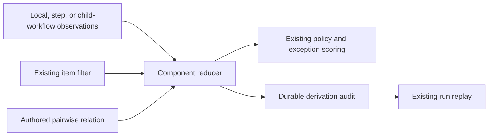
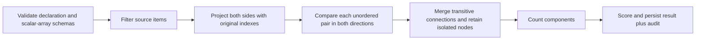
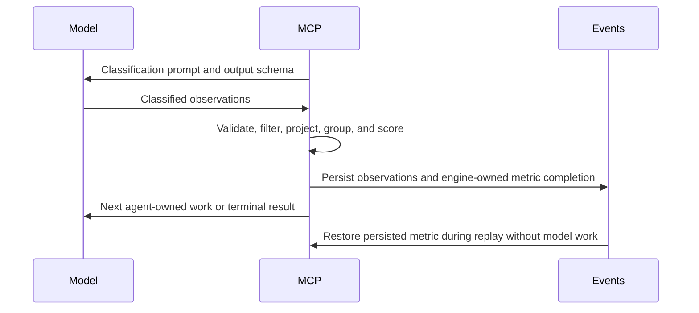

# Pairwise Component Reduction

## Description

Allow any workflow to count connected groups in a collection using a declared
pairwise relation. The initial relation is set intersection. MCP filters the
collection, compares the retained items, merges transitive connections, and
scores the resulting component count. The model classifies source facts only.

SRP-2 motivates this feature: methods that share instance variables belong to
the same cohesion group, including connections through other methods. The
engine must not know about methods, variables, lifecycle methods, orchestrators,
or SRP. Those meanings belong to workflow prompts, output schemas, and filters.

## Input / Output

| Boundary | Contract |
|---|---|
| Input | A workflow collection output, its declared item schema, an optional existing item filter, two scalar-array projections, and metric severity bands. Sources may be local observations, an upstream step, or projected child-workflow outputs. |
| Output | An integer component count and severity consumed by the existing metric/result pipeline. The run's durable derivation retains source indexes, projections, edges, components, and the relation declaration for audit and replay. |
| Storage | Canonical run events and results remain under the existing user-root project-slug run directory. The live harness preserves copies under the repository's ignored test-artifact directory. |

## YAML Contract

```yaml
metrics:
  - id: cohesion_groups
    metric_id: SRP-2
    value: {type: integer, minimum: 0}
    scoring:
      source: method_variable_usage
      when:
        all:
          - ref: "{{item.is_lifecycle}}"
            equals: false
          - ref: "{{item.is_orchestrator}}"
            equals: false
      reducer:
        type: component_count
        relation:
          operator: intersects
          left: "{{left.variables}}"
          right: "{{right.variables}}"
      severe: {operator: greater_than_or_equal, value: 2}
```

The explicit `type: metric` form accepts the same reducer with its existing
step-output or workflow-output `scoring.source`. Co-located metrics continue to
use a local output name and normalize into the same runtime nodes.

### Relation semantics

- `scoring.when` uses the existing item condition language and filters first.
- Every retained source item is a separate node identified by its original
  source index. Names and equal item contents do not collapse nodes.
- `left` and `right` are references scoped to the two compared items, never
  executable expressions. Each must project an array of JSON scalar values.
- `intersects` is true when the arrays contain at least one equal value using
  the engine's existing strict equality. In particular, boolean `true` does
  not equal integer `1`. Duplicate array members do not affect the result.
- Components are undirected. For each distinct pair A/B, an edge exists when
  either `left(A)` intersects `right(B)` or `left(B)` intersects `right(A)`.
  This makes different projection paths meaningful without making the result
  depend on source ordering. Identical paths are the ordinary shared-set case.
- All transitive connections are merged before counting. Pair counts and
  distinct array counts are not component counts.
- An empty selected collection returns zero. A retained isolated item,
  including one with an empty array, contributes one component.
- Component members use ascending original indexes. Components are ordered by
  their first member. Audit output remains deterministic.

## User Stories

### US-1: Derive auditable groups from classified facts

As a workflow author, I want MCP to calculate connected groups from shared
values through the existing collection-scoring pipeline so the model classifies
facts while MCP determines, scores, and preserves group membership.

#### Connected groups and filtering

**Given** items contain sets `{cache}`, `{cache, storage}`, and `{storage}`
**When** the component reducer compares their sets
**Then** the result is one component with all three source indexes.

**Given** items contain `{cache}`, `{cache}`, and `{formatter}`
**When** MCP calculates components
**Then** the result is two and the audit identifies both groups.

**Given** the first example's bridge item is excluded by `scoring.when`
**When** MCP calculates components
**Then** the remaining items form two components
**And** the excluded item cannot connect otherwise separate groups.

#### Empty, duplicate, and differently typed values

**Given** no selected items remain
**When** the reducer executes
**Then** the metric value is zero with an empty component list.

**Given** two retained items each have an empty array
**When** the reducer executes
**Then** each remains isolated and the metric value is two.

**Given** items repeat scalar members or share the same display name
**When** the reducer executes
**Then** duplicate members do not add edges or nodes
**And** each source item retains its original identity.

**Given** one item contains `true` and another contains `1`
**When** they are compared
**Then** strict equality does not connect them.

**Given** relation projections use different field paths
**When** the source collection is reordered
**Then** the component membership, mapped back to source items, is unchanged.

#### Malformed declarations and inputs

**Given** a component reducer is missing its relation, has an unknown operator,
contains unsupported fields, references a wrong root, references an undeclared
field, projects a non-array or nonscalar array, or declares a noninteger metric
**When** the workflow loads
**Then** validation identifies the metric and invalid declaration.

**Given** an agent output violates its declared array schema
**When** it is submitted
**Then** the existing output validation rejects the submission
**And** no component metric completes until corrected output is accepted.

#### Existing scoring lifecycle

**Given** an agent produces valid observations for a component metric
**When** the engine advances, including within aggregate or nested execution
**Then** MCP completes the metric without a model metric turn
**And** it applies effective severity bands and existing exception behavior.

**Given** the metric completion has been persisted
**When** the run is replayed or resumed
**Then** the same value, severity, relation, edges, and components are restored
**And** the completed metric is not evaluated again.

**Given** observation output is durable but its metric is still pending
**When** the run resumes
**Then** the existing engine-owned drain completes that metric exactly once.

## Technical Requirements

- Extend the existing sealed reducer declaration and registration path.
- Decode YAML/JSON at boundaries into typed objects. No new dictionaries in
  domain logic and no dynamic evaluation of authored expressions.
- Reuse existing expression parsing, item-schema navigation, strict equality,
  metric evaluation, event projections, and graph facilities where applicable.
- Reuse existing protocols with the same signatures. Simple data construction
  does not need a new factory or protocol.
- Validate both relation projections against the source item schema for local,
  step-output, and projected child-workflow sources.
- Preserve the relation declaration, selected/excluded source indexes,
  projected sets, matching source-index pairs, resulting component indexes,
  raw value, and severity in durable derivation evidence.
- Only successful pair matches need explicit edge records; projected sets
  retain the evidence needed to inspect nonmatching pairs without model calls.
- The reducer accepts any suitable workflow collection. Tests must include a
  non-review example such as files connected by shared tags.
- Component computation is bounded by the input collection and terminates
  without recursive model calls. Use iterative graph traversal or union/find.

## Non-Goals

- Arbitrary pairwise predicates, executable expressions, joins, or a new
  workflow programming language.
- Adding `left`/`right` to ordinary workflow `when` conditions.
- Automatic synonym merging or AST extraction of method-variable usage.
- Changing all bundled SRP prompts or locked live expectations as part of
  engine implementation. The SRP-2 authoring example will be validated using
  test-owned workflows before its separate bundled migration.

## Connects To

| Direction | Spec | Relationship |
|---|---|---|
| Parent | SPEC-010 | Workflow execution, audit, persistence, and replay |
| Upstream | SPEC-053 | Collection sources, filtering, and default counting |
| Upstream | SPEC-054 | Typed reducers and their validation/evaluation path |
| Upstream | SPEC-058 | Co-located authoring normalizes into ordinary metrics |
| Consumer | SPEC-055 | SRP-2 can migrate to method-variable classification |

## Diagrams

### Connections



### Reduction



### Model and engine ownership



## Test Plan

1. Parser/schema tests for both authoring forms and all invalid shapes above.
2. Reducer tests for direct and transitive overlaps, disjoint/isolated items,
   empty collections, duplicates, strict equality, filtering before grouping,
   different projection paths, and source permutation invariance.
3. Engine integration tests for a test-owned SRP-2 shape and a generic tag
   collection, deterministic audit, policy, aggregate/nested execution,
   rejected output followed by correction, resume, and replay.
4. Test-owned live workflow shared by the existing Codex and Claude harnesses:
   one classification produces known overlapping sets; MCP must derive the
   expected count and complete without an LLM counting step. Preserve logs
   through the existing harness, preserving copies of canonical user-root runs.
5. Run all non-live tests, followed by flow-engine live E2E verification.

## Implementation Plan

1. Add failing parsing and reducer/integration tests using existing fixtures
   and test helpers.
2. Add typed relation declarations and boundary/schema validation.
3. Implement pair comparison and component reduction using existing capability
   contracts; register it in the current collection evaluator factory.
4. Carry typed relation and component evidence through snapshots, events,
   results, and replay.
5. Document authoring syntax, validate SRP-2 usage in tests, and run required
   non-live and live verification.

## Verification — 2026-09-30

The engine implementation, authoring reference, deterministic acceptance tests,
and selected live checks are complete. Bundled SRP prompts remain unchanged.
The complete non-live sweep and four selected Codex/Claude live checks pass.

| Non-live suite | Result |
|---|---|
| `tests/harness/flow_engine` excluding live files | 841 passed |
| `tests/mcp-server` | 867 passed, 4 skipped (abstract schema fixture base) |
| `tests/harness/tests` | 107 passed |
| `tests/hooks` | 41 passed |
| `tests/mcp` | 22 passed |
| `scripts/tests` plus the harness runner module | 265 passed |
| Skill script tests under `skills` | 252 passed |
| Apple helper tests under `mcp-server/build/apple/tests` and version-bumper tests under `.claude/skills/version-bumper/scripts/tests` | 43 passed |
| Total | 2,438 passed, 0 failed, 4 skipped |

All 23 previously reported failures are resolved, not excluded:

- The CLI now uses the existing shared raw-search adapter instead of importing
  the deleted search module. Query ordering is deterministic across processes.
- Search summaries retain documented-file totals before matching, thresholds,
  or candidate limits; multiple matching units count as one matched file.
- CLI assertions cover the intended per-unit frontmatter results and explicit
  missing-description fallback for undocumented source, rather than the removed
  implementation's file-only grouping and frontmatter-only search behavior.
- Pipeline search tests use the existing fixed source fixtures instead of
  matching their own test code. Positive results assert names, descriptions,
  paths, and candidate presentation.
- Six added checks cover summary accounting and the unchanged two-field
  `source.present_search` input. No bundled workflow YAML changes are required.

The broader discovery sweep also includes the 43 Apple helper/version-bumper
tests outside the primary test roots. Generated token-report diffs were restored
after testing; project TOML settings were not changed.

Live verification uses the existing locked profiles (`gpt-5.6-terra` and
`claude-opus-4-5`). Both backends pass each of these contracts:

- `test_component_metric_e2e_live.py`: two model-owned classifications,
  engine-owned value `2`, excluded index `[4]`, components `[[0, 1, 2], [3]]`,
  completed run, and matching persisted aggregate/individual rule results.
- `test_flow_e2e_live.py -k collection_reducers_are_scored_and_audited_by_engine`:
  existing reducers still execute and retain their expected audit.

Four selected live tests pass. The other eight cases in `test_flow_e2e_live.py`
were not selected in this verification. Initial component live runs completed
successfully but exposed a test-only artifact assertion counting the aggregate
summary as a second individual result; the assertion now verifies both canonical
artifacts and both live tests were rerun successfully.

Preserved successful run copies under `.solid-coder/.artifacts/test/`:

- Codex component: `codex/e2e/flow-engine/component-count/20260930T144732Z-cef78347/`
- Claude component: `claude/e2e/flow-engine/component-count/20260930T144815Z-90a71031/`
- Codex existing reducers: `codex/e2e/flow-engine/workflow-contract/20260930T144912Z-015cc6f0/`
- Claude existing reducers: `claude/e2e/flow-engine/workflow-contract/20260930T145005Z-5b4c20be/`

## Definition of Done

- [x] Generic relation semantics and acceptance scenarios specified.
- [x] Failing tests establish parser, grouping, and engine contracts.
- [x] Typed reducer implementation and durable audit are complete.
- [x] Authoring reference documents supported syntax and empty semantics.
- [x] SRP-2 and generic non-review use cases pass deterministic tests.
- [x] All non-live tests pass.
- [x] Codex and Claude flow-engine live E2E tests pass.
