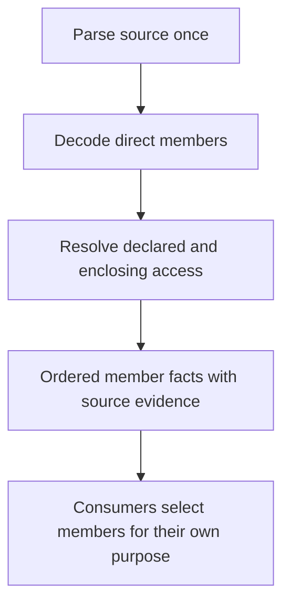

# Deterministic Source Member Inventory

## Description

Extend the existing source analysis with typed declaration-member facts so
workflows can count declared interface requirements and select visible extension
members without asking a model to rediscover syntax. Reuse the existing parser
execution and file/text boundary. This is the first prerequisite for the ISP
revision discussed in SPEC-057, not an activation of that workflow.

## Input / Output

| Direction | Contract |
|---|---|
| Input | Existing file or text source accepted by source.analyze |
| Output | Ordered members attached to their owning source unit, with stable identity, name, kind, syntax-derived visibility, and source line evidence |
| Consumer | Source operations and downstream workflows; completed operation output is persisted by the existing flow engine |

## User Stories

As a workflow author, I want MCP-owned member facts so classification prompts and
metric counts use the same source inventory.

### Acceptance scenarios

1. **Given** a Swift protocol declaring two overloaded methods, one property,
   and one associated type, **when** the source is analyzed, **then** its member
   inventory contains four distinct records in declaration order. Parameter
   declarations, accessors, and property-binding wrappers are not extra members.
2. **Given** a protocol inherits another protocol, **when** members are extracted,
   **then** only directly declared members belong to that protocol's inventory;
   inherited requirements are not copied into its width.
3. **Given** declarations with private, fileprivate, internal, package, public,
   or open access, **when** members are extracted, **then** their declared/default
   access is retained. An extension's declared access supplies its members' default;
   an explicit member access overrides that default.
4. **Given** a private setter on an otherwise visible property, **when** its
   visibility is recorded, **then** setter access does not hide the property.
5. **Given** equivalent file and text sources, including a not-yet-written
   virtual path, **when** analysis runs, **then** member facts are equivalent
   and text analysis never reads or writes the destination.
6. **Given** a nested type or a local function, **when** the enclosing unit is
   analyzed, **then** nested methods do not leak into the enclosing unit's direct
   method inventory. This slice does not flatten nested type hierarchies.
7. **Given** partial or unsupported source, **when** analysis returns,
   **then** its existing partial/unsupported outcome remains available; an empty
   member list is not proof of complete semantic analysis.
8. **Given** a workflow completes a source-analysis operation, **when** its run
   is replayed, **then** the original member metadata is recovered from the
   recorded output without another parser execution.

## Technical Requirements

- Extend the typed source-unit contract, not the search-candidate contract.
  Search remains parser-free; metadata discovery is not semantic analysis.
- Member kinds initially cover methods, properties, associated types,
  initializers, deinitializers, and subscripts. Retain lifecycle members as
  distinct kinds rather than silently counting them as methods.
- Member identities are stable for unchanged input and distinguish overloads
  with the same name on the same line. Each record belongs to one source unit.
- Decode external parser data into typed boundary models before member logic.
  Reuse existing generic decoding, source ranges, and parser execution. Do not
  introduce a parallel parser or regular-expression declaration extraction.
- Preserve existing top-level unit identities, ordering, tag detection, parser
  diagnostics, and timeout/error behavior. Member extraction shares the same
  parser result and does not invoke the compiler again.
- This slice reports syntax and access facts only. It does not infer meaningful
  implementations, exceptions, conformer completeness, callers, or severities.
- Visibility is syntax-derived: protocol requirements use protocol access,
  nominal owners restrict their members, and explicit extension access supplies
  a default. It is not compiler type-checked accessibility. Resolving an
  extension's target in another declaration or file, including that target's
  access restrictions, belongs to subsequent relationship analysis. Consumers
  must not interpret a bare extension's default as verified public availability.
- ISP's subsequent preparation must filter private/fileprivate members before
  LLM classification while retaining exclusion evidence. Do not remove those
  members from this generic source inventory: other consumers may need them.
- The source capability is extension-selected and language-neutral at its
  output boundary. Swift is the initial implementation; no language server is
  required. Unsupported languages retain their existing explicit outcome.

## Connects To

| Direction | Spec | Contract |
|---|---|---|
| Parent | SPEC-010 | Typed operation execution and replay |
| Upstream | SPEC-040 | Source normalization, Swift parsing, units, diagnostics |
| Downstream | SPEC-057 ISP follow-up | Requirement width and visible extension/conformer preparation |

## Diagrams

## Test Plan

### Source member extraction

- When a protocol mixes overloads, properties, and associated types, analysis
  returns exact ordered members without accessor/binding duplicates.
- When inheritance or nested declarations are present, extraction retains only
  the owning declaration's direct members.
- When extension defaults and explicit member access differ, the recorded
  visibility follows the declared default/override rules.
- When private(set) appears, the property retains getter visibility.
- When source contains multibyte text, member line evidence remains accurate.
- When file/text inputs are equivalent, identities and member metadata match.
- When source is partial or unsupported, no verified-completeness claim is made.

### Integration and compatibility

- When source.analyze runs inside a workflow, members persist and survive replay.
- When source search runs, the existing parser-free search tests still pass.
- Run all non-live tests and the shared Codex/Claude flow-engine live contract
  before declaring the slice complete.

## Definition of Done

- [x] Failing source-contract tests demonstrate the missing member inventory.
- [x] Existing source analysis publishes typed direct-member facts.
- [x] Visibility, overload identity, property handling, and lifecycle kinds pass.
- [x] Workflow persistence/replay and parser-free search remain covered.
- [x] Full non-live and Codex/Claude flow-engine live tests pass (Claude retry noted below).

## Implementation Sequence

1. Add failing tests through the real source-analysis operation.
2. Add typed member and parser-boundary records; reuse existing decoding.
3. Preserve members during unit extraction without changing workflow prompts.
4. Add operation/replay coverage and run compatibility suites.
5. Continue separately with repository relationships, visible-member selection,
   and ISP classification/scoring. The unable-to-verify representation and gate
   policy remain pending as recorded in SPEC-057; extension thresholds are not
   chosen by this source work.

## Implementation and Verification — 2026-10-06

- `source.analyze` now returns typed direct members on each `SourceUnit`.
  Member decoding reuses the existing Swift parser result, generic Pydantic
  decoder, source evidence resolver, and UTF-8 offset handling. No search
  candidate contract or bundled review workflow changed.
- Eight inventory cases cover overloads, inherited/nested exclusion, access,
  private setters, lifecycle/subscript kinds, multiline properties, Unicode,
  file/buffer equivalence, and partial/unsupported analysis.
- The operation integration test records members, changes the source on disk,
  resumes through a fresh orchestrator, and verifies identical persisted facts
  and exactly one parser invocation through completion.
- Non-live validation: **2,493 passed, 4 skipped**. Roots were run separately
  because `tests` and `scripts` contain a same-named test module. This includes
  `tests/`, `scripts/`, `skills/`, the existing Apple build tests, version-bumper
  tests, and the mocked DRY live-scenario wiring tests. Only real model-launching
  suites were excluded.
- Live compatibility: Codex (`gpt-5.6-terra`) and Claude (`claude-opus-4-5`)
  passed the shared nested workflow catalog contract. These are flow-engine
  compatibility checks, not live validation of the future ISP workflow.

### Observed Claude registration reliability issue

The first Claude attempt produced no run. Its startup record reported
`plugin:solid-coder:solid-coder-flow-engine` as failed while
`plugin:solid-coder:flow-engine` was connected. The model stopped without a
flow tool call, citing the failed registration. An unchanged retry passed;
no test prompt, assertion, plugin registration, or local configuration was
changed to obtain that result. The passing retry does not resolve the duplicate
registration issue.

Failed attempt evidence:
`.solid-coder/.artifacts/test/claude/e2e/flow-engine/workflow-catalog/20261006T204926Z-665d467d/claude-result.json`
(Claude session `479b471a-2176-4e99-986a-74f1cd5dff2a`).

Next ISP work remains repository relationship discovery, auditable exclusion of
private/fileprivate members before model judgment, implementation and extension
classification, and typed unable-to-verify outcomes. First-interface warning
eligibility is recorded in SPEC-057; neither that policy nor ISP scoring is
activated by this slice.
