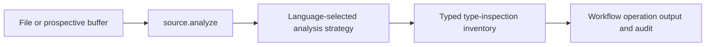
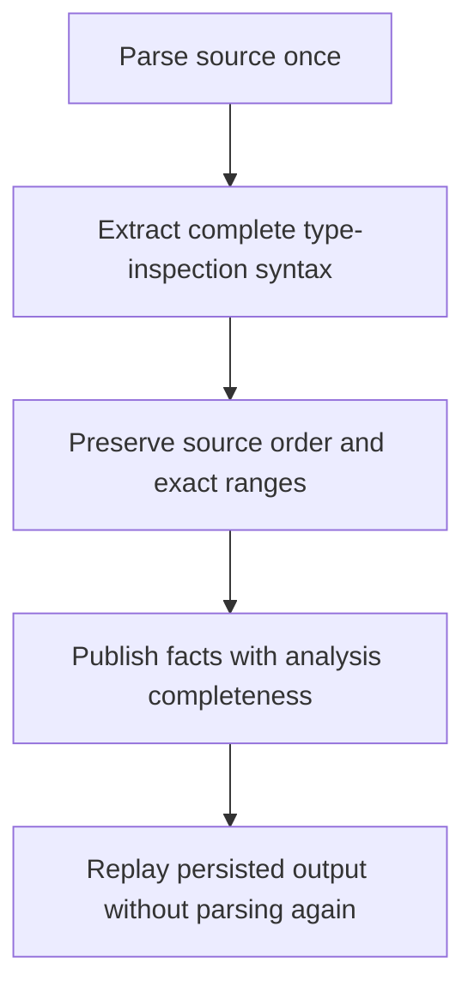

# Language-Selected Source Type Inspection

## Description

Extend source analysis with deterministic cast and runtime-type-inspection facts,
using the existing language-selected analysis strategies. Swift is the first
implementation; consumers receive shared typed facts, not parser nodes or
language-specific search rules. This supplies the source inventory needed by
LSP-1 without changing its scoring or the other LSP metrics in this slice.

## Input / Output

| Direction | Contract |
|---|---|
| Input | The existing file or prospective text source accepted by source.analyze |
| Output | Ordered type inspections: source-local identity, operation kind, exact expression or pattern fragment, explicit operand text (null for patterns), target type syntax when present, UTF-8 byte range and inclusive line span |
| Completeness | Existing parsed, partial, or unsupported analysis outcome and diagnostics; an empty collection is not proof of absence when analysis is partial or unsupported |
| Consumer | Source operations and workflow authors through persisted source.analyze outputs; no model turn is needed to extract syntax |

## User Stories

As a workflow author, I want source analysis to identify type inspections using a
strategy selected by language so rules can classify a stable inventory instead
of asking the model to discover occurrences.

### Acceptance scenarios

1. **Given** Swift source with expression-form conditional casts, forced casts,
   explicit type conversions, type tests, and runtime-type-query syntax, **when** analysis runs,
   **then** each occurrence appears once in source order with its distinct kind.
   A conversion is not automatically classified as an unsafe downcast.
2. **Given** repeated expressions, nested expressions, and Unicode preceding a
   cast, **when** facts are extracted, **then** identities distinguish occurrences
   and UTF-8 ranges recover their exact source text. Nested method and closure
   bodies are included; source ranges allow consumers to associate facts with
   declarations without guessing from names.
3. **Given** cast-like text inside comments or string literals, **when** analysis
   runs, **then** literal text produces no facts, while executable string
   interpolation still does. Member calls named like a runtime-type query are
   not treated as that syntax.
4. **Given** equivalent file and prospective-buffer inputs, **when** analysis
   runs, **then** their facts match and the prospective destination need not
   exist. Extraction shares the existing parse with units, members and tags.
5. **Given** malformed source or an unsupported language, **when** analysis
   returns, **then** existing diagnostics and completeness outcomes remain
   explicit; recoverable complete occurrences are retained without fabricating
   missing operands or types.
6. **Given** another registered language strategy, **when** its source is
   analyzed, **then** the existing selector dispatches to that strategy and
   preserves the same typed fact contract without Swift checks in consumers.
7. **Given** an operation has completed, **when** the workflow resumes after
   source changes, **then** replay preserves its recorded type-inspection facts
   without another parse or model call.
8. **Given** type-test or cast patterns in switch cases, conditional cases,
   iteration cases or catch clauses, **when** analysis runs, **then** every
   authored type-inspection operator appears once with a distinct pattern kind,
   exact operator-to-type evidence and source range. Nested tuple and enum
   patterns, multiple alternatives and repeated conditional clauses retain
   separate identities. Patterns have no direct expression operand: that field
   is explicitly null, not a fabricated binding name or an enclosing tuple.
9. **Given** a pattern has a missing target type or cast-like text appears only
   in comments and literals, **when** analysis runs, **then** it does not invent
   a complete inspection; malformed syntax retains partial-analysis diagnostics.
   Valid inspections beside malformed syntax remain available.

## Technical Requirements

- Reuse the existing Tree-sitter parse and language strategy selection. Keep
  grammar-specific extraction inside the source-analysis package; do not add
  parsing to metadata search or the flow engine.
- Operation kinds distinguish conditional cast, forced cast, conversion, type
  test and runtime-type-query syntax. Query syntax has no authored target type;
  its target-token collection is empty. Syntax does not establish whether an
  unqualified runtime-type-query function has been shadowed.
- Facts use typed boundary models and the existing source-range/token contracts.
  Application logic does not pass dictionaries between collaborators.
- This slice does not infer value types, declaration ownership, framework
  exceptions, abstraction violations or severities. In particular, a declaration
  missing from the repository is not evidence of external ownership.
- The inventory covers expression and pattern syntax, not semantic provenance.
  Pattern cast and pattern type-test are distinct operation kinds. Pattern
  evidence covers the authored operator through its target type; there is no
  direct expression operand in that syntax. Consumers must not interpret a null
  operand as a parse error or infer the value-providing contract from a binding
  name. A parsed outcome means syntactic validity, not verified ownership or
  complete LSP analysis.
- The subsequent LSP integration must distinguish the ownership of the
  value-providing contract from the cast destination, retain unresolved and
  ambiguous evidence, and ask the model only for semantic classification.
  Compiler/language-server ownership integration requires a separately confirmed
  scope; a type-name allowlist is not an acceptable substitute.
- Later LSP integration must validate coverage of every extracted occurrence,
  score inside MCP, and skip model classification only for a complete empty
  inventory. Existing LSP-2/3/4 behavior remains unchanged by this prerequisite.

## Connects To

| Direction | Boundary | Responsibility |
|---|---|---|
| Parent | SPEC-010 | Operation execution, audit and replay |
| Upstream | SPEC-040 | Typed file/text normalization and language selection |
| Upstream | SPEC-062 | Shared parse and declaration/member inventory |
| Downstream | Bundled LSP-1 follow-up | Contract ownership, classification, exceptions and scoring |

## Diagrams

## Test Plan

### Syntax and strategy contracts

- When all supported Swift inspection forms occur, analysis returns their exact
  kinds, expressions, operands and target tokens in source order.
- When occurrences repeat or nest after Unicode text, identities remain unique
  and each byte range reconstructs its expression.
- When comments, strings, interpolation and member calls contain similar text,
  only executable type-inspection syntax is returned.
- When a file and unwritten buffer contain identical code, facts match.
- When source is malformed or unsupported, completeness remains explicit.
- When a second language strategy is registered in a test, the existing selector
  returns that strategy's shared facts without invoking the Swift strategy.
- When switch, conditional, iteration and catch patterns contain type checks,
  analysis returns distinct pattern kinds without inventing explicit operands.
- When patterns nest, have multiple alternatives or share a conditional header,
  exact UTF-8 evidence and occurrence identity remain distinct and ordered.
- When an ordinary cast or type test occurs in a pattern guard or body, analysis
  reports it once as an expression, not again as a pattern.
- When a pattern target is missing, analysis reports partial syntax and does not
  invent a target; complete neighboring occurrences remain available.

### Integration and compatibility

- When source.analyze extracts facts, units, members and tags, parsing occurs once.
- When an operation completes and source changes, replay returns the original
  facts without a second analysis call.
- When metadata search runs, the parser-free search contract remains unchanged.
- Run all non-live tests, then shared locked Codex/Claude flow-engine live checks.
  These are engine compatibility checks, not a claim that LSP migration is done.

## Definition of Done

- [x] Failing tests demonstrate the missing source facts before implementation.
- [x] Typed inventory is available through the real source.analyze operation.
- [x] Extraction, language selection, single parsing and replay tests pass.
- [x] Non-live suite and locked Codex/Claude flow-engine checks pass.
- [x] Ownership and LSP-consumer follow-ups are clearly distinguished from this slice.
- [x] Pattern extraction and its operation replay coverage pass.
- [x] The full non-live suite and locked live checks pass after pattern support.

## Implementation Evidence

- Six initial integration tests failed because source analysis had no
  type-inspection output. The shared typed output now carries expression facts
  through the existing Swift language strategy, without a new dispatcher.
- Shared syntax traversal is reused by tag detection, type-inspection extraction
  and diagnostic collection. The existing generic parser protocol is reused;
  the old diagnostic-specific protocol and resolver were removed.
- A new incomplete-cast case exposed hidden missing-token diagnostics. The
  diagnostic decoder now accepts a narrow read-only node contract and reports
  opaque erroneous leaves instead of returning a parsed empty inventory.
- Focused source/replay validation: 236 tests and 8 subtests passed. This includes
  a second-language registration test, exact UTF-8 evidence, prospective buffers,
  malformed input, and partial aggregate completion after the source changes.
- The bundled LSP workflow, health-check feature flags and legacy behavior are
  not migrated by this source prerequisite. Next work is pattern coverage,
  trustworthy contract-ownership provenance and the LSP classification/scoring
  consumer. No framework type-name allowlist or repository-absence inference
  has been introduced.

### Expression-syntax checkpoint — 2026-10-17

- Full non-live suite: **2,753 passed, 177 subtests passed, 4 skipped**. The four
  skips are the existing abstract schema-fixture base, not excluded failures.
  Flow-engine, MCP-server, harness support, hook dispatch, script, skill-script
  and Apple-build test roots were run separately to avoid module-name collisions.
- Shared workflow-catalog live E2E: **2 passed in 70.57 seconds**, using the
  unchanged Codex gpt-5.6-terra and Claude claude-opus-4-5 profiles. These prove
  engine compatibility, not LSP classification accuracy; no local model ran.
- The source prerequisite is complete within its explicit expression-only
  scope. The complete LSP migration remains open and requires the separately
  recorded pattern-coverage, ownership and workflow-consumer work.

### Pattern extension and final validation — 2026-10-17

- Failing tests first reproduced missing switch, conditional, iteration and catch
  patterns. The existing Swift decoder now recognizes their authored operators
  through the same shared traversal; no extra parser or dispatcher was added.
- Pattern casts and type tests retain exact operator-to-target UTF-8 evidence,
  including comments and line breaks. Their operand is explicitly null because
  the pattern does not contain a direct expression operand. Binding names,
  enclosing tuples and implicit caught values are not fabricated as operands.
- Focused syntax validation: **15 passed, 5 subtests passed**. This covers nested
  patterns, repeated conditional clauses, alternatives, malformed neighbors and
  ordinary expressions in pattern guards/bodies without duplicate reporting.
- The real source.analyze aggregate/replay integration test passes with both
  expression and pattern facts: one parse, partial model completion, changed
  source, and unchanged persisted evidence through completion.
- Full non-live suite: **2,759 passed, 182 subtests passed, 4 skipped**. Only the
  four abstract schema-fixture base cases were skipped.
- Locked Codex/Claude live checks: **4 passed in 156.49 seconds**. Both backends
  completed the shared catalog workflow and the real bundled LSP workflow. LSP
  retained its locked values **0 / 0 / 1 / 0**; prompts, fixtures and expected
  values were not changed. These are compatibility checks, not validation of a
  newly migrated LSP consumer. No local model ran.
- Source syntax extraction is complete for this spec's declared scope. Remaining
  LSP work is contract-ownership provenance, occurrence-classification coverage
  and workflow scoring integration. Tree-sitter alone does not verify external
  ownership; that semantic integration must not be inferred from repository
  absence or a type-name allowlist.
