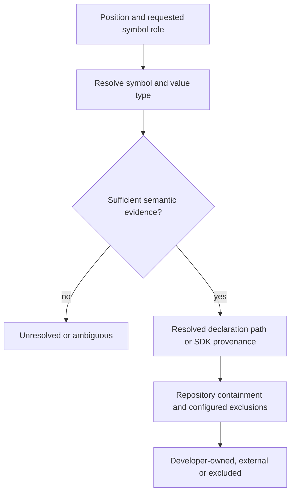
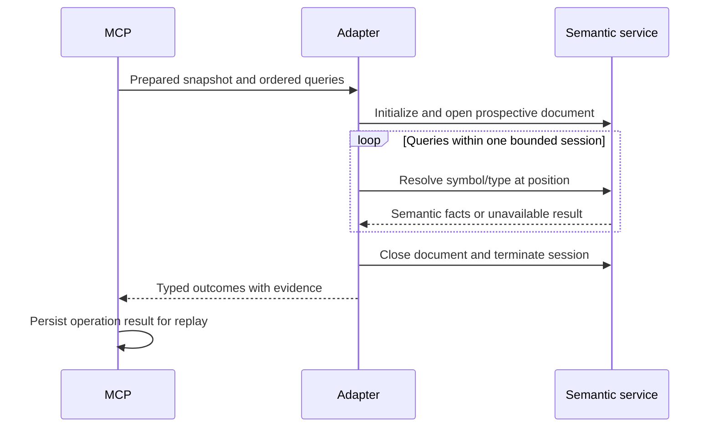

# Language-Selected Source Symbol Provenance

## Description

Resolve source declarations and apply repository-based ownership at the
source-analysis boundary. Code inside the repository is developer-owned unless
it is outside the configured search/review scope. Exclusion is not itself proof
of external ownership. Resolve the contract behind an inspected value separately
from the cast destination; this capability does not itself declare a contract violation.

## Input / Output

| Direction | Contract |
|---|---|
| Input | Prepared file or prospective buffer, repository root, effective configured exclusions, exact source positions and the role of each requested symbol: value contract or inspected destination |
| Output | Ordered outcomes with query identity, resolved symbol identity, declaration location when available, ownership evidence and resolution status |
| Status | Resolved, unresolved or ambiguous; unsupported language, missing tooling, missing build context, timeout and malformed responses retain explicit reasons |
| Ownership | Developer-owned when the resolved declaration is inside the repository and not excluded; excluded when the existing exclusion policy removes that repository path from scope; external when resolved outside the repository or verified as SDK-owned; unknown when declaration or external provenance cannot be established |
| Consumer | Source operations and persisted workflow operation results; models receive only the facts relevant to their classification |

## User Stories

As a workflow author, I want language-selected semantic provenance for source
symbols so that MCP can apply ownership conditions without asking the model to
guess where a contract is defined.

### Acceptance scenarios

1. **Given** a cast of a parameter declared using a project-owned interface,
   **when** provenance is resolved, **then** the value contract identifies that
   interface separately from the concrete destination. A variable declaration
   alone is not presented as the declaration of its type.
2. **Given** a value whose type is supplied by an SDK API, **when** the semantic
   service resolves its contract, **then** verified SDK provenance establishes
   external ownership without a framework or type-name allowlist.
3. **Given** a resolved declaration inside the repository, **when** its path is
   checked against the effective exclusions, **then** it is developer-owned
   unless excluded. This does not require build metadata or a separate
   module-ownership policy. Configured exclusions govern candidate discovery
   and automatic write-review eligibility; they do not silently change explicit
   manual-review behavior. Exclusion alone does not establish an external API contract.
4. **Given** duplicate names, aliases, generics, inferred values or shadowed
   bindings, **when** resolution cannot establish one contract, **then** the
   outcome retains ambiguity or an unresolved reason rather than choosing the
   first textual match. A repository search miss does not establish externality.
5. **Given** a prospective buffer whose destination does not exist, **when** the
   semantic service supports its project context, **then** it analyzes that exact
   buffer without writing the reviewed file. Unsupported overlays or missing
   build settings produce explicit unresolved outcomes.
6. **Given** unsupported language, absent tooling, timeout, process failure or
   invalid protocol output, **when** resolution ends, **then** results remain
   bounded and explicit, and the owned subprocess is cleaned up.
7. **Given** multiple queries for one snapshot, **when** resolution runs, **then**
   it shares one document session, preserves input ordering and exact positions,
   and does not start a separate server for every occurrence.
8. **Given** completed provenance output, **when** workflow state is replayed,
   **then** the same evidence is restored without querying the semantic service
   again. The operation is an MCP-owned aggregation boundary.
9. **Given** ownership is determined by a repository path or configured exclusion,
   **when** the result is recorded, **then** its evidence includes the repository
   root, resolved declaration path and the matched configured exclusion, if any.
   Later configuration changes do not rewrite that recorded decision on replay.
10. **Given** repository-owned tests or generated files are skipped by an unrelated
    search or review filter, **when** ownership is evaluated, **then** that skip
    does not classify them as third-party. Configured path exclusions record
    excluded scope; other applicability filters do not change provenance.
11. **Given** an inspected method or function result, **when** the semantic
    provider identifies the exact called declaration and its substituted return
    type, **then** record separate callee and return-contract identities. An
    SDK-owned method returning a project-owned type does not make that type external.
12. **Given** multiple overloads or a generic return type, **when** binding the
    call site, **then** use the selected overload and substituted semantic type
    identity. Unsupported composite or opaque return types, mismatched identities
    and absent provider capabilities remain explicitly unavailable.
13. **Given** method-result queries in one prospective snapshot, **when** the
    adapter needs the installed native semantic provider, **then** share one
    lazily opened isolated provider session using the active compiler settings
    and exact source overlay. Identifier-only analysis starts no native worker;
    success, failure and timeout close all owned processes without writing the target.

## Technical Requirements

- Keep semantic resolution in the source-analysis package, selected by language.
  Reuse existing source normalization, language selection and typed operation
  registration; metadata search remains parser-free.
- Separate declaration resolution from ownership. Syntax analysis and semantic
  tooling identify the declaration; repository containment decides ownership
  and configured exclusions record scope. Swift semantic integration uses SourceKit-LSP
  document requests where needed for binding, not a module-ownership classifier.
  Verify the installed toolchain before depending on optional fields or methods.
- Use explicit document overlays and negotiated position encoding. Preserve
  exact UTF-8 evidence at the source boundary; convert positions at the protocol
  boundary without confusing byte offsets with UTF-16 character positions.
- Reuse the existing configured exclusion policy across source search, automatic
  write-review eligibility and ownership. Exclusions are project-configured paths and
  patterns, not model classifications. Reuse path normalization, glob matching
  and early traversal filtering; do not add separate ownership-root settings,
  another exclusion list or a project/module dependency graph.
- Preserve the distinction between configured path exclusions and unrelated
  extension or rule-applicability filters. A skipped test, artifact or workflow
  is not automatically third-party. Apply the configured path exclusions before
  scanning candidates or automatically reviewing excluded writes; explicit manual
  review retains its existing behavior and other filters retain their own purposes.
- Compare canonical paths using path containment, not string prefixes. A
  prospective source can be owned before its destination exists. A declaration
  resolved outside the repository is external even when reached through an
  in-repository symlink. Generated interface locations are not substitutes for
  the original declaration's location.
- SDK provenance can establish externality without a source declaration path.
  An absent SDK flag does not establish ownership either way. A search miss is
  unresolved, not external; candidate links from SPEC-062 are not proof of which
  declaration a use refers to. Preserve ambiguity until binding identifies it.
- A verified contract requires semantic type/declaration binding. A declaration
  request on a value can resolve its variable instead; never silently substitute
  that result for the value's type. Pattern subjects also require binding, not
  fabricated operands from their textual pattern.
- Method-result binding may use the installed native semantic library from the
  same toolchain as the active SourceKit-LSP session. Obtain compiler settings
  from that session and resolve compiler-authored return-type symbol references
  independently. Do not substitute called-API ownership, parse hover prose or
  infer ownership from type names. Missing settings, native library or supported
  semantic references produce unavailable evidence rather than a scoring exception.
- Keep native semantic requests in a bounded child process. Reuse existing RPC
  framing, typed decoding and process cleanup. Open the exact source overlay
  once per snapshot; reuse that session for return queries and stop retrying a
  failed provider within the same snapshot. No new model-facing tool is added.
- Do not trigger package downloads, builds, global indexing or trust bypasses
  implicitly. Missing preparation is an unresolved result with diagnostic reason.
- Requests and session shutdown are bounded. Preserve diagnostics without
  placing logs or generated sources in the reviewed project.
- Typed models cross application boundaries; mappings are confined to wire
  serialization. No source-specific ownership logic enters the flow planner.
- Ownership is not the LSP verdict. External contracts can still be misused;
  developer-owned casts require the authored rule's conditions. Existing
  LSP-2/3/4 and the health-check mode remain unchanged by this prerequisite.

### Approved downstream LSP-1 contract

The bundled rule will use the prepared inspection inventory rather than ask the
model to discover casts or determine ownership. One classification is required
for each supplied inspection identity, with reasoning and source evidence:

- `ABSTRACTION_BYPASS`: subtype-specific behavior bypasses a contract controlled
  by the project.
- `REQUIRED_EXTERNAL_NARROWING`: an externally imposed API supplies a broader
  contract that must be narrowed to access the intended behavior.
- `NON_BEHAVIORAL_INSPECTION`: type information is reported without selecting
  subtype-specific behavior, including diagnostic output.
- `UNABLE_TO_VERIFY`: the evidence cannot establish the classification.

The non-behavioral category is an approved refinement of the original blanket
type-check rule. Choosing a built-in broad type for a project-controlled API
does not make that API externally imposed. The model cannot replace recorded
ownership facts, and a classification cannot repair missing semantic evidence.

MCP validates exact identity coverage before scoring. Partial submissions retain
accepted assignments and return missing assignments as pending. Invalid, stale
or invented identities produce actionable correction errors. Scoring waits for
all required classifications; an omitted model answer is not semantic uncertainty.
MCP counts verified
abstraction-bypass classifications and assigns SEVERE at one or more. Unknown
cases remain unavailable rather than contributing a compliant zero; confirmed
violations remain reportable alongside incomplete coverage. Empty, completely
parsed inventories require no classification turn. LSP-2/3/4 and the legacy
health-check path retain their existing behavior.

Existing configured exclusions are reused, not replaced by a new ownership
configuration. Excluded repository paths are outside candidate discovery and
automatic write-review scope; explicit manual reviews keep their existing
behavior. Exclusion alone does not prove third-party provenance. Repository
containment is checked on canonical paths, including prospective destinations.

## Connects To

| Direction | Boundary | Responsibility |
|---|---|---|
| Parent | SPEC-010 | MCP-owned operations, aggregation and durable replay |
| Upstream | SPEC-040 | File/buffer normalization and project context |
| Shared source policy | Existing configured path exclusions | One exclusion decision for search and review eligibility without claiming third-party ownership |
| Upstream | SPEC-062 | Declaration candidates with explicit uncertainty |
| Upstream | SPEC-063 | Exact type-inspection syntax inventory |
| External | Language semantic service | Symbol/type binding, declaration locations and SDK evidence |
| Downstream | Bundled `workflows/review/rules/lsp/workflow.yaml` | Classification coverage, exceptions and MCP scoring |

## Diagrams

## Test Plan

### Toolchain contract checkpoint

- When the installed Swift semantic service receives an unwritten document,
  query a local interface, its parameter use and an SDK type; distinguish actual
  symbol details, type-definition support and absent fields in the responses.
- When the service lacks a required semantic feature, keep the feature disabled
  and record the gap rather than deriving ownership from syntax or spelling.

### Source capability

- When a local contract and concrete destination differ, preserve both identities.
- When an SDK contract is resolved, retain the service's externality evidence.
- When a declaration resolves inside the repository outside configured exclusions,
  classify it as developer-owned without build or module metadata.
- When a vendored dependency matches an exclusion, record excluded scope and
  omit its files from candidate search and automatic write review without claiming
  the exclusion proves an external API contract or changing explicit manual review.
- When ordinary review/search filters skip owned tests or generated files,
  preserve their ownership instead of labelling them third-party.
- When a resolved declaration lies outside the repository, classify it as external;
  canonical symlink targets and similarly prefixed sibling roots do not pass containment.
- When a prospective declaration belongs to an uncreated repository path, apply
  the same containment and configured exclusions without writing the source.
- When names collide or semantic context is missing, preserve uncertainty.
- When Unicode precedes a query, resolve the requested symbol at the correct position.
- When a source overlay is supplied, use it and leave the destination untouched.
- When a request times out or the process fails, report the reason and clean up.
- When another language strategy is registered, use the common typed result.
- When an SDK cache call returns a broad SDK type, retain the actual returned
  type's semantic identity separately from the SDK method and cast destination.
- When an SDK generic method returns a project-owned interface, retain developer
  ownership of that interface; method ownership does not determine return ownership.
- When overloaded methods return different types, bind the selected call's exact
  identity and return contract rather than choosing by spelling.
- When return annotations are malformed, composite or opaque, or the callee or
  return identity cannot be confirmed, retain an explicit unavailable result.
- When several return queries use one snapshot, open one lazy native session,
  use the active compiler settings and close both providers after consumer failure.
- When a native provider fails, preserve its diagnostic reason and do not repeatedly
  restart it for other queries in that snapshot.

### Workflow compatibility

- When provenance completes before an aggregate agent phase, model work receives
  the recorded facts only after the operation completes.
- When the flow resumes, replay does not perform another semantic query.
- When configured exclusions change after an operation completed, replay preserves
  the original ownership decision and its recorded exclusion evidence.
- Run all non-live tests and locked Codex/Claude flow-engine compatibility tests;
  no local model and no changes to existing LSP metric expectations.

### Downstream LSP-1 migration checks

- When an owned abstraction is narrowed to concrete-only behavior, MCP counts
  one confirmed bypass and the authored policy returns SEVERE.
- When an external API requires narrowing, the classification retains the
  externally imposed contract evidence and contributes no violation.
- When a project API chooses a broad SDK type, ownership of that type does not
  grant an automatic external-contract exception.
- When an inspection is diagnostic-only, its classification contributes no
  violation and retains reasoning and evidence.
- When lookup fails or is ambiguous, the metric retains unavailable evidence
  rather than reporting measured compliance.
- When classifications omit an inspection identity, accepted assignments persist
  and the missing assignment remains pending. Invalid, stale or invented labels
  are rejected; correcting only outstanding assignments can complete the review.
- When a confirmed bypass coexists with incomplete semantic or model-verification
  evidence, retain the confirmed severe finding alongside unavailable coverage.
- When two inspected units are reviewed by the real aggregate bundle, each
  nested batch retains its own unit context and score; completed conditional
  prefixes do not prevent later aggregation.
- When aggregation encounters source operations, MCP completes and persists
  them before presenting classifiers; replay does not repeat their analysis.
- When the same snapshot is reviewed by locked Codex and Claude, use the real
  bundled workflow and preserve artifacts for inspection.
- When the real write-gate fixture inspects a cache method's result, require
  persisted verified return-contract evidence and a measured LSP-1 outcome,
  not merely workflow completion. Preserve the existing LSP-3 severe assertion.

## Definition of Done

- [x] Installed-toolchain contract is verified before production integration.
- [x] Typed ownership boundary covers canonical paths, unwritten declarations,
  exclusions, verified SDK evidence and unresolved/ambiguous results.
- [x] Failing tests precede typed resolver and adapter implementation.
- [x] Ownership evidence and uncertainty remain distinct from rule judgments.
- [x] Source capability, operation boundary and replay tests pass.
- [x] Full non-live and locked model compatibility checks pass.
- [x] LSP migration scope and any unresolved semantic capabilities are recorded.
- [x] Validate the subsequent classification-only workflow cleanup on the full
  non-live suite and both locked live profiles.
- [x] Validate method-result provenance on the full non-live suite, locked LSP
  workflows and both real write-gate profiles without changing rule semantics.

## Workflow cleanup — 2026-10-19

Keep separate prompts when they perform different work; a single total prompt
is not a requirement. This cleanup does not extend aggregate planning or remove
LSP-2/3/4. Existing thresholds, fixtures, ownership facts and LSP-1 unavailable
outcomes remain unchanged.

- Given verified type inspections, when the model classifies them, expect direct
  named `classification` and `additional_info` outputs. Existing collection
  conditions and scoring consume the classifications without empty-array count
  marker operations. Missing IDs remain pending and invalid submissions remain
  rejected.
- Given a selected repository declaration, when its child workflow runs, expect
  one reading/evidence step. The parent compares the gathered contracts with the
  reviewed subtype once; no child judgment is copied into another model output.
- Given contract implementation observations, expect classification only in the
  model prompt. MCP counts FATAL/EMPTY entries and relationship violations using
  the existing metric definitions. Model count and percentage instructions are
  removed, while canonical contract definitions and the NoOp exception remain.
- Given the real bundled workflows, expect the original fixture scores and
  exact inspection coverage to remain valid in ordinary and aggregate runs.

The obsolete relationship-assessment schema is removed with its only producer
and consumer. Tests exercise the distributed YAML rather than a copied workflow.

## Completion — 2026-10-18

`source.resolve_type_inspections` is registered through the shared source
operation registry. It consumes the normalized target, source snapshot context
and file extension, selects a language strategy, and persists ordered inspection
identities, role-specific provenance and explicit limitations. Search remains
parser-free. Replay restores these outputs rather than repeating semantic lookup
or applying later exclusion settings to earlier decisions.

The real bundled LSP workflow now uses this operation for LSP-1. Verified
inspections reach one shared classification prompt per unit, with only compact
expressions, line numbers and role ownership; full source and internal provenance
are not repeated. The model supplies purpose classifications, reasoning and
evidence. Existing batch coverage and YAML collection scoring enforce completion
and derive counts. A confirmed bypass alongside unavailable coverage uses the
existing observation identity `confirmed_partial`; unavailable evidence never
becomes a compliant zero. LSP-2/3/4, their original locked expectations and the
legacy health-check path are unchanged.

At this milestone, Swift's semantic path resolved simple identifier operands with
explicit parameter/property annotations through SourceKit symbol evidence. The
method-result extension below adds call-site return binding; other unsupported
expressions remain unavailable. References into prospective sibling snapshots not
opened by the session also remain unverified. Reviewed source is not written,
and bounded document sessions handle a snapshot without triggering builds,
downloads or global indexing. Other language strategies use the same typed
contracts; this is not semantic support for every language.

Acceptance tests also exposed and fixed two generic aggregation defects: child
steps with their own batched iteration now retain materialized owner identity,
and already settled conditional steps no longer stop later phase planning.
Unresolved conditions and MCP operations still form execution boundaries. No
LSP-specific logic was added to the planner. The shared operation-test driver now
passes its isolated project context consistently to policy loading and operations.

### Final validation

- All non-live suites: **2,860 passed, 197 subtests passed, 4 existing abstract-fixture skips**.
- Locked Codex Terra and Claude Opus live checks: **6 passed in 312.50 seconds**.
  Each model ran catalog compatibility, the original LSP fixture and the new
  aggregate LSP case against the real distributed workflows. No local model ran.
- The new live fixture verifies an owned abstraction bypass, required external
  narrowing, diagnostic-only inspection and unresolved inferred binding. Both
  models returned the three expected classifications; MCP retained one severe
  confirmed bypass plus unavailable LSP-1 coverage. Events prove the operation
  preceded classification and that exactly the verified inspection IDs were used.
- Original fixtures and metric expectations were not changed. Fixture 4 adds
  coverage rather than replacing a locked expectation. Live evidence is preserved
  using the established test artifact infrastructure:
  - Codex: `.solid-coder/.artifacts/test/codex/e2e/review/lsp-type-inspections/20261018T143020Z-a35713eb/flow-run/`
  - Claude: `.solid-coder/.artifacts/test/claude/e2e/review/lsp-type-inspections/20261018T143124Z-503304b2/flow-run/`

The model's purpose judgment remains auditable, not independently proven by MCP.
Semantic facts, coverage, scoring and replay are engine-owned. Implementation
sequence and detailed validation are recorded in `ExecutionPlan.md`.

## Verification References

- [SourceKit-LSP extensions](https://github.com/swiftlang/sourcekit-lsp/blob/main/Contributor%20Documentation/LSP%20Extensions.md)
  documents position-based symbol information, optional SDK provenance and
  declaration locations. Optional fields require installed-version verification.
- [SourceKit-LSP background indexing](https://github.com/swiftlang/sourcekit-lsp/blob/main/Contributor%20Documentation/Background%20Indexing.md)
  distinguishes preparation for semantic requests from the reference index.
- [SourceKit protocol](https://github.com/swiftlang/swift/blob/main/tools/SourceKit/docs/Protocol.md)
  describes native document and cursor requests. The installed toolchain was
  probed for structured return-type references and independent symbol lookup.

## Method-result provenance extension — 2026-10-19

The real gate fixture exposed an unsupported call operand: the cache method and
its return contract were unknown even though the cast destination was resolved.
The adapter now binds the exact callee, resolves its compiler-authored substituted
return-type identity and independently establishes that type's provenance. This
does not change LSP's classifications, scoring or unavailable-result contract.

The installed toolchain's type-definition request returns no useful result for
these calls. Its native cursor evidence supplies the required semantic reference.
Native queries use the active session's compiler settings and exact unwritten
source, in one lazily started isolated worker per document. Simple named return
types, optional named types and explicit existential references are supported;
composite, opaque or otherwise unverified return contracts remain unavailable.
The worker does not replace the existing identifier-binding path, and method
ownership is never used as a substitute for return-type ownership.

Final validation: **2,900 non-live tests and 228 subtests passed**, with four
existing abstract-fixture skips. All ten locked live cases passed across the
initial run and one corrected-test rerun: original LSP, aggregate provenance,
repository relationships, catalog compatibility and the real write gate on both
Codex Terra and Claude Opus. The initial Codex relationship failure came from a
test treating an explicitly instructed file read as source repetition by MCP;
the assertion now correlates only workflow responses, with two model-free tests
and a successful fresh live rerun. Rule expectations were not weakened.

Both real gate runs resolved the cache call's return contract independently,
completed with measured LSP-1 zero and retained the expected LSP-3 severe finding.
The separate unresolved-binding live fixture still retained unavailable LSP-1
coverage. Exact commands, evidence locations and the initial failure are recorded
in `ExecutionPlan.md`.

## Historical Toolchain Checkpoint — 2026-10-17

This section and the ownership-only checkpoint below record intermediate states.
The completion section above supersedes their then-pending integration work.

The repeatable integration test lives at
`tests/mcp-server/source/analysis/test_sourcekit_symbol_contract.py` and reuses the
existing content-length reader/writer. It starts one isolated language-server
process per case, opens the reviewed source in memory, uses a 30-second request
deadline and cleans up the process and temporary workspace. It does not download
packages, build a project, bypass workspace trust or write the reviewed source.

On the installed Apple Swift 6.4 toolchain:

- An explicit interface type reference resolves to its declaration and symbol
  identity in the prospective document.
- SDK type references resolve to SDK declarations with `isSystem: true`.
- A parameter use resolves to the parameter declaration, with a different symbol
  identity from the interface used as its type.
- A type-definition request on that existential parameter returns null. This is
  missing semantic evidence, not proof of externality or a compliant LSP result.

The initial probe deliberately required the missing value-type binding and
failed. The retained two toolchain contract tests pass and distinguish symbol
lookup from type lookup; they are not product acceptance tests or a claim that
ownership resolution is implemented. A sandboxed semantic query timed out;
the approved outside-sandbox run completed against Xcode's SDK caches.

Integration requirements remaining at that checkpoint:

1. Wire the agreed repository ownership and excluded-scope policy through one
   shared configured-exclusion capability used by search and review. The earlier
   build-metadata/module-ownership proposal is superseded by the user's decision;
   no such metadata or extra ownership-root configuration is required.
2. Implement and test value-contract binding without treating a variable as its
   type. Follow a semantically resolved parameter or variable declaration to its
   explicit type annotation and resolve that annotation semantically. Inferred,
   composite and pattern subjects stay unresolved when the language service
   supplies no type definition. Do not parse hover prose or guess from type names.

At this checkpoint, the ownership policy was settled and the typed ownership
boundary was implemented; production semantic integration and LSP migration
were not complete. The then-existing bundled workflow and health-check
configuration were unchanged.

### Existing exclusion integration

At this checkpoint, search supplied default directory exclusions to its source-file
discoverer while the write gate separately read hook exclusion globs from project
TOML. The new ownership boundary reused the existing exclusion-checking contract
but was not yet wired to production configuration. That integration is completed
above; exclusions retain their existing meaning and are not promoted into
verified dependency declarations.

### Compatibility validation

- Full non-live suite: **2,761 passed, 182 subtests passed, 4 skipped**. The four
  skips are the existing abstract schema-fixture base; both new installed-Swift
  contract tests executed and passed.
- Locked Codex and Claude catalog/LSP live checks: **4 passed in 175.17 seconds**.
  These exercise the unchanged real bundled LSP workflow and engine, not this
  pending provenance integration. No local model ran and no expected review
  metric or fixture was changed.
- These validation results precede the documentation-only ownership correction.
  The policy question is resolved as repository containment plus explicit
  excluded scope. Measurement subagents were not run, as requested.

### Ownership implementation checkpoint — 2026-10-18

The typed ownership boundary now lives in
`mcp-server/source/analysis/provenance/`. Eleven new tests in
`tests/mcp-server/source/analysis/test_source_symbol_ownership.py` cover unwritten
declarations, canonical roots, symlink escapes, excluded scope, SDK proof,
unknown/ambiguous evidence, boundary validation and persisted decisions.

The gate required separating declaration ownership from locationless outcomes;
both use one generic resolver contract, with the coordinator delegating through
injected implementations. No factory for simple data construction was added.

- All non-live tests: **2,772 passed, 182 subtests passed, 4 existing skips**.
- Locked Codex Terra and Claude Opus catalog/LSP checks: **4 passed in 161.09 seconds**.
- The bundled LSP workflow, locked expectations and health-check configuration
  were not changed. These are compatibility results, not migration acceptance.
- Production semantic lookup, shared exclusion/configuration wiring, operation
  replay and LSP-1 migration were pending at this checkpoint and are completed
  above. See `ExecutionPlan.md` for the ordered implementation and verification.
