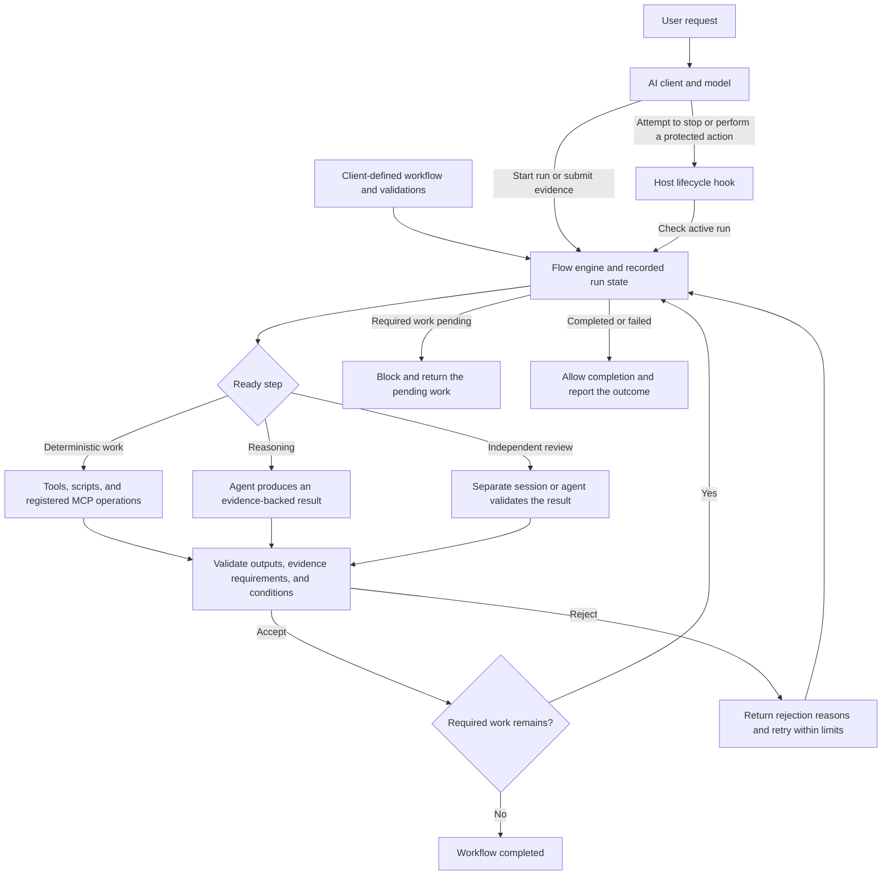
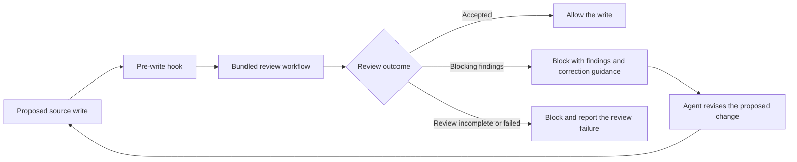

# solid-coder

SOLID Coder drives AI-assisted work through **client-defined workflows with
required steps, evidence, and validation**. The flow engine controls which steps
can run and which submitted results are accepted before the workflow advances.

Clients can define their own workflows and checks. The bundled workflows apply
the same engine to principle-based source review. Claude Code and Codex plugin
integrations supply MCP tools and hooks for enforcing the workflow around agent
actions.

## How the workflow engine works

A client maps a request, such as "research this", to a workflow and starts a run.
The workflow defines the required work: deterministic tool operations, model
reasoning, evidence to collect, output schemas, validation conditions, and any
independent reviewer sessions. The engine returns the ready work and accepts
completion only through the workflow's submission and validation contract.



The engine runs deterministic steps itself and holds dependent work until its
prerequisites are accepted. A model cannot complete a required step merely by
saying it did the work: it must submit the required result, and failed validation
keeps that step pending or rejected. Attempts and turn limits make stalled runs
fail explicitly rather than remain locked forever.

The execution contract is model-independent. A compatible AI client can drive
model-owned steps through MCP; its host integration supplies lifecycle hooks and
the adapters needed for delegated sessions. The shipped integrations support
Claude Code and Codex, with a local-model review backend as well. Stop/action
blocking depends on those host integrations being present and enabled.

### Example: evidence-backed research

A client-defined research workflow could require:

1. Search the web and submit sources with evidence for each claim.
2. Query the client's database and submit the relevant records or query results.
3. Produce a draft tied to both sets of evidence.
4. Require an independent validation step before the run can finish. If the agent
   tries to stop with validation still pending, the host hook blocks completion
   and directs it to the remaining step.
5. Pass the draft and evidence to a separate reviewer session or agent to check
   for unsupported claims, contradictions, and missing evidence.
6. Accept the result, or reject it with reasons and require correction before
   successful completion.

This is an example of a client-authored workflow, not a bundled web/database
integration. Clients define what counts as evidence and how to validate it.
Schema and execution checks are deterministic; judging whether a claim is
supported can be assigned to a reviewer. The current main-session Stop hook
checks active-run progress; it does not automatically create this research
workflow or launch a fact-checker for every answer. Enforcement of a delegated
subagent's own unfinished isolated run remains separate, deferred work.

### Example: gate on write

With workflow review selected, a source-write hook starts the bundled
`solid-gate-on-write` workflow against the exact proposed source buffer. The
review gathers source evidence, applies the configured rules, and produces an
outcome before the file is written.



The legacy healthcheck remains an alternative review path. Select the path with
`[feature_flags].health_check_mode`; both use the source-write hook, while their
native review rules remain distinct.

## Current capabilities

- Source-write review through the legacy healthcheck or the flow engine.
- Executable workflows and bundled principle-review workflows.
- Spec creation, code-to-spec analysis, and spec validation.
- Coding with loaded SOLID rules and source metadata.
- Apple build, test, and lint tools, with build logs and test-failure inspection.

The active user-facing skills are `build-spec`, `build-spec-from-code`,
`validate-spec`, and `code`. The older `implement`, `plan`, `refactor`, `review`,
and related pipeline skills and agents are retained as disabled copies.
They are not the current entry points.

The plugin registers four MCP servers: `docs` for principle rules and patterns,
`pipeline` for preserved healthcheck/search support, `flow-engine` for workflows,
and `apple-build` for Apple tooling. The `docs` server supplies rule knowledge;
it is separate from the Markdown guides linked below.

## Requirements

| Requirement | When needed |
| --- | --- |
| Python 3.12 available as `python3.12` to the host | Plugin MCP servers and hooks |
| Packages in `requirements-runtime.txt`, installed into that host interpreter | Plugin runtime; a checkout's `.venv` does not supply these automatically |
| The selected Claude or Codex CLI, configured and authenticated | Reviews using that backend |
| A running local inference server | Reviews using `backend = "local"` |
| Xcode and its Swift/SourceKit toolchain on macOS | Apple builds/tests and Swift semantic analysis |
| mise, Ruff, pytest, and the existing Ruby/Lefthook setup | Development and repository checks |

## Setup

Install or update solid-coder through your host's plugin manager. Both Claude
and Codex plugin manifests are included in this repository.

For development from a checkout:

```bash
mise install
mise run install
```

This creates the project `.venv` and installs development dependencies. Ruby is
inherited from the machine's global setup; the existing Lefthook and
conventional-commit setup is preserved.

Provision the **exact Python interpreter the host uses** separately. For a host
using mise's global Python 3.12:

```bash
DESKTOP_PYTHON="$HOME/.local/share/mise/installs/python/3.12/bin/python3.12" mise run install:desktop
```

Set `DESKTOP_PYTHON` to a different absolute interpreter path when appropriate.
This installs the pinned runtime packages and checks their dependencies. The
plugin does not install dependencies automatically at startup. Repeat this
step when changing the host interpreter or the runtime requirements, then
restart the host session to relaunch its MCP servers.

## Configuration

Commit project settings in `.solid-coder/config.toml`. Put personal project
overrides in `.solid-coder/config.local.toml` and keep that file out of Git.
These plugin settings are separate from `.config/mise/config.toml`.

For defaults shared across repositories, use `~/.config/solid-coder/config.toml`
(or the fallback `~/.solid-coder/config.toml`). Repository settings override
those defaults. The alternate repository location is
`.config/solid.coder/config.toml`; each alias pair uses its first existing file.

A minimal Codex-backed legacy review configuration is:

```toml
code_review_on_write_enabled = true

[llm]
backend = "codex"
timeout = 1000

[feature_flags]
health_check_mode = "legacy"
```

Omitting `model` uses the CLI default. Select `health_check_mode = "workflow"`
for flow-engine review. Keep the root review flag before any TOML table header.

See the [configuration reference](.claude/docs/configuration.md) for every
setting's meaning, type, default, examples, and override rules.

## Documentation

- [Configuration reference](.claude/docs/configuration.md)
- [Workflow YAML reference](.claude/docs/workflow-yaml-reference.md)
- [Testing guide](tests/README.md)

## Development and release checks

```bash
mise run lint
mise run test
mise run release:check
```

`lint` checks without applying fixes. `test` runs non-live groups in separate
processes. Live model checks require their own profiles, authentication, and
MCP setup and run separately after non-live checks pass.

`release:check` runs lint, non-live tests, and the installed-plugin smoke check.
The smoke check copies the distribution outside the checkout, uses an empty
home and base Python, and verifies MCP initialization, hook startup, and
schema-invalid-config denial. It does not invoke a model or prove a live
reviewer completed a source-write review.

The version-bumper runs that smoke guard before changing either plugin version.
The GitHub release-check workflow runs it with explicitly provisioned runtime
dependencies. Required remote status checks still depend on repository branch
protection.
